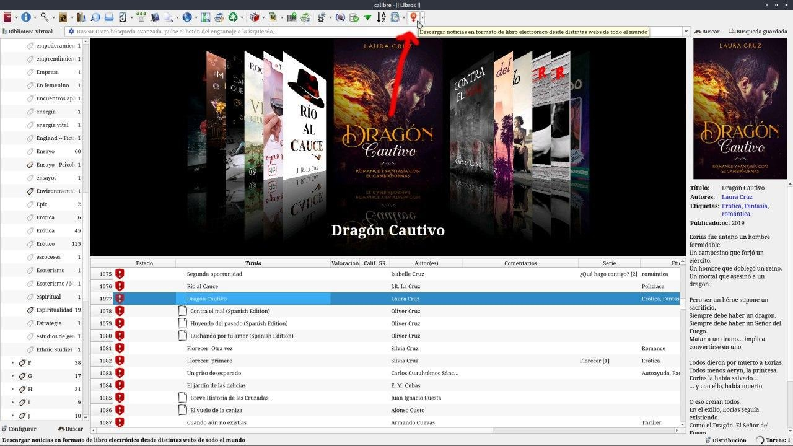
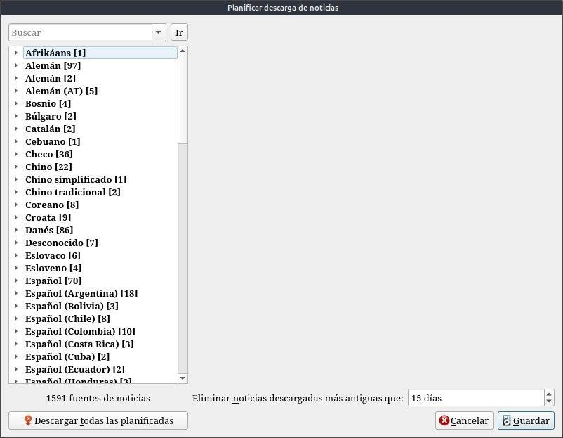
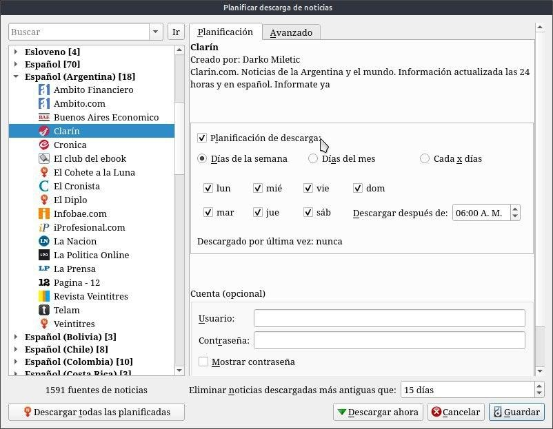
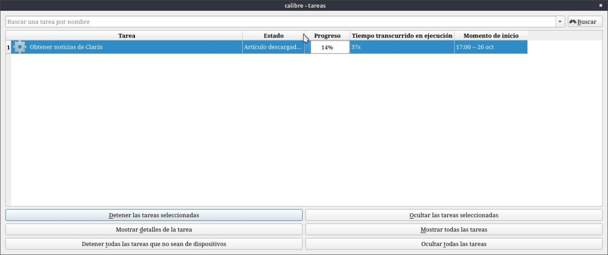
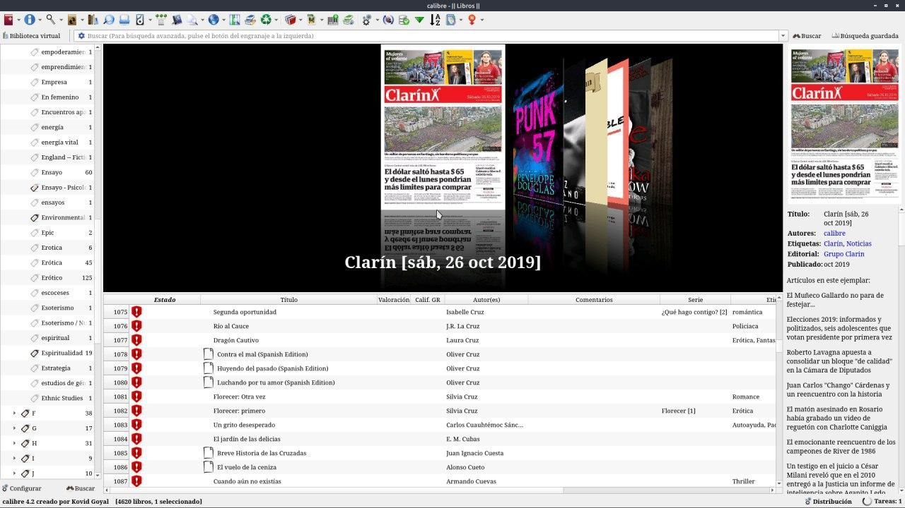

# Noticias - cómo descargarlas

:material-account: [Walter](https://t.me/Dunhill69){ target=_blank } · :material-link-variant: [Ver el original en Telegraph](https://telegra.ph/Noticias---Como-descargarlas-09-06){ target=_blank }
{ .tut-datos }

---

Y si les digo que pueden bajar las noticias de los diarios de su país con Calibre para leerlos en su lector favorito !!! Tocamos en este icono

Elegimos el Idioma en la columna de la izquierda y se despliega las fuentes de noticias disponibles.

En mi caso Español Argentina, seleccionamos y podemos seleccionar para que se automatiza la descarga y ponemos descargar. Podemos decir que día nos interesa descargar y al descargarlas las envía automáticamente a nuestro kindle

En las tareas nos muestra que se esta descargando

Una vez terminada la descarga se nos carga automáticamente y se ve así.

## [Volver al inicio](https://telegra.ph/Indice-Calibre-en-Espa%C3%B1ol-10-03)

 

 

---

[:material-arrow-left: Volver al índice](../../alfabetico.md) · [:fontawesome-brands-telegram: Preguntar en el grupo](https://t.me/calibreconfiguraciones){ target=_blank }
