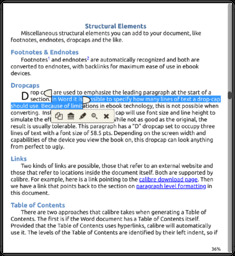
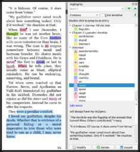
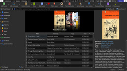
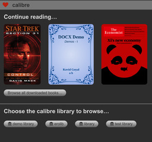
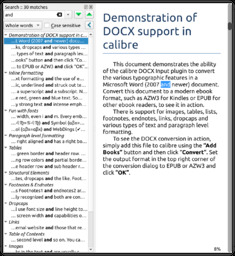
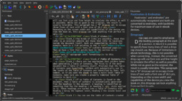
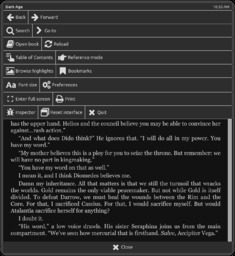
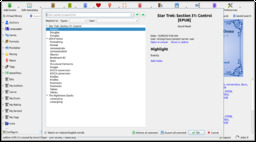
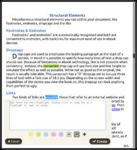

# Novedades de Calibre 5.0

:material-link-variant: [Ver el original en Telegraph](https://telegra.ph/Nuevo-en-calibre-50-10-10){ target=_blank }
{ .tut-datos }

---

[Walter](https://t.me/Dunhill69)

Nuevo en calibre 5.0

Bienvenidos, usuarios de calibre. Ha pasado un año desde el calibre 4.0. Las dos características principales son el soporte de *resaltado* en el visor de libros electrónicos de calibre y ese calibre ahora se ha trasladado a *Python 3* .

Se ha trabajado mucho en el visor de libros electrónicos de calibre. Ahora es compatible con *Resaltado* . Los aspectos más destacados pueden ser colores, subrayados, tachados, etc. y tener notas añadidas. Todos los aspectos destacados se pueden almacenar en archivos EPUB para compartirlos fácilmente y de forma centralizada en la biblioteca de calibre para navegar fácilmente. Además, el visor de libros electrónicos ahora admite texto vertical y de derecha a izquierda.

calibre ha pasado a usar Python 3. Esto se debe a que Python 2 se terminó este año. Esto debería ser completamente transparente para los usuarios de calibre, la única advertencia es que algunos complementos de calibre de terceros aún no se han adaptado a Python 3 y, por lo tanto, no funcionarán en calibre 5. Para conocer el estado de los distintos puertos de complementos, [consulte aquí](https://www.mobileread.com/forums/showthread.php?t=326405) . Este esfuerzo implicó portar medio millón de líneas de código Python y decenas de miles de líneas de código de extensión a Python 3. Esto no hubiera sido posible sin la ayuda de Eli Schwartz y Flaviu Tamas.

- Resaltado en el visor de libros electrónicosAhora puede resaltar texto en el visor de libros electrónicos. Los aspectos más destacados se pueden crear en muchos estilos, con notas asociadas. De forma predeterminada, al resaltar libros EPUB, los aspectos destacados se almacenan en el archivo del libro para compartirlos fácilmente. También se almacenan de forma centralizada en la biblioteca de calibre y se pueden explorar con la herramienta *Examinar anotaciones a la* que puede acceder haciendo clic con el botón derecho en el botón *Ver* .
- Los resaltados se pueden crear simplemente seleccionando texto y haciendo clic en el botón de *selección Resaltar* .
- El resaltado funciona incluso con el visor del navegador que forma parte del servidor de contenido de calibre. Puede elegir que los aspectos destacados se creen allí sincronicen automáticamente con los aspectos destacados creados en el visor de libros electrónicos de calibre a través de una configuración en la sección *Varios* de las preferencias del visor de libros electrónicos.

  
<small>primero</small>

 

  
<small>Tercero</small>

 

Soporte de modo oscuro calibre ahora es totalmente compatible con el modo oscuro en la interfaz principal, el visor de libros electrónicos, el editor de libros electrónicos e incluso el servidor de contenido. En Windows y macOS, el modo oscuro se activa automáticamente según la configuración del sistema operativo. En Linux tienes que configurar la `CALIBRE_USE_DARK_PALETTE=1`variable de entorno.

  
<small>primero</small>

 

 

  
<small>Cuarto</small>

  
<small>Tercero</small>

- Búsqueda mejorada en el visor de libros electrónicos. El visor de libros electrónicos ahora admite búsquedas mejoradas con palabras completas, expresiones regulares, etc. Los resultados de la búsqueda se muestran agrupados por capítulo. Hay un botón que lo lleva de regreso al lugar del libro en el que estaba después de haber terminado de buscar.

  
<small>primero</small>

- Incompatibilidades hacia atrás. Hay algunas pequeñas incompatibilidades con versiones anteriores que se deben tener en cuenta en calibre 5
   Debido a que calibre se ha trasladado a Python 3, algunos complementos de terceros ya no funcionarán hasta que también se transfieran a Python 3. Para conocer el estado del esfuerzo de migración del complemento, [consulte aquí](https://www.mobileread.com/forums/showthread.php?t=326405) .
- Debido a la compatibilidad con anotaciones en toda la biblioteca, el formato de la base de datos se modificó ligeramente. Si bien calibre 4.23 puede abrir y operar con bases de datos de calibre 5, las versiones anteriores de calibre pueden tener problemas.

---

Este es un momento apropiado para dar un gran agradecimiento a la comunidad de calibre que ha contribuido desinteresadamente con su energía y entusiasmo, sin los cuales muchas de las características anteriores nunca habrían visto la luz.

Tenga en cuenta que algunas de estas características se introdujeron durante la vida útil de la serie 4.x. Este documento describe nuevas funciones en comparación con 4.0

Vea las novedades de las versiones anteriores de los principales calibres: [4.0](https://calibre-ebook.com/new-in/thirteen) , [3.0](https://calibre-ebook.com/new-in/twelve) , [2.0](https://calibre-ebook.com/new-in/eleven) , [1.0](https://calibre-ebook.com/new-in/ten) , [0.9](https://calibre-ebook.com/new-in/nine) , [0.8](https://calibre-ebook.com/new-in/eight) , [0.7](https://calibre-ebook.com/new-in/seven) .

 

 

 

 

 

 

## [Volver al inicio](https://telegra.ph/Indice-Calibre-en-Espa%C3%B1ol-10-03)

 

---

[:material-arrow-left: Volver al índice](../../alfabetico.md) · [:fontawesome-brands-telegram: Preguntar en el grupo](https://t.me/calibreconfiguraciones){ target=_blank }
