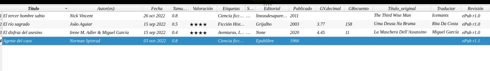
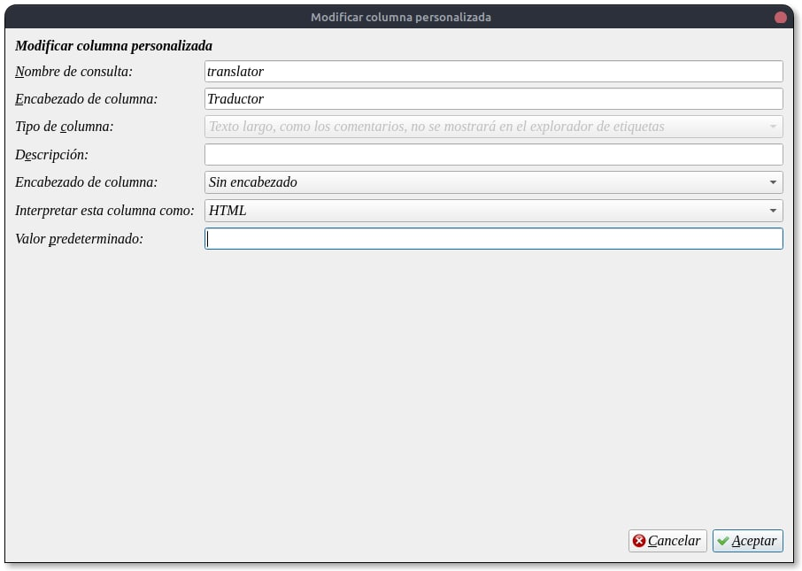
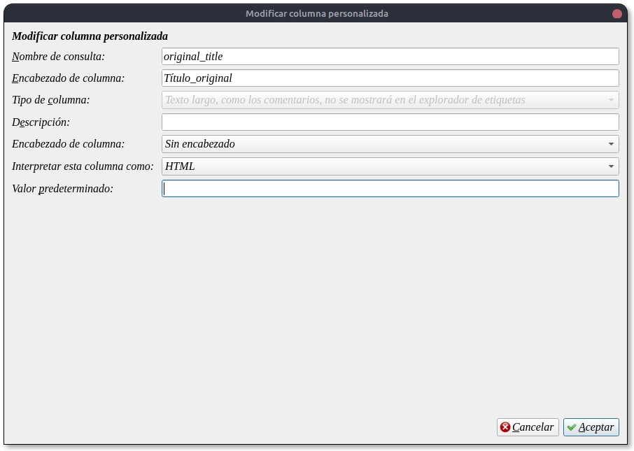
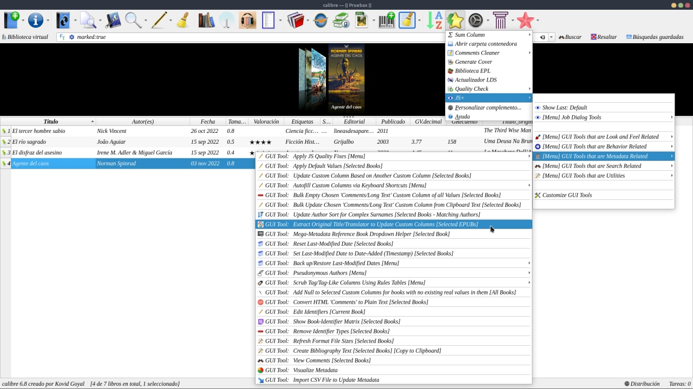
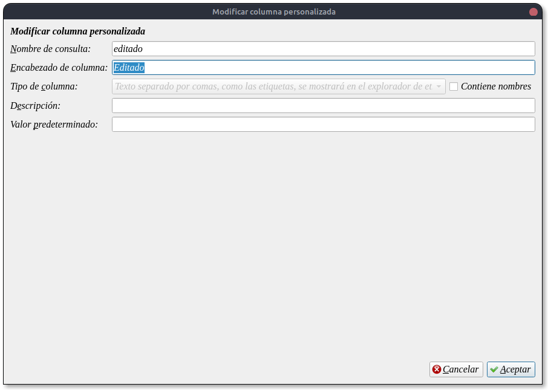
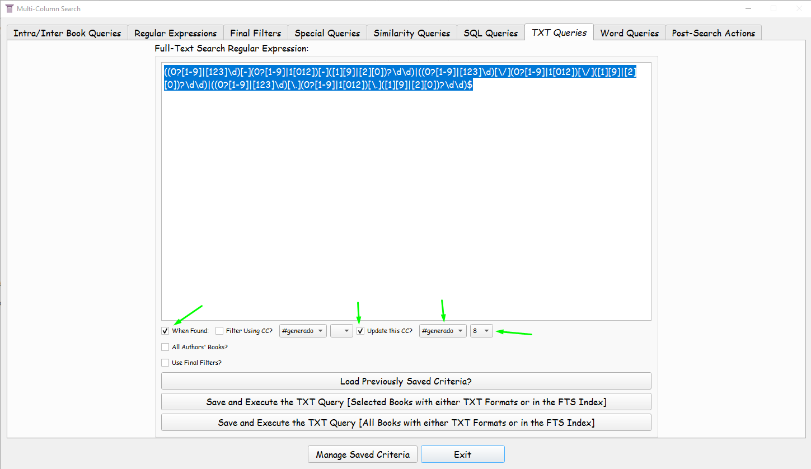
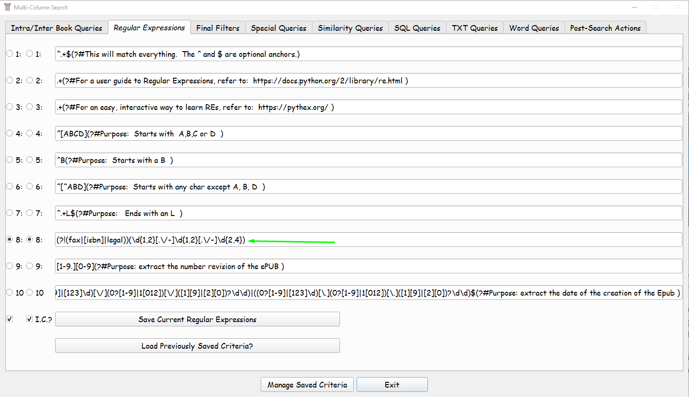
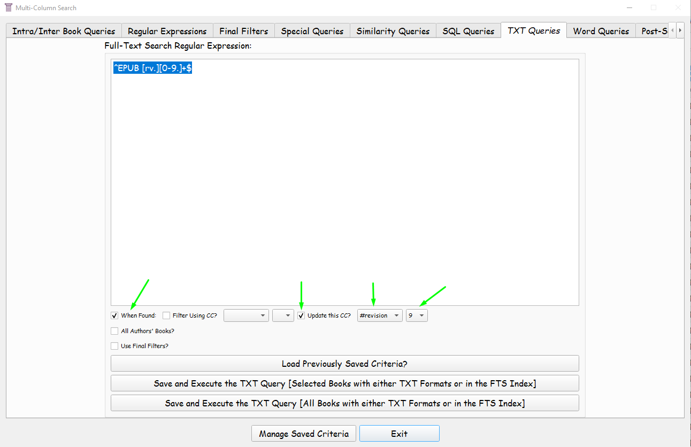
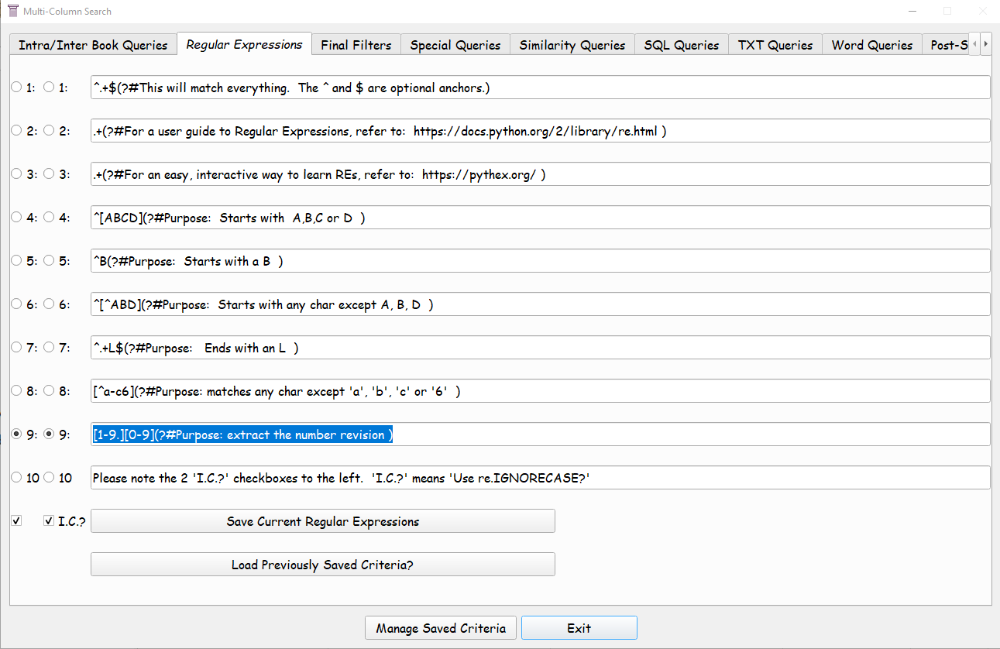
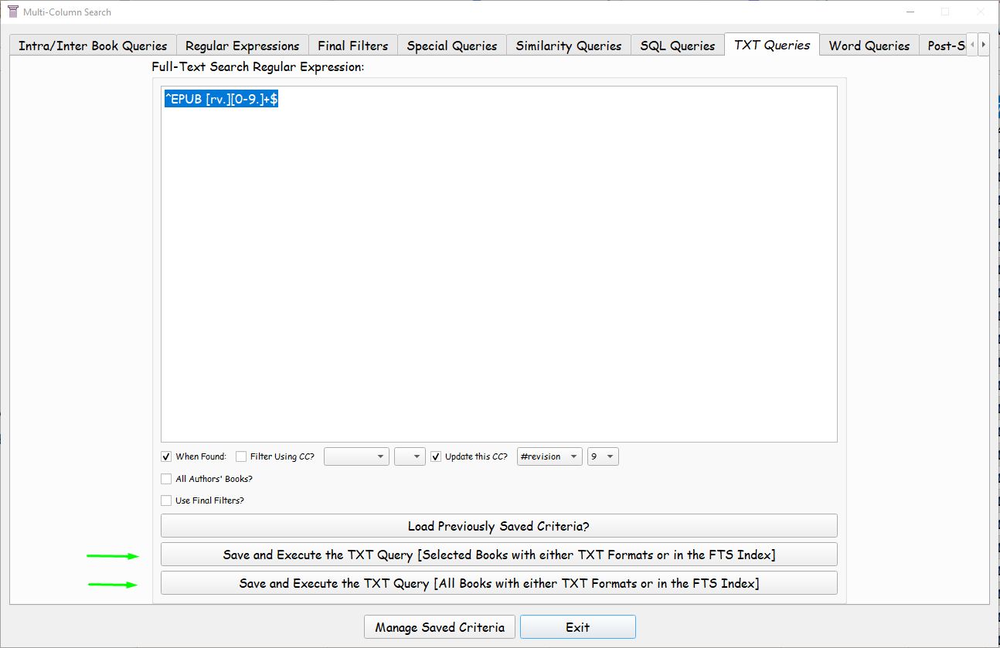

# Obtener traductor, nombre original, revisión y fecha de edición de un libro

:material-account: [@Killo\_3967](https://t.me/Dunhill69){ target=_blank } · :material-link-variant: [Ver el original en Telegraph](https://telegra.ph/Obtener-Traductor-Nombre-original-Revisi%C3%B3n-y-fecha-de-edici%C3%B3n-de-un-libro-11-12){ target=_blank }
{ .tut-datos }

---

Trabajo realizado por @Killo\_3967

***Para traductor:***

Creamos una columna personalizada como se ve en la imagen

***Para Título original*** otra de esta manera:

Instalamos el plugin Js+, una vez instalado vamos a \[Menu\] GUI Tools that are Metadata Related y tocamos en Extract Original Title/ Translator y como el plugin contador de paginas saldra un aviso de que esta trabajando y completará los datos si es que el libro los tiene.

***Para editado o  Generado:***

Para las columnas editado y revisión deberemos descargar el plugin **Multi-Column Search.**

Ejecutamos el plugin y en TXT Queries ponemos esta expresión

((0?\[1-9\]\|\[123\]\\d)\[-\](0?\[1-9\]\|1\[012\])\[-\](\[1\]\[9\]\|\[2\]\[0\])?\\d\\d)\|((0?\[1-9\]\|\[123\]\\d)\[\\/\](0?\[1-9\]\|1\[012\])\[\\/\](\[1\]\[9\]\|\[2\]\[0\])?\\d\\d)\|((0?\[1-9\]\|\[123\]\\d)\[\\.\](0?\[1-9\]\|1\[012\])\[\\.\](\[1\]\[9\]\|\[2\]\[0\])?\\d\\d)$

Atentos a lo marcado con las flechas

Y en la solapa Regular Expressions

(?!(fax\|\[isbn\]\|legal))(\\d{1,2}\[.\\/-\]\\d{1,2}\[.\\/-\]\\d{2,4})

***Para Revisión:***

^EPUB \[rv.\]\[0-9.\]+$

\[1-9.\]\[0-9\](?#Purpose: extract the number revision )

 

## [Volver al inicio](https://telegra.ph/Indice-Calibre-en-Espa%C3%B1ol-10-03)

 

 

---

[:material-arrow-left: Volver al índice](../../alfabetico.md) · [:fontawesome-brands-telegram: Preguntar en el grupo](https://t.me/calibreconfiguraciones){ target=_blank }
