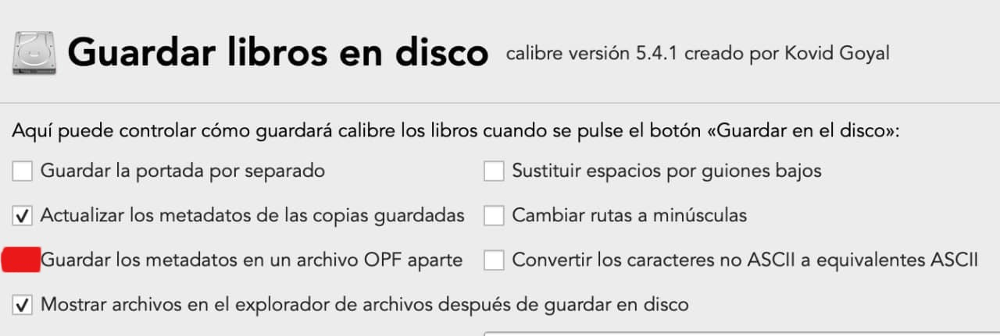

# OPF: no aparecen al copiar desde otra biblioteca

:material-account: [@Inatxo](https://t.me/Dunhill69){ target=_blank } · :material-link-variant: [Ver el original en Telegraph](https://telegra.ph/OPF-No-aparecen-al-copiar-desde-otra-librer%C3%ADa-11-08){ target=_blank }
{ .tut-datos }

---

Explicado por @Inatxo

La solución para que SI te aparezca el OPF es señalar esta opción

«Guardar metadatos en un archivo OPF aparte»

Es decir, si no señalas la opción, todos los metadatos, etc, se guardan en el mismo archivo .epub (no por separado). Por ejemplo a mi me parece menos engorroso tener dos archivos (epub y cover), que tres…

Sobre todo porque no pierdes nada.

ir al mensaje: [https://t.me/calibreconfiguraciones/23044](https://t.me/calibreconfiguraciones/23044)

[https://telegra.ph/OPF-No-aparecen-al-copiar-desde-otra-librer%C3%ADa-11-08](https://telegra.ph/OPF-No-aparecen-al-copiar-desde-otra-librer%C3%ADa-11-08)

 

## [Volver al inicio](https://telegra.ph/Indice-Calibre-en-Espa%C3%B1ol-10-03)

 

---

[:material-arrow-left: Volver al índice](../../alfabetico.md) · [:fontawesome-brands-telegram: Preguntar en el grupo](https://t.me/calibreconfiguraciones){ target=_blank }
