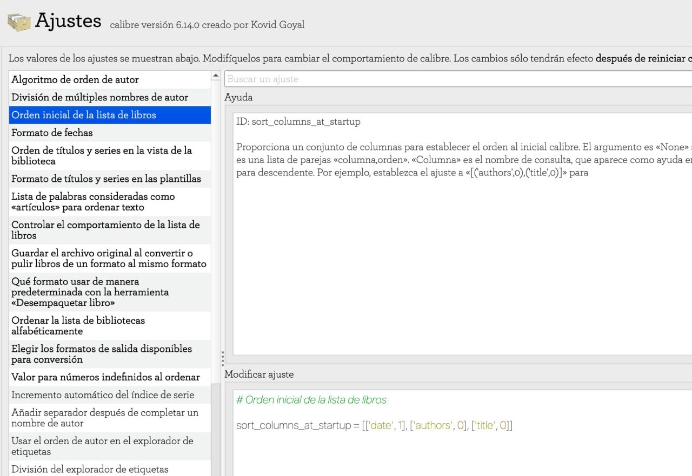

# Orden automático al ingresar libros

:material-account: [@Inatxo](https://t.me/Dunhill69){ target=_blank } · :material-link-variant: [Ver el original en Telegraph](https://telegra.ph/Orden-autom%C3%A1tico-al-agregar-libros-03-13){ target=_blank }
{ .tut-datos }

---

Explicado por @Inatxo

Hay una forma en que puedes hacer que automáticamente los libros se orden de una manera determinada al iniciar calibre.

Fíjate en AJUSTES: ORDEN INICIAL DE LOS LIBROS

En este caso se ordena por fecha de inclusión, autor y luego título.

Si nos figura NONE,  el NONE indica que no has predeterminado ningún orden específico, con lo cual entiendo que se te abrirá Calibre en función de los últimos libros incluidos, pero no te lo garantizo…

Tal vez seria conveniente que establecieras un orden de inicio que te agradara… luego siempre puedes cambiar ese orden en función de tus necesidades pinchando en el título de cada columna…

Ir al mensaje: [https://t.me/calibreconfiguraciones/112333/130473](https://t.me/calibreconfiguraciones/112333/130473)

## [Volver al inicio](https://telegra.ph/Indice-Calibre-en-Espa%C3%B1ol-10-03)

 

 

---

[:material-arrow-left: Volver al índice](../../alfabetico.md) · [:fontawesome-brands-telegram: Preguntar en el grupo](https://t.me/calibreconfiguraciones){ target=_blank }
