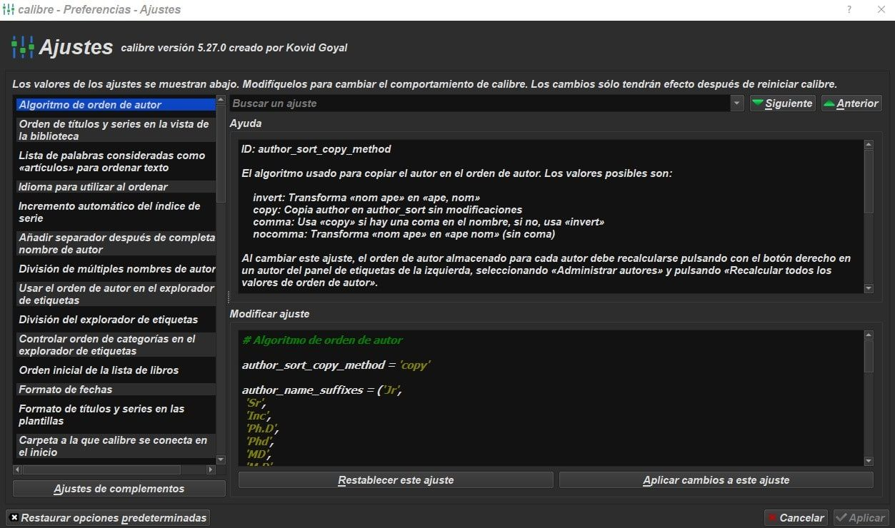
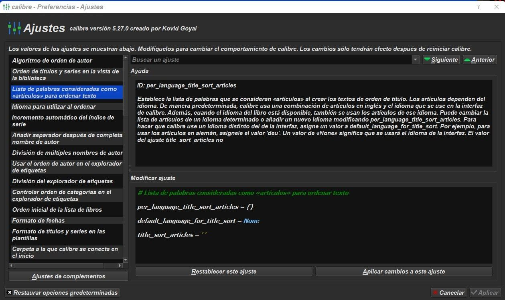
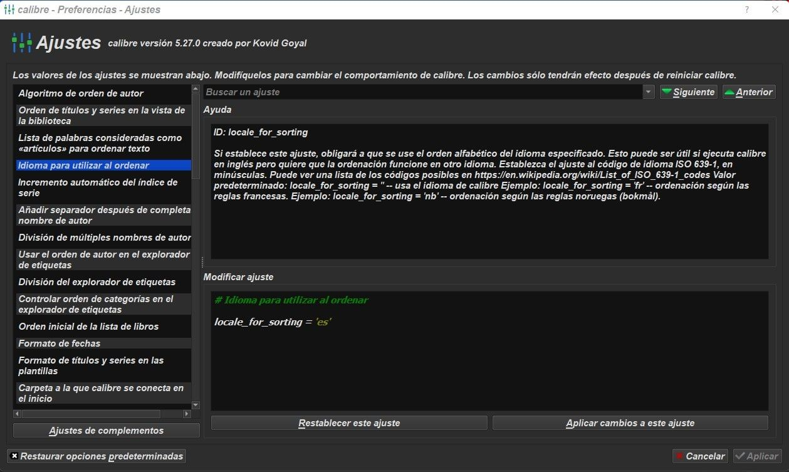
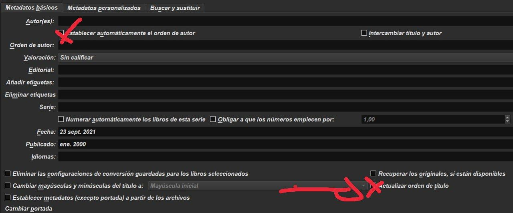

# Orden de autor (Nombre Apellido)

:material-account: [@jaucar](https://t.me/Dunhill69){ target=_blank } · :material-link-variant: [Ver el original en Telegraph](https://telegra.ph/Orden-de-Autor-Nombre-Apellido-09-23){ target=_blank }
{ .tut-datos }

---

A respuesta de anabel @Anabeluci por José Antonio @jaucar

Qué rabia me daba eso! Al final decidí poner el autor por nombre y luego apellido.

Tengo tenido un montón de carpetas del mismo autor. Por ej:

Antonio del Río- Del Río, Antonio Río, Antonio del

Y luego las variaciones correspondientes sin el acento.

Eso te pasa porque no tienes bien configuradas las preferencias de Calibre

 

Algoritmo de orden de autor ponlo en 'Copy'

Lo que se me olvido de explicar es lo de

per\_language\_title\_sort\_articles = {} (Si aparece algo entre estos corchetes, borrarlo y dejarlo tal como se muestra)

Eliminando lo que contienen los corchetes evitarenos que aparezcan libros del tipo Casa de la pradera, La en vez de La casa de la pradera.

Es decir, conserva el artículo al principio del título.

Palabras consideradas artículos 'none'( si no está lo escribes con las comillas

Idioma para ordenar 'es'

Una vez configurado, reiniciar Calibre

Ahora seleccionamos todos los libros.

Metadatos.

Modificar metadatos en masa (desde la flechita lateral)

Marcamos esas casillas de la captura anterior y modificar.

Esperamos a que termine y aceptar.

Con todos los libros seleccionados.

Vamos al panel lateral de la izquierda

Nos posicionamos con el cursor en autores y picamos con el botón derecho del ratón.

Administrar autores.

Pulsamos en "Recalcular el orden de autor"

Aceptar

Reiniciamos calibre

 

Deberían estar ordenados los autores con Nombre Apellido.

 

Por si acaso hay alguno con apellido, nombre.

En el cajón de búsqueda ponemos lo siguiente author: "," (author: espacio comillas coma comillas) y lupa de buscar

Nos aparecerán los que no hayan sido ordenados.

Esos se modifican a mano uno por uno.

 

En resumen:

Cómo (no) ordenar autores

Mi preferencia a la hora de ordenar autores es simple: no ordenar. Es

decir, Julio Verne es Julio Verne, no es Verne, Julio.

Ésta es la chuleta.

Preferencias -\> Avanzado -\> Ajustes

Algoritmo de orden de autor

author\_sort\_copy\_method = 'copy'

Lista de palabras consideradas como «artículos» para ordenar texto

per\_language\_title\_sort\_articles = {} (Si aparece algo entre estos corchetes, borrarlo y dejarlo tal como se muestra)

default\_language\_for\_title\_sort = 'none'

title\_sort\_articles = ''

Aplicar. Aplicar.

Seleccionar TODOS los libros -\> Editar metadatos -\> Editar metadatos en

masa

Metadatos básicos

\[x\] Establecer automáticamente el orden de autor

\[x\] Actualizar orden de título

\[x\] Actualizar lista de libros al modificar

Aplicar. Aceptar.

Mostrar explorador de etiquetas \[Mayúsculas+Alt+T\]

Autores -\> Click derecho -\> Administrar autores

Ordenar por autor

Recalcular todos los valores de orden de autor

Aceptar.

 

## [Volver al inicio](https://telegra.ph/Indice-Calibre-en-Espa%C3%B1ol-10-03)

 

---

[:material-arrow-left: Volver al índice](../../alfabetico.md) · [:fontawesome-brands-telegram: Preguntar en el grupo](https://t.me/calibreconfiguraciones){ target=_blank }
