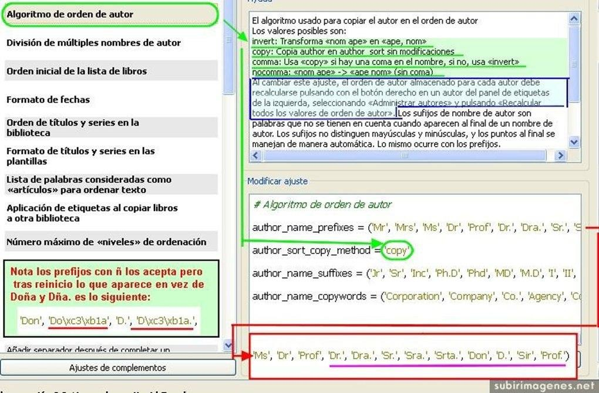
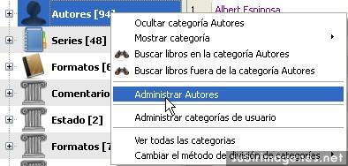
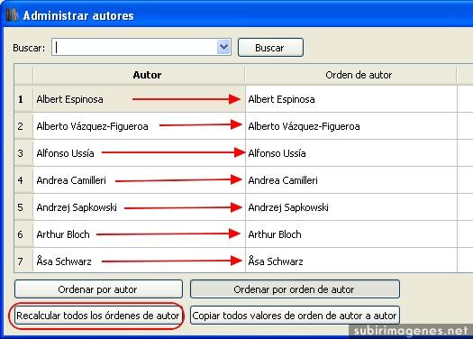

# Ordenando los nombres de autor

:material-account: Walter · :material-link-variant: [Ver el original en Telegraph](https://telegra.ph/Ordenando-los-nombres-de-Autor-09-06){ target=_blank }
{ .tut-datos }

---

 

Vamos a ver las distintas posibilidades que el programa nos ofrece para ordenar los nombres de autor. Tendremos que ir la configuración **"Algoritmo de orden de autor"**. En este apartado hay varios valores que cambiar y he intentado en una sola imagen aglutinar mucha información. Espero no liaros demasiado con tanto esquema. Para ello vamos a diferenciar los distintos pasos por colores:

**MARCADO EN VERDE: **Lo primero que podemos modificar es como calibre va a colocar el nombre de pila y el apellido, el apartado sombreado de arriba a la derecha muestra los distintos valores.

-**invert**: invierte el orden de "nombre apellido" en "apellido, nombre" (incluyendo la coma intermedia)

-**copy**: deja el nombre de autor sin modificaciones.

-**comma**: usa copy si hay una coma y si no lo hay usa invert (osea coloca "apellido, nombre"). Es decir fuerza el uso de la coma siempre.

-**nocomma**: "nombre apellido" lo convierte en "apellido nombre" sin coma entre medio.

**El programa viene pre-establecido en comma. Ósea hace forzoso el uso de coma.** Si eliges otra configuración distinta debemos pasamos al apartado azul, que para no liaros más lo dejo para el final.

Sigo. Como a mi los nombres con coma no me gustan he elegido cambiar la configuración pre-establecida por **copy** que se adapta a mis necesidades. Es decir deja el nombre tal cual sin comas si no las trae. Y así lo he configurado (redondeado de verde).

**MARCADO EN ROJO: **Antes de aceptar los cambios en esta pantalla solo queda la configuración de sufijos y prefijos. Estos no tienen especial importancia, solo decir que no los va a tener en cuenta en la clasificación de nombres. Yo he editado los prefijos para añadir alguno a mi gusto. **Son los subrayados en morado**. En un primer momento incluí los sufijos Doña y Dña. pero en el reinicio el programa no los reconoció como indico en la nota a la izquierda.

También podríamos borrar todos los existentes y que directamente los considerara al clasificar los nombres alfabéticamente. Esa es otra posibilidad a tener en cuenta.

**LO MARCADO EN AZUL: **Al cambiar la configuración del orden de autor debemos forzosamente recalcular los nombres para que los cambios se apliquen. Para ello, debemos pasar a la pantalla principal del programa pero antes terminamos de validar cambios dando en aceptar, y tras realizar el reinicio necesario pasamos al panel de etiquetas:

Como se ve solo hay que pulsar botón derecho y elegir "Administrar Autores". Y veremos:

Aquí hay que pulsar para **recalcular todos los ordenes de autor** que pasarán a igualarse ambas columnas. Con esto calibre reconoce el nuevo sistema que hemos elegido de clasificar los nombres de autor.

Espero que todo este lió de pantallazos y flechitas le sirva a alguien. Aún me quedan varios truquillos destacables, los dejaremos para otro dia. Que por hoy ya me lo he currado bien ehhh, jejeje.

Un saludo.

Última edición por P-ludus; 29/02/2012 a las 21:03

 

## [Volver al inicio](https://telegra.ph/Indice-Calibre-en-Espa%C3%B1ol-10-03)

 

---

[:material-arrow-left: Volver al índice](../../alfabetico.md) · [:fontawesome-brands-telegram: Preguntar en el grupo](https://t.me/calibreconfiguraciones){ target=_blank }
