# Ordenar autores

:material-account: [Walter](https://t.me/Dunhill69){ target=_blank } · :material-link-variant: [Ver el original en Telegraph](https://telegra.ph/Ordenar-Autores-09-06){ target=_blank }
{ .tut-datos }

---

***(Para que todos queden con el mismo orden, no unos antes el nombre y otros el apelllido)***

***(si por ejemplo se da el caso de que teneis Arthur C. Clarke... Clarke, Arthur C..... C. Clarke, Arthur, igual tienes tres libros y te cuenta como tres autores diferentes y de este modo los unifica.)***

**1.-**En autores (arriba izqda.) clic con el botón dcho del ratón à clic en “administrar autores” con el botón izqdo… **(pantallazo 01)** esperar

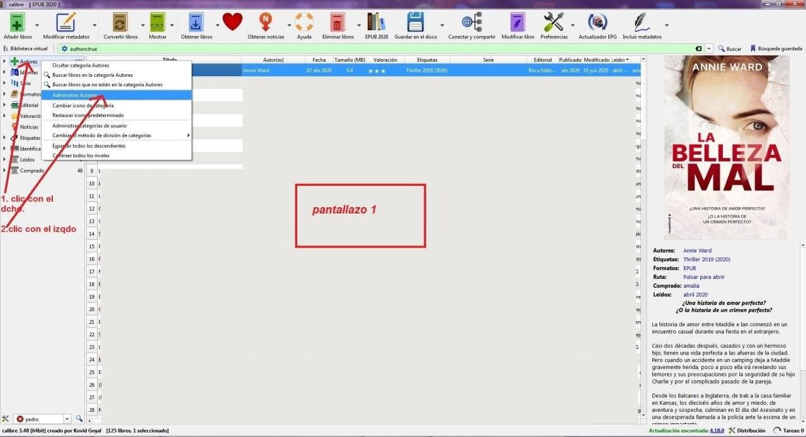

 

**2.-**En la ventanita que se abre clic con el botón izquierdo, en las dos ventanitas de abajo y clic en aceptar. **(pantallazo 02)**

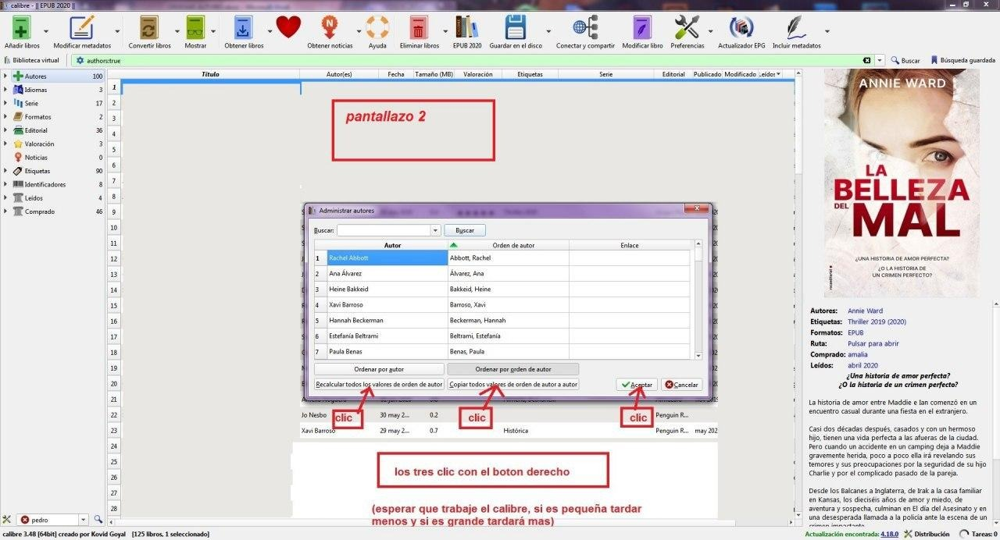

Esperar, no veréis nada, solo que no deja hacer nada y que sale la ruedecita girando si intentáis hacer algo.

**3.**-En preferencias a cambiar el comportamiento del calibre à ajustes à algoritmo orden de autor , ver que sale como en el **pantallazo 3**

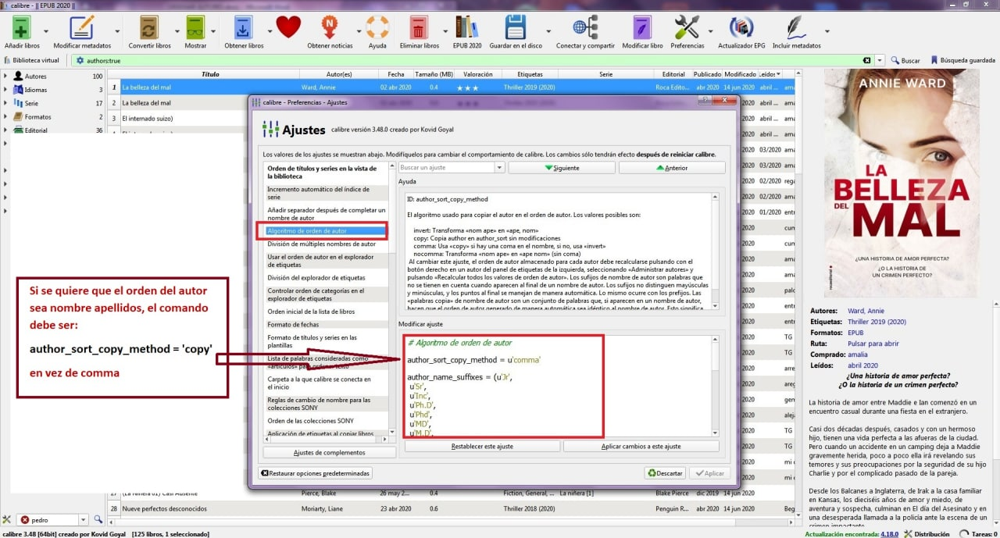

"si se quiere que el orden de autor sea nombre y apellidos el comando deberá ser:

author\_sort\_copy\_method = 'copy'

con copy en vez de comma"

**<u>ORDENAR Y ARREGLAR TÍTULOS</u>**

***(Para que por ejemplo los libros no se llamen : Rojo, chica de La, sino La chica de rojo)***

***(este apartado hacerlo solo la primera vez que se arregla una biblioteca, luego cuando se añaden libros no hacerlo ya, se hace solo)***

**4.-** En preferencias a cambiar el comportamiento del calibre a ajustes a clic en Orden de títulos y series en la vista de la biblioteca. Y tiene que estar exactamente como en el **pantallazo 04**,

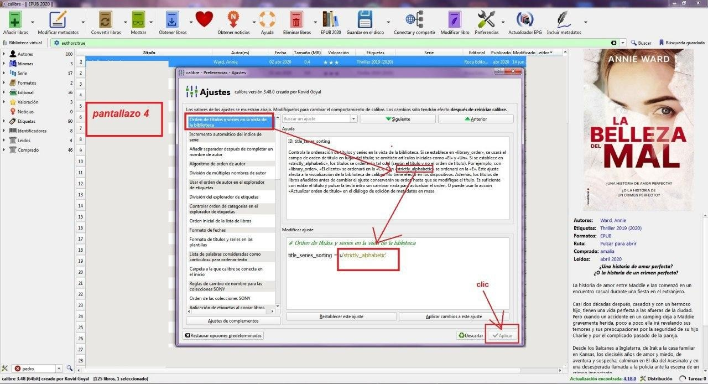

para ello borráis lo que pone y pegais exactamente esto entre las comillas:

strictly\_alphabetic

(o lo que es lo mismo leeis arriba y copiáis, strictly\_alphabetic , y lo pegais abajo, cuidado con las comillas que tiene que ser exacto para que funcione.

clic en aplicar

**5.-** Hecho esto teneis que conseguir que lo haga en todos los libros de esa biblioteca, para lo cual teneis que :

**6.-**Seleccionar todos los libros **(Ctrl A)** , tardará unos segunditos según el tamaño de la biblioteca.

Cuando veais que toooodo está en azul:

**7.-**Arriba a la izquierda.., clic en la flechita chiquitina del desplegable de Modificar metadatos a clic en Modificar metadatos en masa **(pantallazo 05)**

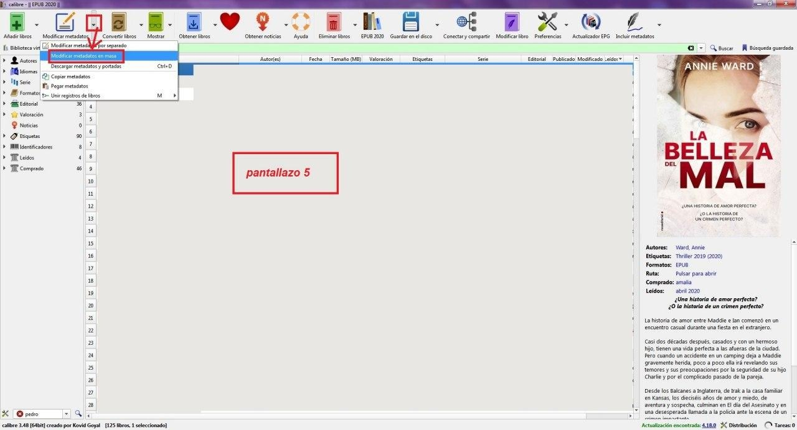

**8.-**En la pantalla que se os abre **(pantallazo 06)**

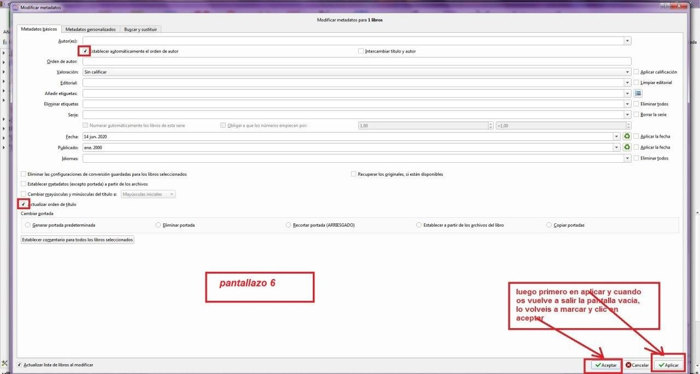

marcar lo que os he encuadrado , aunque lo del autor se supone que ya está hecho con el grupo anterior, no está de más volverlo a marcar…

Clic en aplicar (tardara un poco según los libros), y luego os volverá a salir la misma pantalla sin marcar , la volveis a marcar idéntica en los dos sitios y clic en aceptar.

**<u>ARREGLAR METADATOS:</u>**

**9.-** Clic en el montoncito de libros de la biblio que sea à clic en mantenimiento de la biblioteca à clic en Estado de la copìa de respaldo de metadatos de la biblioteca **(pantallazo 07)**

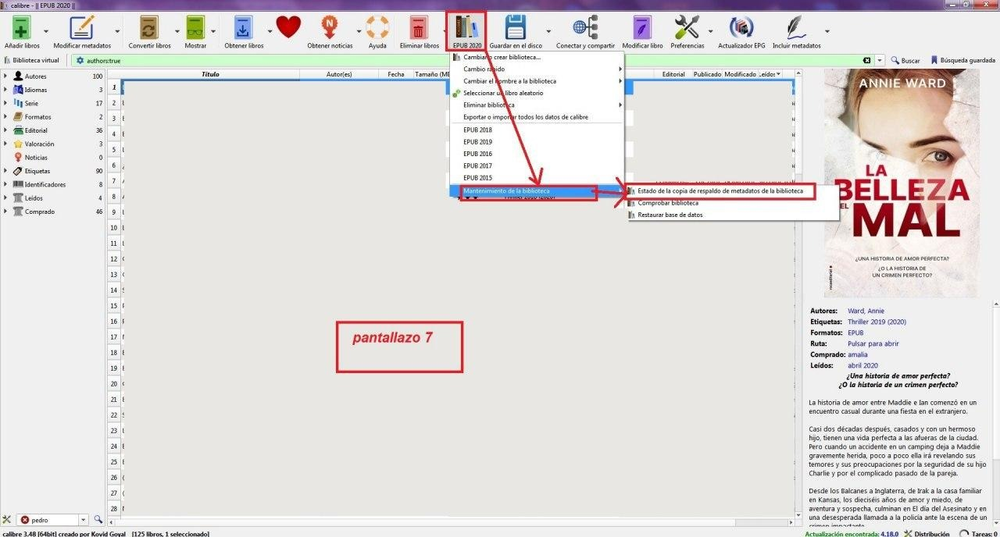

**10.-** En la pantalla que se abre **(pantallazo 08)**

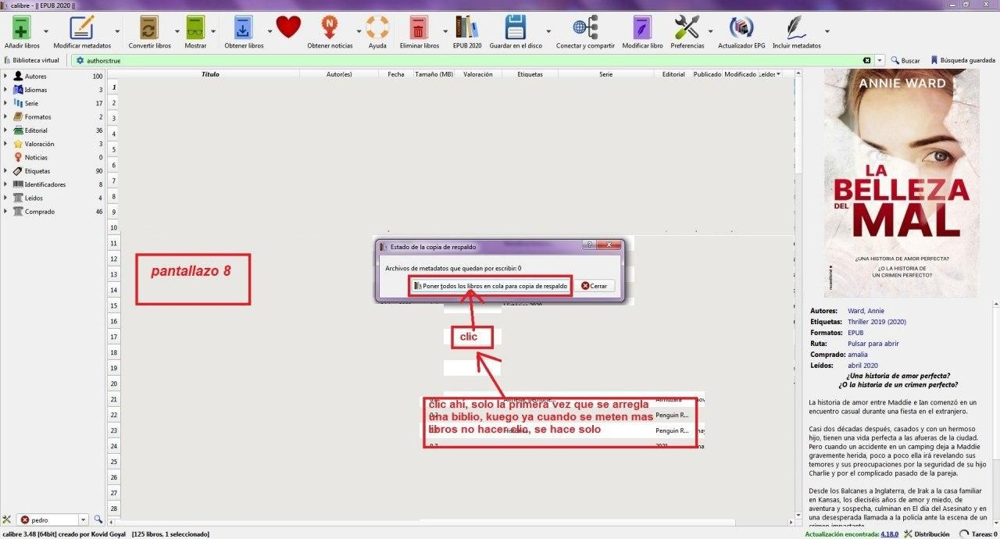

clic en poner todos los libros en cola para copia de respaldo y esperar hasta que donde poner Archivos de metadatos que quedan por escribir salga cero.(Esto solo hacerlo la primera vez que se arregla una biblio, luego ya cuando se añaden libros, no hacer nada, se hace solo, y si se clica es un horror porque vuelve a empezar desde el principio y no solo los añadidos)

Esto es lo que mas tarda, y como en todas las biblios , si es pequeña tardara menos y si es grande tardará mucho, en la mega tardará varios días, pero cada noche podeis cerrar el calibre y el ordenador y cuando lo volváis a encender , y abrir el calibre si volveis a hacer el punto 9 y el 10, seguirá donde lo ha dejado el dia anterior.

**<u>COMPROBAR BIBLIOTECA:</u>**

**11.-** Clic en el montoncito de libros de la biblio que sea à clic en mantenimiento de la biblioteca à Clic en comprobar biblioteca **(pantallazo 09)**

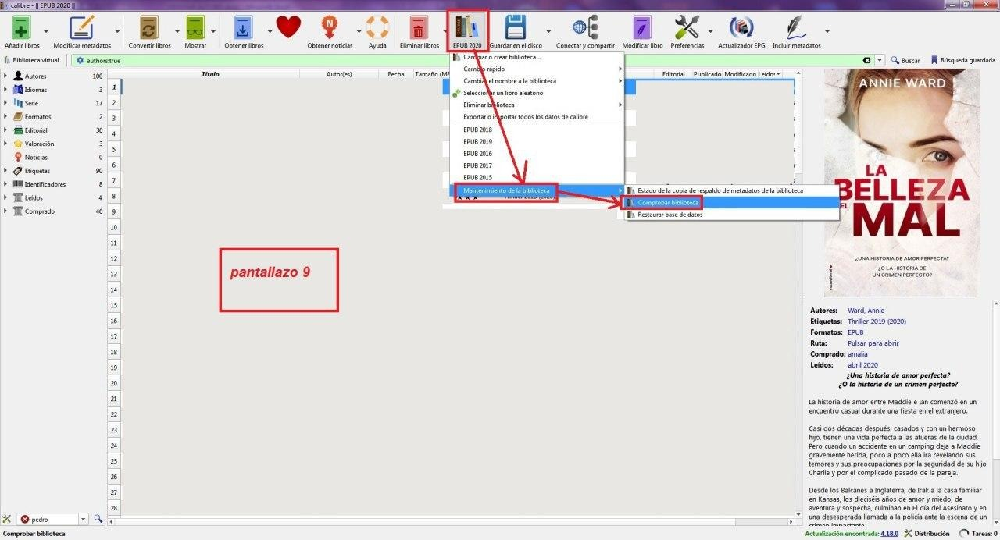

**12.- **En la pantallita que os sale **(pantallazo 10)**

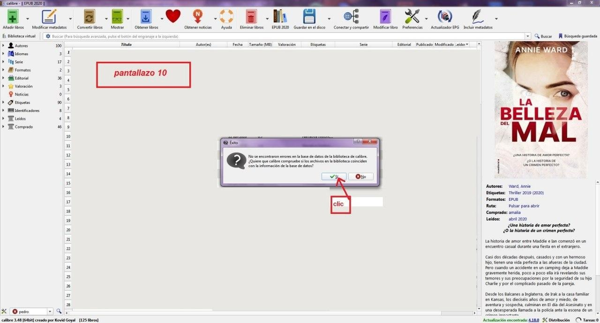

si os dice que no se encontraron errores, clic en **SÍ**

**13.-**En la pantallita que os sale** (pantallazo 11)**

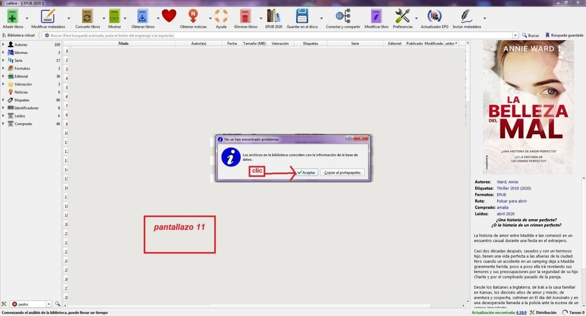

si os dice que los archivos en la biblioteca coinciden con la información de la base de datos, genial! **Clic en aceptar** y se acabó todo el proceso.

ir al mensaje: [https://t.me/calibreconfiguraciones/15121](https://t.me/calibreconfiguraciones/15121)

ir al archivo doc: [https://t.me/calibreconfiguraciones/15132](https://t.me/calibreconfiguraciones/15132)

[https://telegra.ph/Ordenar-Autores-09-06](https://telegra.ph/Ordenar-Autores-09-06)

 

## [Volver al inicio](https://telegra.ph/Indice-Calibre-en-Espa%C3%B1ol-10-03)

 

 

---

[:material-arrow-left: Volver al índice](../../alfabetico.md) · [:fontawesome-brands-telegram: Preguntar en el grupo](https://t.me/calibreconfiguraciones){ target=_blank }
