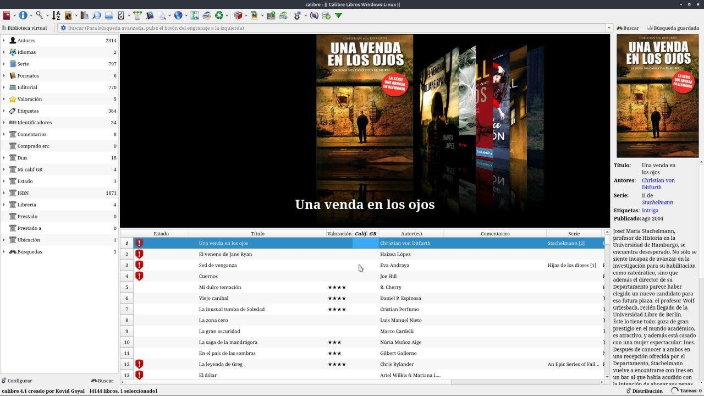
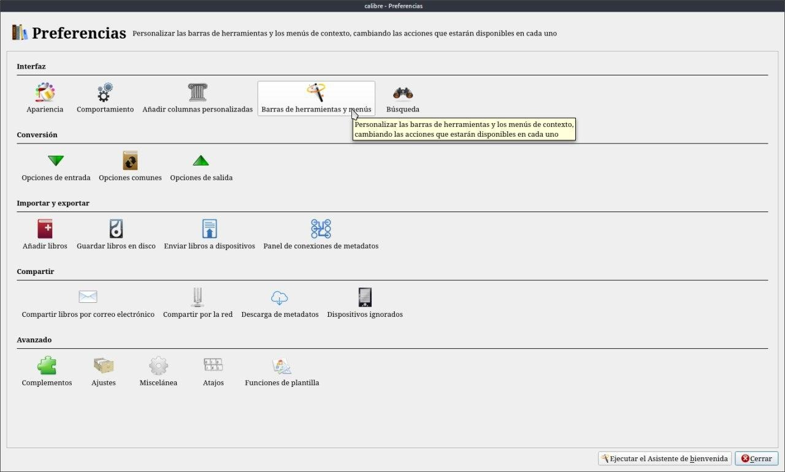
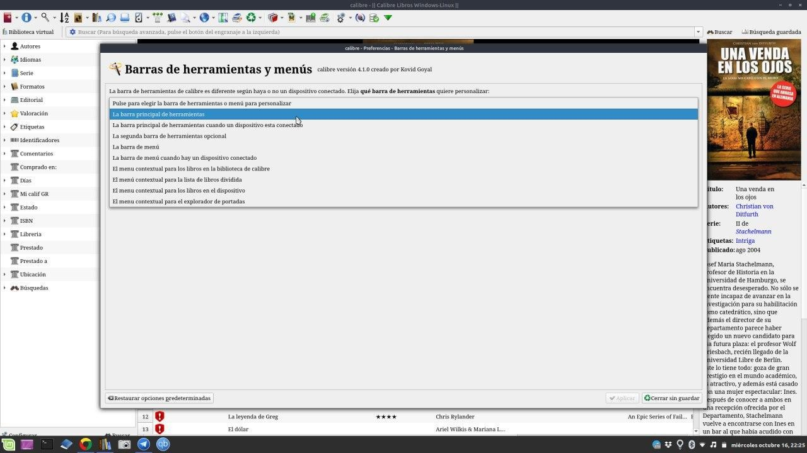
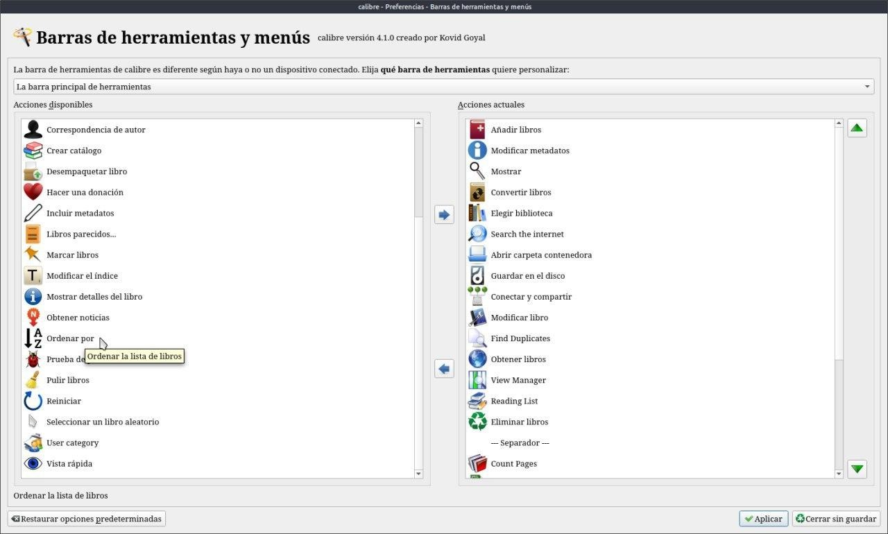
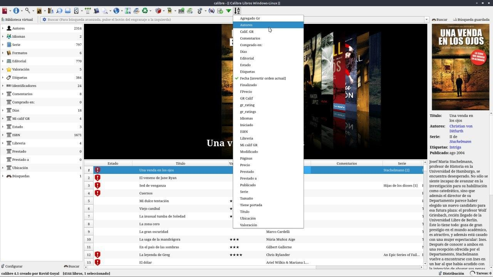

# Ordenar biblioteca

:material-account: [Walter](https://t.me/Dunhill69){ target=_blank } · :material-link-variant: [Ver el original en Telegraph](https://telegra.ph/Ordenar-biblioteca-09-06){ target=_blank }
{ .tut-datos }

---

Estaba mirando mi biblioteca y pensé como puedo hacer para ordenarla alfabéticamente por lo que quiera....

Voy a Preferencia Barra de Herramientas y menús

Marco la barra de Herramienta que es lo que quiero modificar.

Del lado izquierdo veo diferentes acciones encuentro que hay una que dice Ordenar por ... Lo marco y con la flechita azul lo paso a la derecha.

Toco Aplicar y cerrar y al terminar estos pasos aparece en la barra de herramientas .

Y después elijo por lo que lo quiero ordenar.

ir al mensaje: [https://t.me/calibreconfiguraciones/1675](https://t.me/calibreconfiguraciones/1675)

[https://telegra.ph/Ordenar-biblioteca-09-06](https://telegra.ph/Ordenar-biblioteca-09-06)

 

## [Volver al inicio](https://telegra.ph/Indice-Calibre-en-Espa%C3%B1ol-10-03)

 

 

---

[:material-arrow-left: Volver al índice](../../alfabetico.md) · [:fontawesome-brands-telegram: Preguntar en el grupo](https://t.me/calibreconfiguraciones){ target=_blank }
