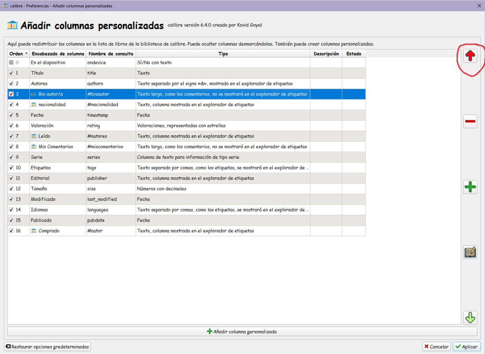

# Ordenar columnas

:material-account: [Walter](https://t.me/Dunhill69){ target=_blank } · :material-link-variant: [Ver el original en Telegraph](https://telegra.ph/Ordenar-columnas-02-15){ target=_blank }
{ .tut-datos }

---

Si quieres que la nueva columna te quede acto seguido de la columna autor te vas a preferencias—\>añadir columnas personalizadas y en esa pantalla seleccionas la nueva columna y con la flechita roja vas subiendo hasta que quede justo debajo de la columna autores.

Con las flechitas de arriba y abajo puedes colocar las columnas en el orden que quieras.

 

Ir al mensaje: [https://t.me/calibreconfiguraciones/144967/146934](https://t.me/calibreconfiguraciones/144967/146934)

## [Volver al inicio](https://telegra.ph/Indice-Calibre-en-Espa%C3%B1ol-10-03)

 

---

[:material-arrow-left: Volver al índice](../../alfabetico.md) · [:fontawesome-brands-telegram: Preguntar en el grupo](https://t.me/calibreconfiguraciones){ target=_blank }
