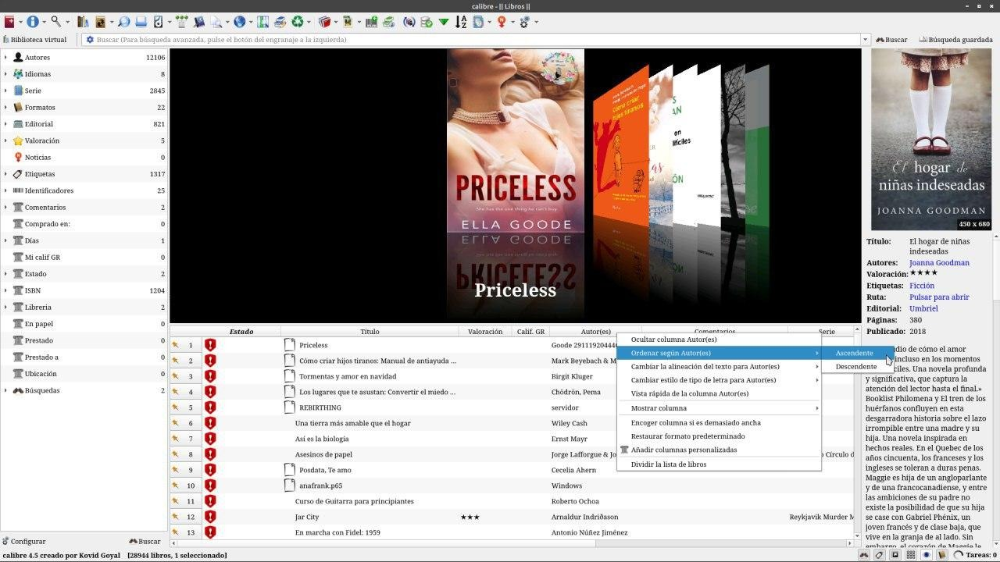

# Ordenar según autores

:material-account: [Walter](https://t.me/Dunhill69){ target=_blank } · :material-link-variant: [Ver el original en Telegraph](https://telegra.ph/Ordenar-seg%C3%BAn-Autores-09-07){ target=_blank }
{ .tut-datos }

---

Tocamos en la columna Autores botón izquierdo del mouse, Ordenar según Autores y marcamos Ascendente o Descendente.

ir al mensaje: [https://t.me/calibreconfiguraciones/2817](https://t.me/calibreconfiguraciones/2817)

[https://telegra.ph/Ordenar-seg%C3%BAn-Autores-09-07](https://telegra.ph/Ordenar-seg%C3%BAn-Autores-09-07)

 

## [Volver al inicio](https://telegra.ph/Indice-Calibre-en-Espa%C3%B1ol-10-03)

 

 

 

---

[:material-arrow-left: Volver al índice](../../alfabetico.md) · [:fontawesome-brands-telegram: Preguntar en el grupo](https://t.me/calibreconfiguraciones){ target=_blank }
