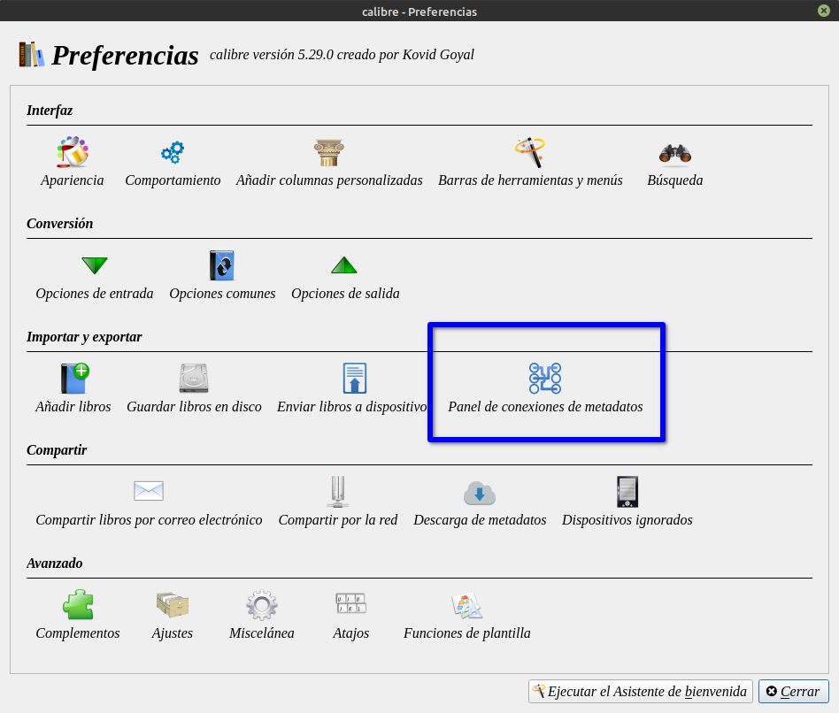
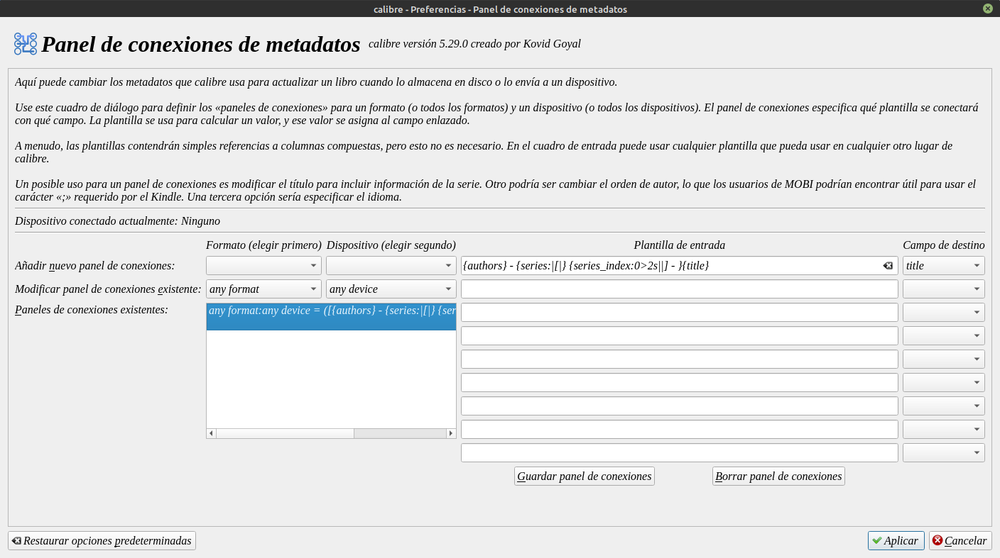

# Panel de conexiones de metadatos

:material-account: [Walter](https://t.me/Dunhill69){ target=_blank } · :material-link-variant: [Ver el original en Telegraph](https://telegra.ph/Panel-de-Conexiones-de-Metadatos-10-14){ target=_blank }
{ .tut-datos }

---

Existen varias maneras de configurar como enviar el libro a nuestro dispositivo.

Este método funciona por medio del envió por cable o enviá al dispositivo desde calibre al lector conectado al pc

Para configurarlo a nuestro gusto debemos ir a Preferencia/Panel de conexiones de metadatos.



Este es mi ejemplo:



Debemos marcar para que formato deseamos esta configuración, para que dispositivo, la plantilla es el orden de como se veran los campos y sobre donde tendra efecto.

Otros ejemplos:

**Para Kindle/Kobo**

Para obtener los títulos en un Kindle 3 para mostrar información de la serie. Usé la siguiente plantilla:

formato:

dispositivo mobi :

plantilla kindle2 : {series} {series\_index: 0\> 2s \| - \| -} {títle}

destino: títle

Esto funciona muy bien para libros que forman parte de una serie, por ejemplo:

Canción de hielo y fuego - 01 - Juego de tronos

Canción de hielo y fuego - 02 - Choque de reyes

Canción de hielo y fuego - 03 - Tormenta de espadas

Canción de hielo y fuego - 04 - Fiesta para cuervos

\*Metadatos: Mostrar serie \[índice de la serie\] - título como título (Kindle) (Scott Nielsen)

format: mobi

device: kindle2

template: {series:\|\| }{series\_index:0\>2s\|\[\|\] - }{title}

destination: title

\*Metadatos: mostrar el nombre del autor como inicial y apellido (Kindle)

1) Verifique que los valores de author\_sort sean el orden de Apellido, Nombre.

2) Desmarque 'usar ordenación por autor' en el complemento de salida de mobi.

3) Cree un formato de tablero de conexiones:

format: mobi

device: kindle2

template: {author\_sort:re(\\, (.).\*?( &\|$),\\, \\1\\2)}

destination: authors

\*Nombre de archivo: orden de autor / serie / título - versión (WinCE / Mobile (Mobipocket))

Usar una columna personalizada de versión en los nombres de archivo

{author\_sort}/{series}/{title} - v{#version:0\>2s}

\*Nombre de archivo: cree rutas de archivo que agrupen a los autores en categorías similares a \[A - D\] (WinCE / Mobile (Mobipocket))

{author\_sort:switch(^\[A-D\],\[A - D\],^\[E-J\],\[E - J\],^\[K-O\],\[K - O\],^\[P-T\],\[P - T\],^\[U-Z\],\[U - Z\],\[Other\])}

\*Nombre de archivo: crea una ruta basada en el índice de la serie

Si tiene muchos libros en una serie y los quiere en una jerarquía de carpetas como series / 00-09 / autor / título, serie / 10-19 / autor / título. Quieres solo autor / título si no hay serie.

Cree una columna compuesta llamada (por ejemplo) #s\_index.

Columna: #s\_dex

Plantilla: {series\_index:0\>2s}

Código:

```
 {series}{#s_dex:switch(0.,00-09,1.,10-19,2.,20-29,3.,30-39,4.,40-49,5.,50-59,6.,60-69,7.,70-79,8.,80-89,9.,90-99,)|/|/}{author}/{title}
```

<br>

Más ejemplos en: [https://www.mobileread.com/forums/showthread.php?t=118563](https://www.mobileread.com/forums/showthread.php?t=118563)

<br>

Para guardar en disco por serie

```
{series:'ifempty($, list_item($authors, 0, '&'))'}/{title} - {authors:list_item(0,&)}
```

{series:'ifempty("{series:\|\[\|\]}", list\_item($author, 0, '&'))'}/{series:\|\| \[{series\_index:0\>2.1f}\] - }{title} - {authors:sublist(0,2, & )}

<br>

<br>

## [Volver al inicio](https://telegra.ph/Indice-Calibre-en-Espa%C3%B1ol-10-03)

<br>

<br>

---

[:material-arrow-left: Volver al índice](../../alfabetico.md) · [:fontawesome-brands-telegram: Preguntar en el grupo](https://t.me/calibreconfiguraciones){ target=_blank }
