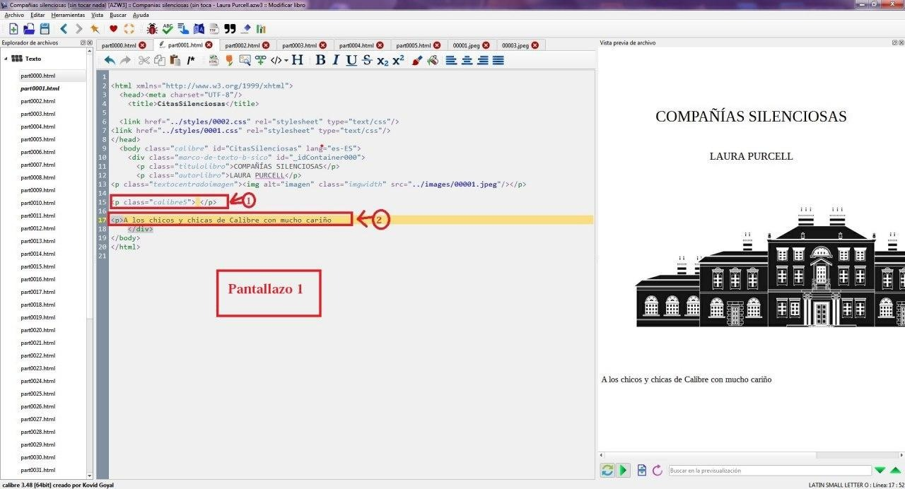
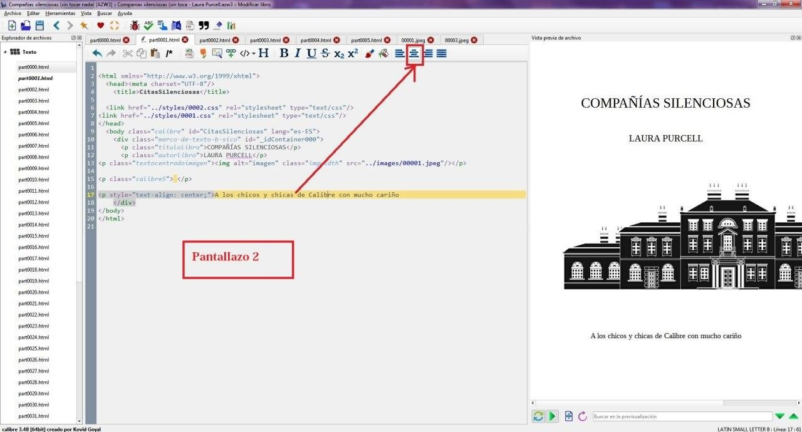
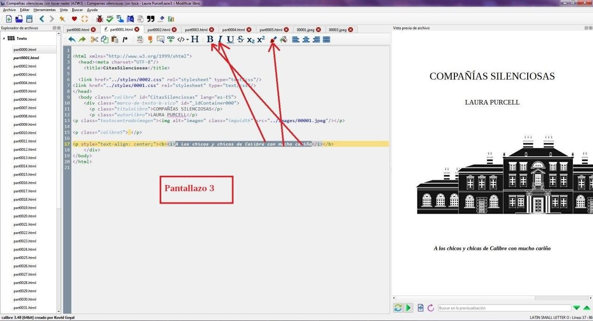
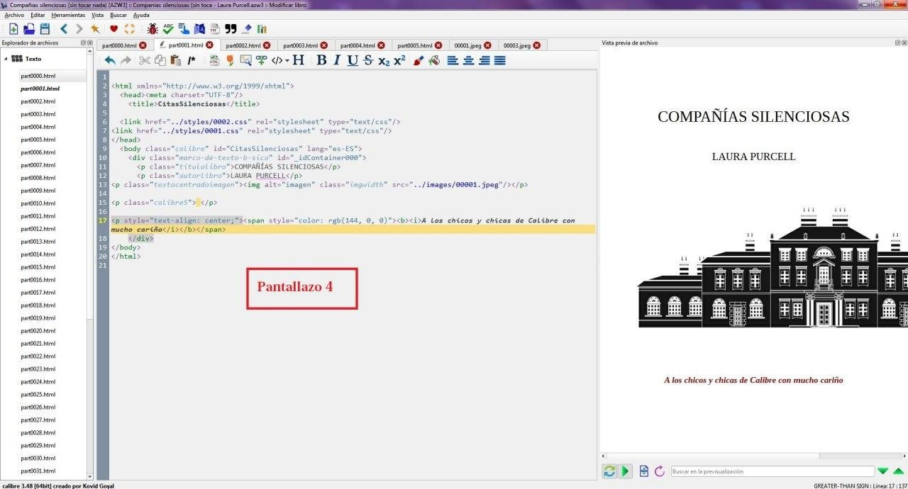
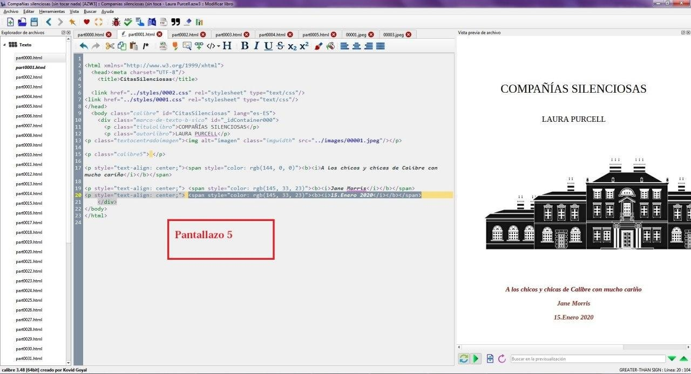

# Poner nombre o dedicatoria en la portadilla de un ebook (HTML)

:material-account: [Walter](https://t.me/Dunhill69){ target=_blank } · :material-link-variant: [Ver el original en Telegraph](https://telegra.ph/Para-poner-nombre-o-dedicatoria-en-una-portadilla-de-un-ebook-09-07){ target=_blank }
{ .tut-datos }

---

Explicado por Jane

Puede ser de dos maneras:

**1.- Que la portadilla no sea imagen, eso es, no extraíble**

**2.- Que sea imagen (jpg, png)**

**En este mini tuto vamos a ver solo la posibilidad 1, la 2 la vemos en otro para no mezclar**

** 1.- Que es html y no imagen, siempre en azw3 :**

**Pantallazo 1:**

**1)**En un sitio que os guste, pegar:

\
 \</p\>

Las veces que os parezca bien según la altura deseada

**2)**Luego escribir \<p\> y escribir el texto a continuación

**Pantallazo 2:**

**3)**situados justo encima de lo que habéis escrito,(que esté marcado) clicar arriba (según pantallazo) donde prefiráis que os quede, si a la izqda., dcha o en medio (pantallazo 2)

**Pantallazo 3 y 4:**

**4)**para que os quede más mono, vamos a poner cursiva y negrita y cambiar el color en la dedicatoria:

5)Marcáis la dedicatoria que se sombree y clicais (pantallazo 3) en la I, en la B y en la brochita y en esta ultima elegís color.

Y os quedará como en el **pantallazo 4**

**Pantallazo 5:**

**6)Si queréis poner más líneas , escribís justo debajo otra vez **

\<p\> y lo que queráis poner, y volvéis a hacer el 3), el 4) y el 5) y os quedará como en el **pantallazo 5**

**Muy importante  guardar los cambios antes de salir y convertir el azw3 otra vez en azw3 y borrar el original, sino no se os guardará, a partir de ese nuevo ya podéis convertirlo en epub, mobi o lo que queráis, aunque el mobi ya está bastante obsoleto y lo cuidan poco, no queda tan bien como en azw3 o en epub**

Ir al mensaje: [https://t.me/calibreconfiguraciones/4694](https://t.me/calibreconfiguraciones/4694)

Ir al documento: [https://t.me/calibreconfiguraciones/4693](https://t.me/calibreconfiguraciones/4693)

[https://telegra.ph/Para-poner-nombre-o-dedicatoria-en-una-portadilla-de-un-ebook-09-07](https://telegra.ph/Para-poner-nombre-o-dedicatoria-en-una-portadilla-de-un-ebook-09-07)

## [Volver al inicio](https://telegra.ph/Indice-Calibre-en-Espa%C3%B1ol-10-03)

 

---

[:material-arrow-left: Volver al índice](../../alfabetico.md) · [:fontawesome-brands-telegram: Preguntar en el grupo](https://t.me/calibreconfiguraciones){ target=_blank }
