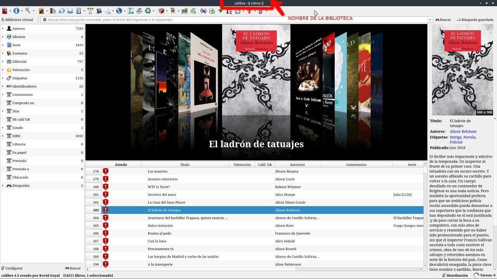
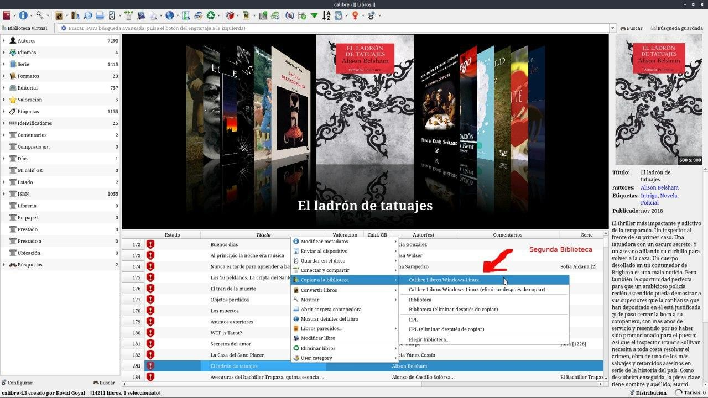
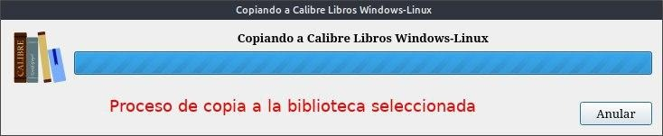
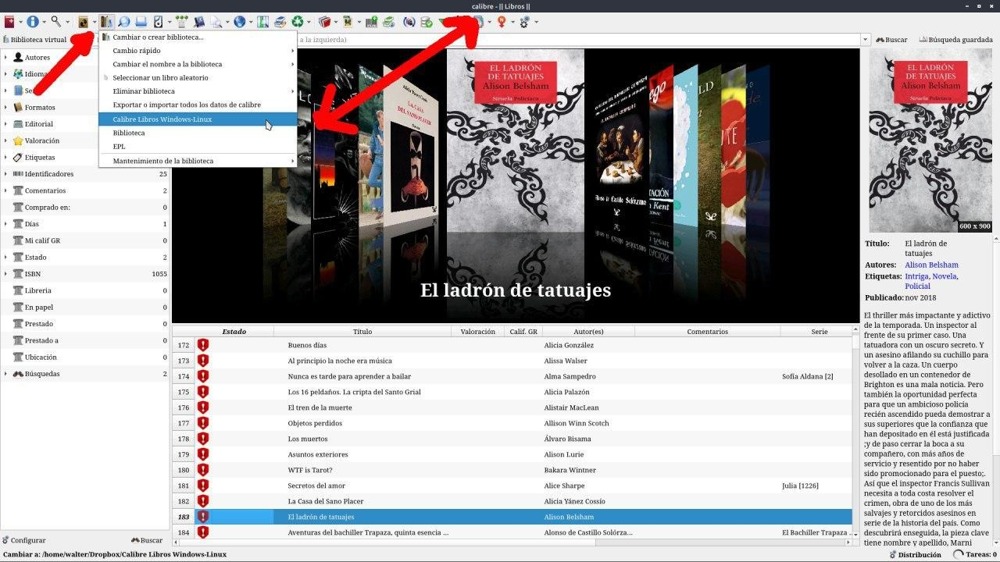

# Pasar libros a otra biblioteca

:material-account: [Walter](https://t.me/Dunhill69){ target=_blank } · :material-link-variant: [Ver el original en Telegraph](https://telegra.ph/Pasar-libros-a-otra-Biblioteca-09-07){ target=_blank }
{ .tut-datos }

---

Supongamos que tenemos dos o más bibliotecas gestionadas con Calibre, Una donde se van cargando los libros que después vamos completando todos sus detalles y la otra, nuestra biblioteca "oficial", llamemos la de alguna forma. ¿Como podría pasar un libro de una biblioteca a otra ?

Mi biblioteca donde pongo todos los libros se llama Libros, En el recuadro en rojo se ve el nombre de la biblioteca que estoy trabajando. Y quiero pasar el libro seleccionado a mi biblioteca oficial "Calibre Libros Windows-Linux"

Sobre el libro seleccionado apretamos botón izquierdo del mouse tocamos en Copiar a Biblioteca y tenemos dos opciones o solo copiar o copiar e eliminar.

Nos aparece este cartel de proceso de copia.

Vamos al icono de Bibliotecas de Calibre y cambiamos de una a la otra.

Y como ven el nombre de la Biblioteca cambio y ya tenemos el libro copiado y con todos los datos que le hayamos completado en la primer instancia.

Ir al mensaje: [https://t.me/calibreconfiguraciones/2426](https://t.me/calibreconfiguraciones/2426)

[https://telegra.ph/Pasar-libros-a-otra-Biblioteca-09-07](https://telegra.ph/Pasar-libros-a-otra-Biblioteca-09-07)

 

## [Volver al inicio](https://telegra.ph/Indice-Calibre-en-Espa%C3%B1ol-10-03)

 

 

---

[:material-arrow-left: Volver al índice](../../alfabetico.md) · [:fontawesome-brands-telegram: Preguntar en el grupo](https://t.me/calibreconfiguraciones){ target=_blank }
