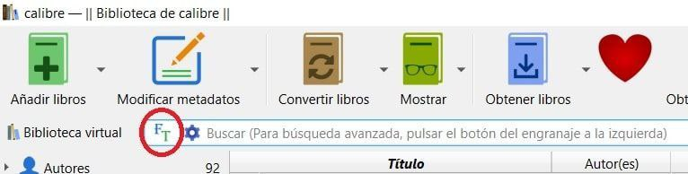
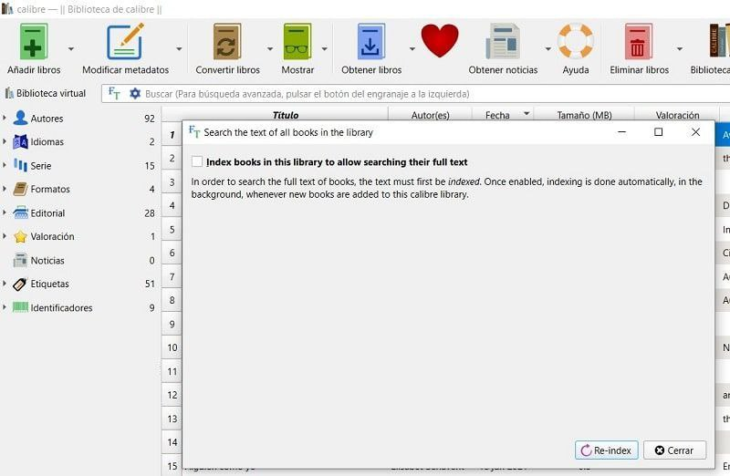
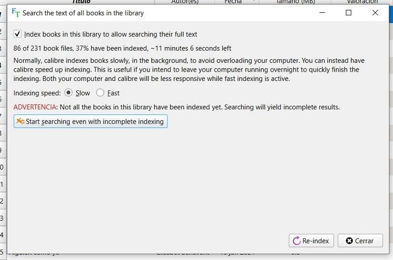
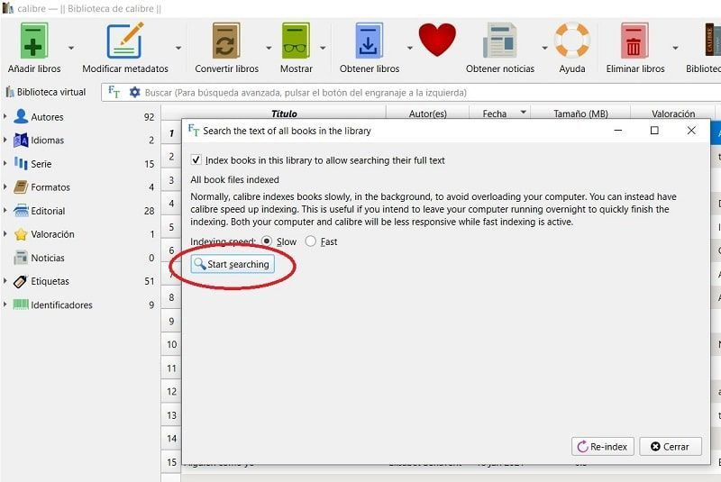
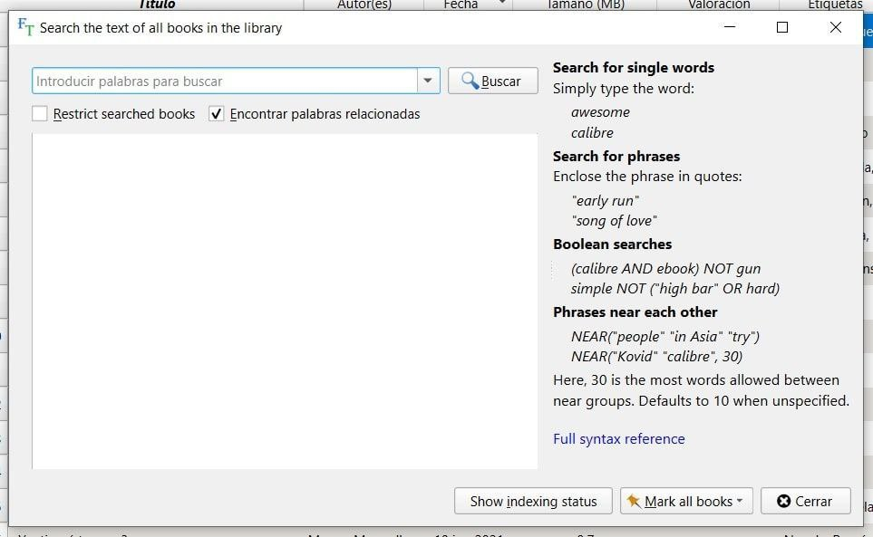

# Pasos para activar la búsqueda de texto completo

:material-account: [Walter Paterno](https://t.me/Dunhill69){ target=_blank } · :material-link-variant: [Ver el original en Telegraph](https://telegra.ph/Pasos-para-activar-la-b%C3%BAsqueda-a-texto-completo-en-Calibre-01-14){ target=_blank }
{ .tut-datos }

---

Paso 1. Actualiza a la versión 6.0 de Calibre y reinicia tu ordenador.

Paso 2. Abre Calibre y haz clic en el botón FT que aparece a la izquierda en la barra de búsqueda.

Paso 3. En la ventana flotante que aparece, activa la casilla Index books in this library to allow searching their full text.

Paso 4. Para no saturar el ordenador, selecciona la opción de indexar los libros lentamente (Slow) en segundo plano.

Paso 5. Haz clic en Re-index y espera a que todos tus libros se indexen. (Yo tengo 231 libros y ha tardado unos 15 minutos).

Paso 6. Tras hacer la indexación, ya podrás empezar a realizar tus búsquedas a texto completo entre tu colección de libros. Por cierto, cuando añadas nuevos libros a la biblioteca, se indexarán automáticamente en segundo plano.

Destacar que la búsqueda a texto completo permite encontrar rápidamente entre todos los libros que contienen, o una selección, una palabra o combinación de palabras. Incluso se pueden buscar palabras que aparezcan cerca de otras palabras, utilizar operadores booleanos y encontrar palabras relacionadas.

 

Ir al mensaje: [https://t.me/calibreconfiguraciones/112333/122251](https://t.me/calibreconfiguraciones/112333/122251)

## [Volver al inicio](https://telegra.ph/Indice-Calibre-en-Espa%C3%B1ol-10-03)

 

 

 

---

[:material-arrow-left: Volver al índice](../../alfabetico.md) · [:fontawesome-brands-telegram: Preguntar en el grupo](https://t.me/calibreconfiguraciones){ target=_blank }
