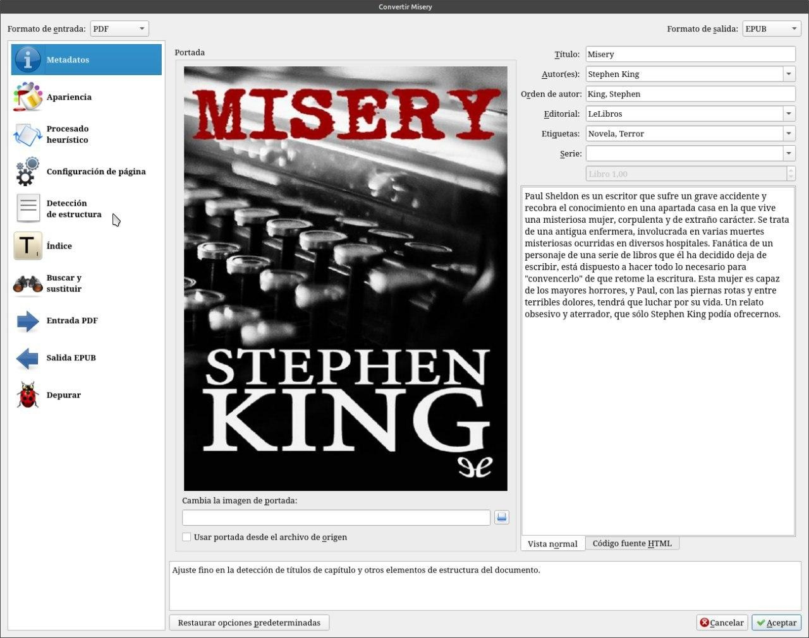
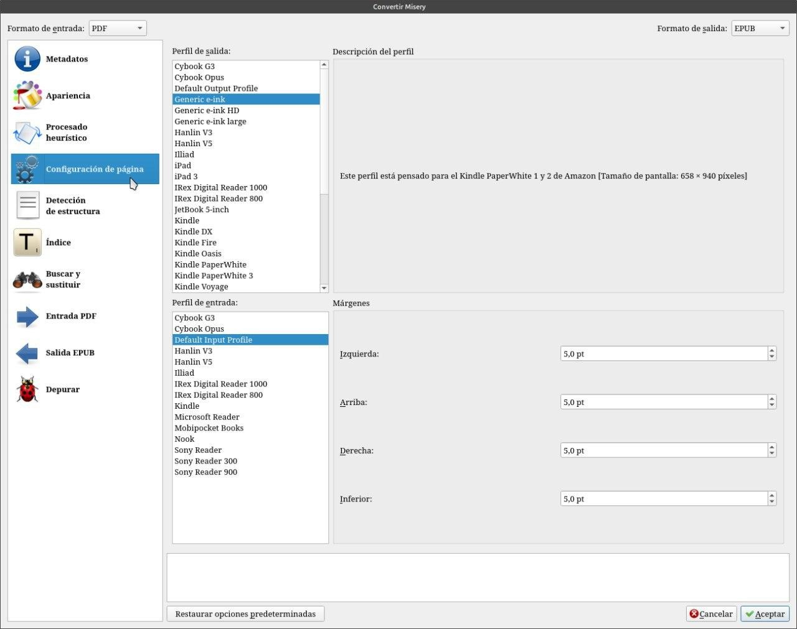

# PDF a EPUB - cuando queda mal maquetado

:material-account: [Walter](https://t.me/Dunhill69){ target=_blank } · :material-link-variant: [Ver el original en Telegraph](https://telegra.ph/Pdf-a-Epub---Cuando-queda-mal-maqueteado-09-07){ target=_blank }
{ .tut-datos }

---

A veces me comentan que cuando convierten un pdf a epub, con Calibre el libro se les ve mal en su lector. Mi respuesta es configuraste la conversión del libro de acuerdo a tu lector ??? Esto se hace tocando convertir libro. En la columna de la izquierda existen varias solapas a tener en cuenta para configuraciones finas.

En la solapa configuración de página Calibre nos estandariza la convención si elegimos el tipo de dispositivo de lectura.

Ir al mensaje: [https://t.me/calibreconfiguraciones/3082](https://t.me/calibreconfiguraciones/3082)

[https://telegra.ph/Pdf-a-Epub---Cuando-queda-mal-maqueteado-09-07](https://telegra.ph/Pdf-a-Epub---Cuando-queda-mal-maqueteado-09-07)

 

## [Volver al inicio](https://telegra.ph/Indice-Calibre-en-Espa%C3%B1ol-10-03)

 

 

---

[:material-arrow-left: Volver al índice](../../alfabetico.md) · [:fontawesome-brands-telegram: Preguntar en el grupo](https://t.me/calibreconfiguraciones){ target=_blank }
