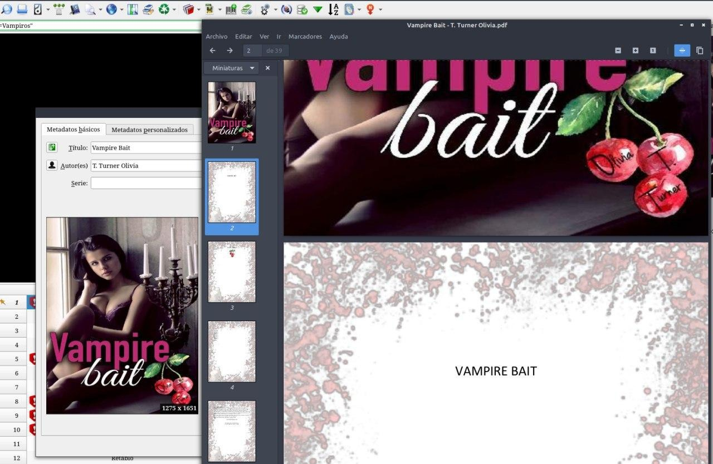
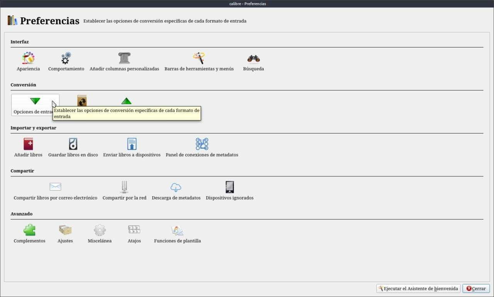
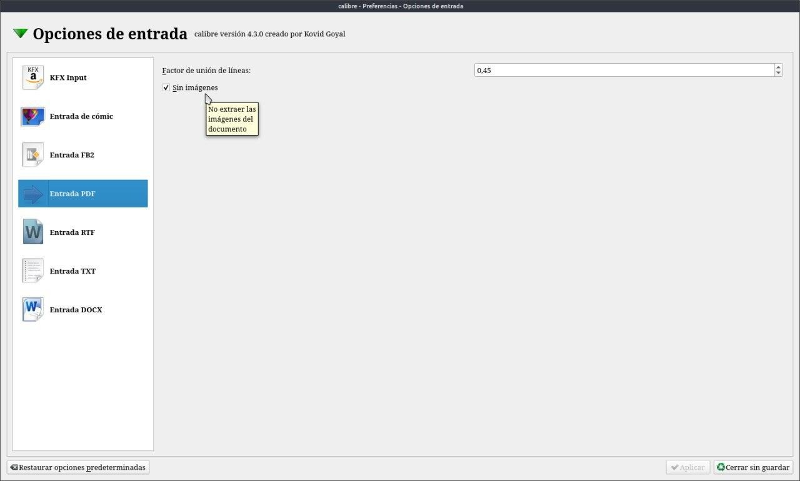
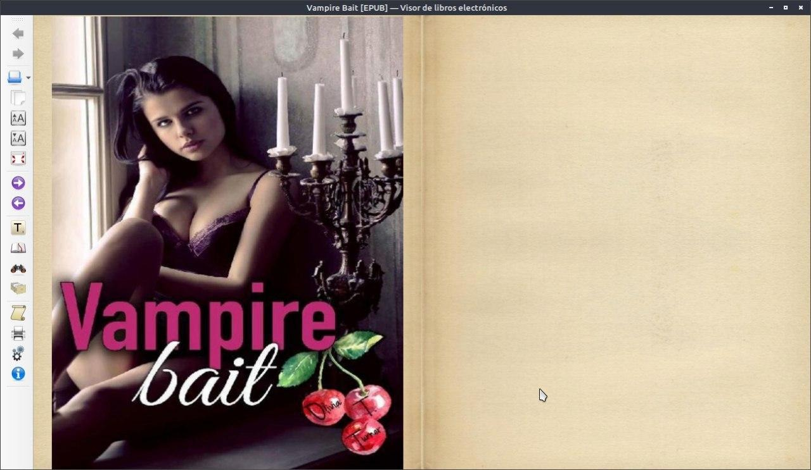

# PDF - sacar imágenes

:material-account: [Walter](https://t.me/Dunhill69){ target=_blank } · :material-link-variant: [Ver el original en Telegraph](https://telegra.ph/PDF---Sacar-im%C3%A1genes-09-07){ target=_blank }
{ .tut-datos }

---

Estaba agregando un pdf y trato de tener todos los libros en epub. Y veo al abrir el pdf que tiene imágenes entre hojas.

Me puse a pensar que quizás esto dificulte la conversión a epub, como podría hacer para que esas imágenes no aparezcan, ni tener que hacer el trabajo a mano.

Fui a preferencias opciones de entrada.

Para ver si podía configurar la entrada de PDF.

Y si, señores y señoras tilde la casilla que dice sin imágenes. Convertí el pdf a epub y acá el resultado.

ir al mensaje: [https://t.me/calibreconfiguraciones/4251](https://t.me/calibreconfiguraciones/4251)

[https://telegra.ph/PDF---Sacar-im%C3%A1genes-09-07](https://telegra.ph/PDF---Sacar-im%C3%A1genes-09-07)

 

## [Volver al inicio](https://telegra.ph/Indice-Calibre-en-Espa%C3%B1ol-10-03)

 

---

[:material-arrow-left: Volver al índice](../../alfabetico.md) · [:fontawesome-brands-telegram: Preguntar en el grupo](https://t.me/calibreconfiguraciones){ target=_blank }
