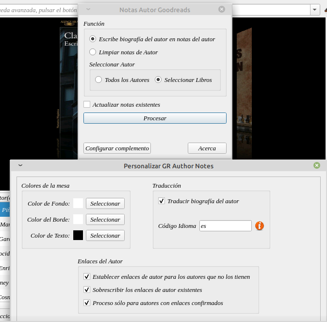
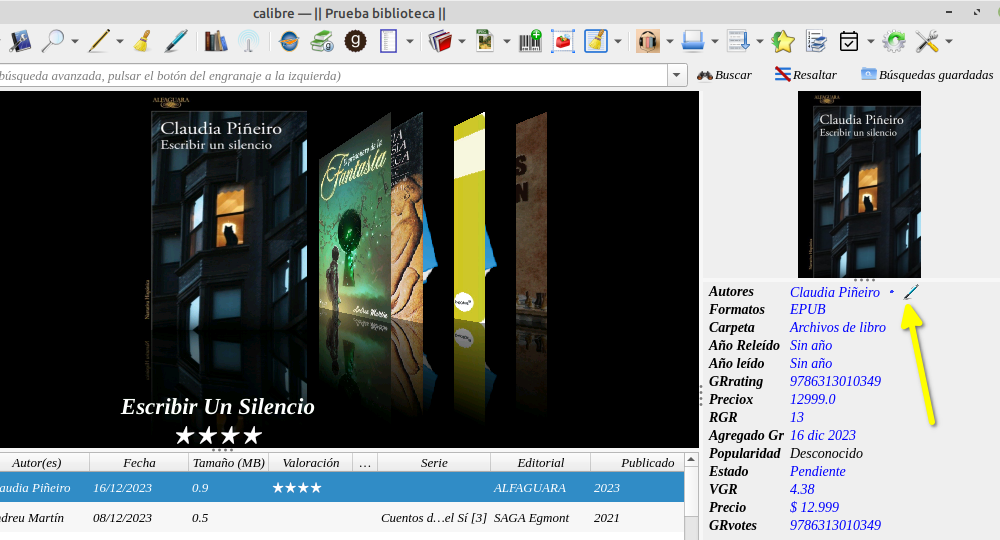
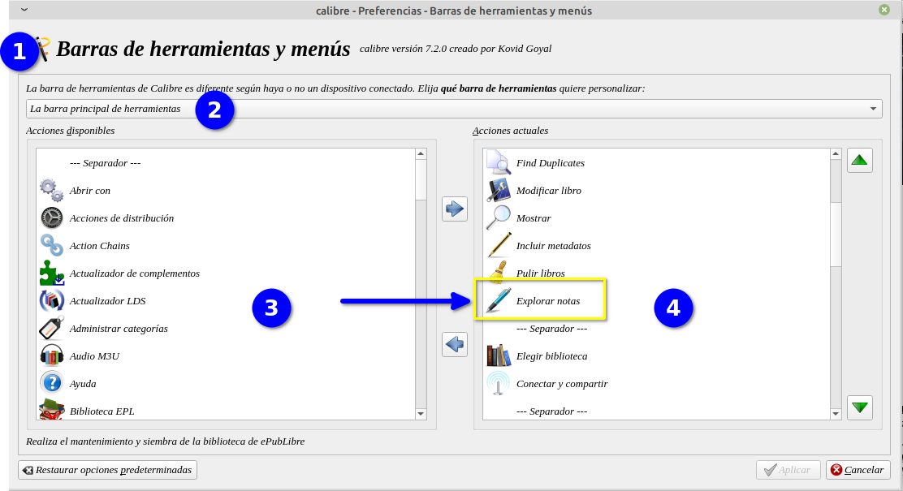
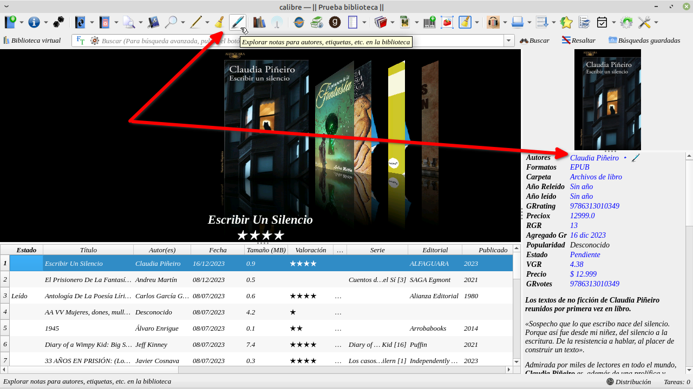
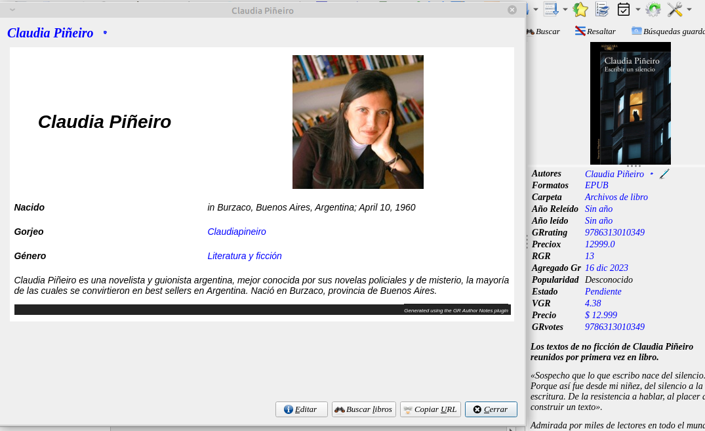

# Complemento - Biografías de autor desde Goodreads

:material-account: [Walter](https://t.me/Dunhill69){ target=_blank } · :material-link-variant: [Ver el original en Telegraph](https://telegra.ph/Plugin-Bibliograf%C3%ADa-del-autor-desde-goodreads-12-24){ target=_blank }
{ .tut-datos }

---

Este plugin funciona en Calibre 7 y lo que hace es obtener la biografía de un autor desde Goodreads.

Se le puede configurar color de fondo de la biografía como así también el color del borde y de la letra.

Se puede configurar para que traduzca la biografía a muestro idioma favorito poniendo la sigla del idioma en nuestro caso "es" sin las comillas.

 

Si el autor no tiene biografía en goodreads se la puede solicitar a un bibliotecario de Goodreads. (https://www.goodreads.com/group/show/220-goodreads-librarians-group) Y el plugin nos dirá que no pudo procesar esa info.

Los libros que tengan notas del autor, que ellas también se pueden agregar a series aparecerá un icono al lado del nombre del autor. Si tenemos más de un autor el plugin recoge las biografías de los diferentes autores con solo apretar un botón.

También podremos tener un icono en nuestra barra de herramienta que nos muestre las notas de Autor. Que se llama explorador de notas, que si no lo tenemos instalado entramos en preferencia/Barra de herramientas y menu. Lo buscamos en la columna izquierda y lo pasamos a la derecha, seleccionado y apretando la flecha hacia la derecha.

Y después de aplicar los cambios nos aparecerá en la barra de herramientas. Esto funciona si ustedes ya tienen sus propias notas de autor o de series independientemente del plugin de biografías.

Así se ve la biografía traducida. Bueno hasta tradujo Twitter jajjaja

Plugin: [https://t.me/calibreconfiguraciones/112333/153140](https://t.me/calibreconfiguraciones/112333/153140)

 

Ir al mensaje: [https://t.me/calibreconfiguraciones/112333/153140](https://t.me/calibreconfiguraciones/112333/153140)

## [Volver al inicio](https://telegra.ph/Indice-Calibre-en-Espa%C3%B1ol-10-03)

 

 

 

---

[:material-arrow-left: Volver al índice](../../alfabetico.md) · [:fontawesome-brands-telegram: Preguntar en el grupo](https://t.me/calibreconfiguraciones){ target=_blank }
