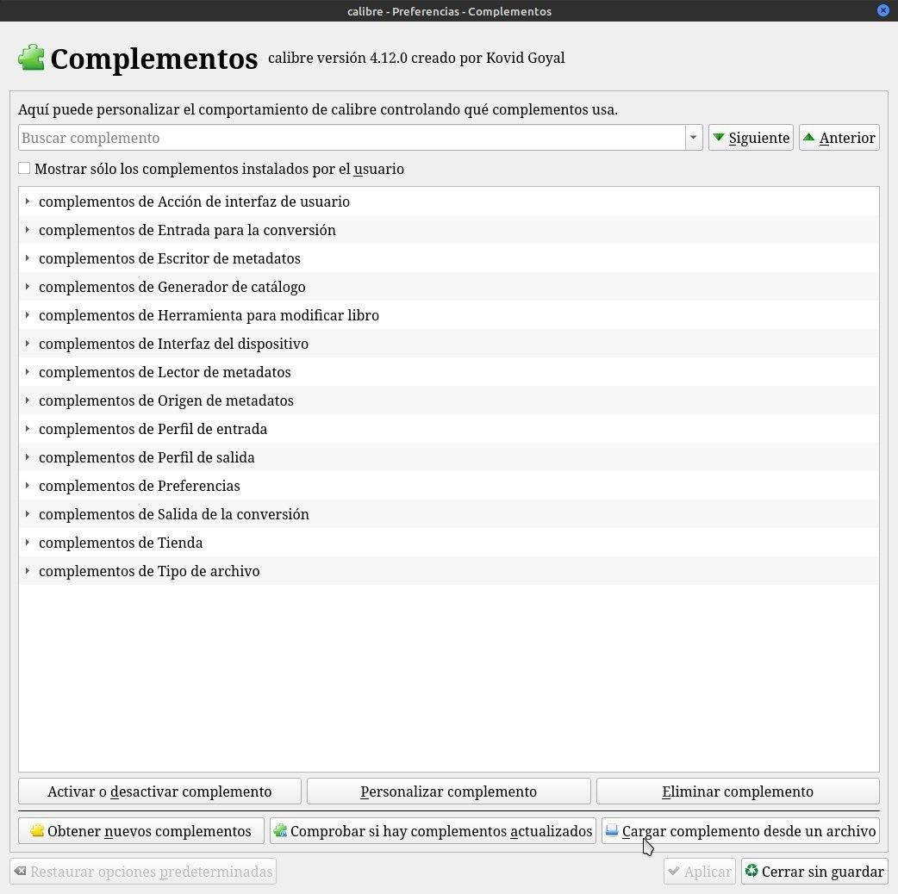
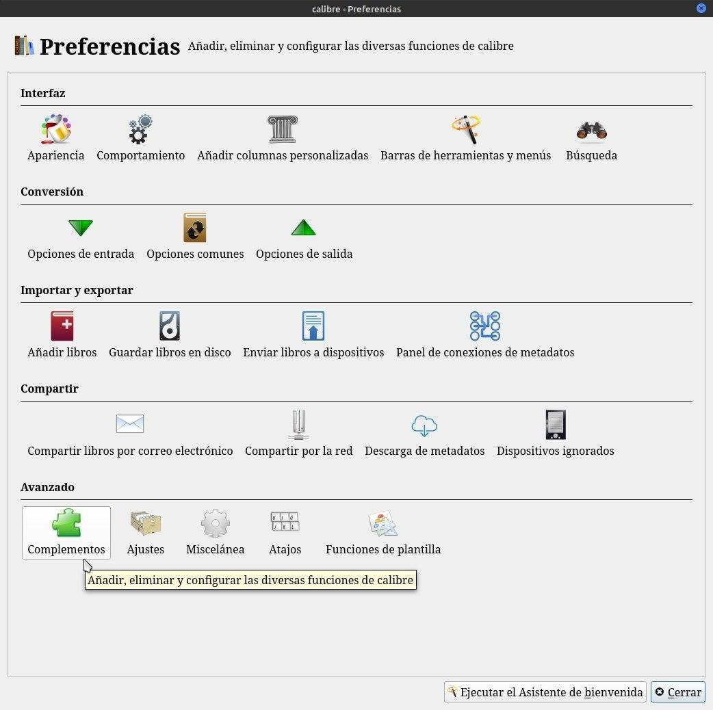
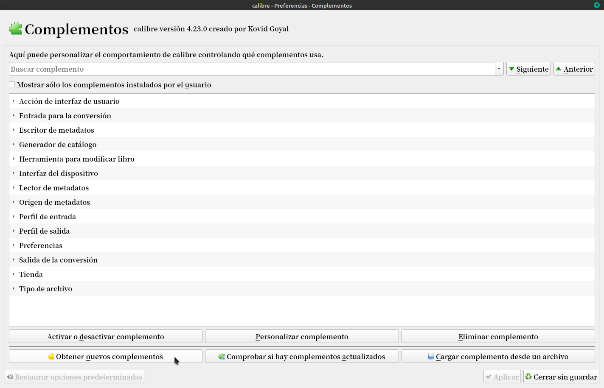
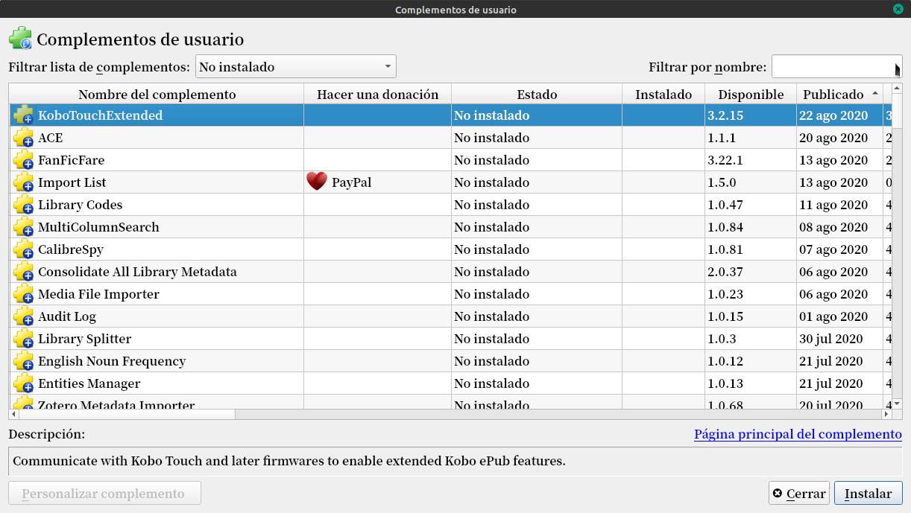

# Complementos - cómo se instalan

:material-account: [Walter](https://t.me/Dunhill69){ target=_blank } · :material-link-variant: [Ver el original en Telegraph](https://telegra.ph/Plugin---Como-se-instala-08-23){ target=_blank }
{ .tut-datos }

---

Como se instala un plugin:

Hay dos maneras de hacerlo

La manual:( por ejemplo para el drm)

Para instalar un plugin vamos a la página oficial de los plugin de Calibre https://plugins.calibre-ebook.com/ y lo descargamos en el escritorio.

Nos vamos a preferencias y complementos.

Y después cargar complemento desde un archivo, lo buscamos en el escritorio y le ponemos aceptar.

La otra es conociendo el nombre del complemento. Vamos a Preferencias /Complementos

Y tocamos en obtener nuevos complementos, se nos abre una pantalla donde o buscamos por lista o ponemos el nombre.

No se asusten con los logos de Paypal no se cobra nada por descargarlo ni usarlos solo indica que uno puede hacer donaciones.

 

 

## [Volver al inicio](https://telegra.ph/Indice-Calibre-en-Espa%C3%B1ol-10-03)

 

 

 

 

---

[:material-arrow-left: Volver al índice](../../alfabetico.md) · [:fontawesome-brands-telegram: Preguntar en el grupo](https://t.me/calibreconfiguraciones){ target=_blank }
