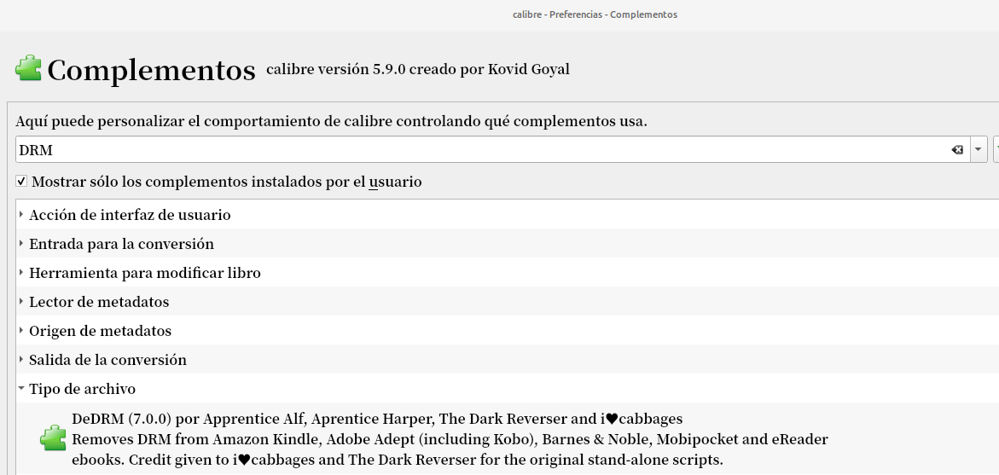
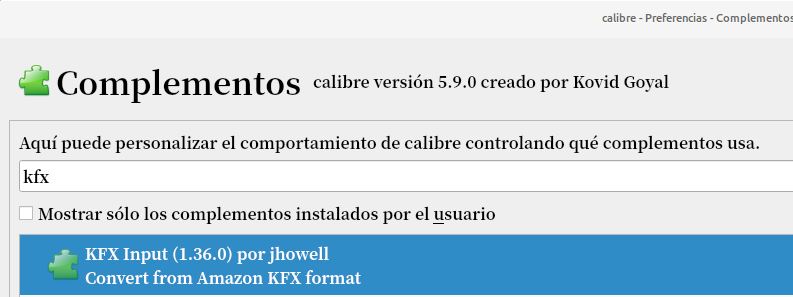
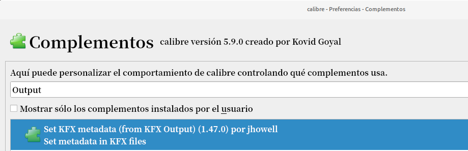
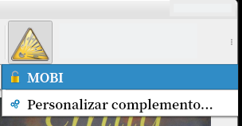
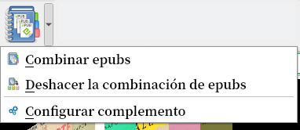
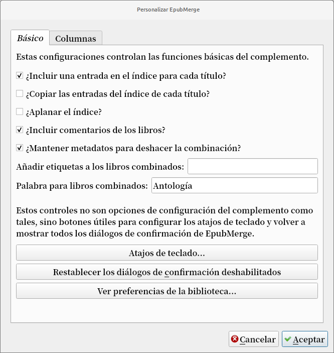
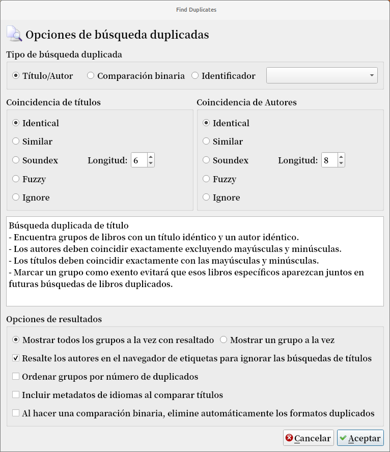
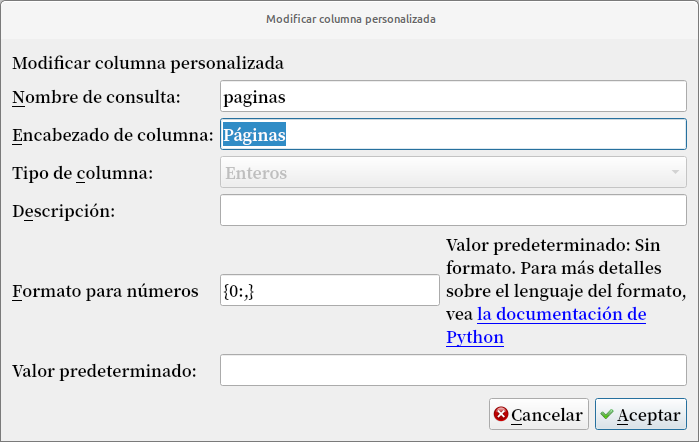
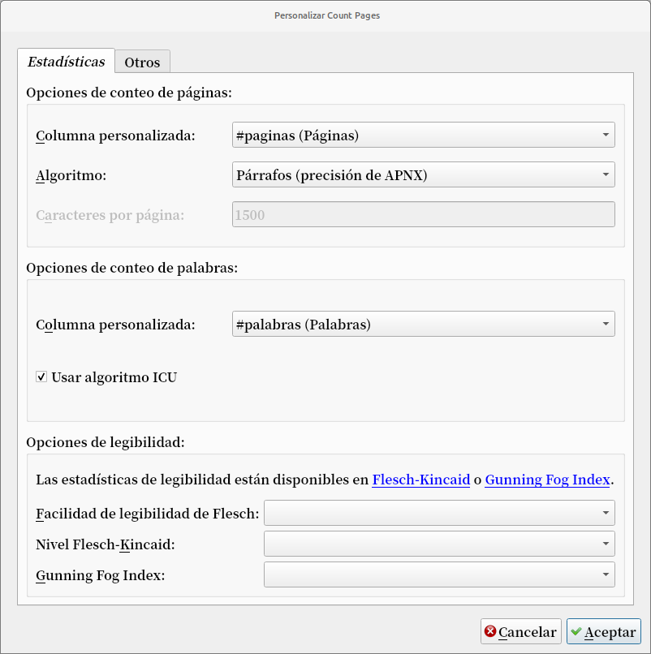

# Complementos - Introducción

:material-account: [Walter](https://t.me/Dunhill69){ target=_blank } · :material-link-variant: [Ver el original en Telegraph](https://telegra.ph/Plugin---Complementos-01-10){ target=_blank }
{ .tut-datos }

---

### [Complemento DeDRM](https://github.com/apprenticeharper/DeDRM_tools/releases)

Ideal para: Eliminar DRM de Kindle, Google Play, Kobo, libros electrónicos de Adobe, etc.

Autor: Apprentice Alf

Calibre: 5.x

DeDRM desarrollado por Apprentice Alf es la herramienta que usamos para eliminar DRM, es uno de los complementos de Calibre más descargados, puede eliminar DRM de la mayoría de los libros electrónicos populares, que incluyen:

1. EBooks Kindle
2. Los libros electrónicos vienen con Adobe DRM (libros electrónicos Kobo, libros de Google Play, libros que obtiene de la biblioteca en línea, libros electrónicos Overdrive).
3. Libros electrónicos antiguos de Mobipocket y eReader.

Nota: No puede utilizar este complemento para eliminar DRM de los libros electrónicos alquilados.

### [KFX Input plugin](https://www.mobileread.com/forums/showthread.php?t=291290)

Ideal para: Ingresar archivos KFX en Calibre.

Autor: jhowell

Calibre: 2.0.0

Descargas: 8648 descargas totales

Desde 2017 hasta ahora, Amazon usa el formato KFX para la mayoría de sus libros electrónicos. Calibre no puede abrir el archivo KFX directamente, incluso si no tiene DRM.

El complemento KFX Input recopilará todos los archivos individuales que componen un libro KFX y lo convertirá en un archivo zip con la extensión kfx-zip. Luego, puede importar fácilmente el archivo comprimido de Amazon KFX a Calibre. Si desea convertir el archivo KFX, debe utilizar este complemento junto con el complemento DeDRM para eliminar primero el DRM y convertir libros KFX a PDF, ePub, Mobi, AZW3, etc. El complemento admite varias variantes de KFX: Monolithic KFX, KFX -ZIP o KPF.

Recomendamos a los usuarios de libros electrónicos que descarguen y conserven este complemento en caso de que necesiten convertir los archivos KFX para sus lectores especiales de libros electrónicos.

### [KFX Conversion Output Plugin](https://www.mobileread.com/forums/showthread.php?t=272407)

Ideal para: Salida de libros electrónicos en formato KFX.

Autor: jhowell

A diferencia de otros formatos de libros electrónicos, KFX combina numerosas funciones, incluido el motor de composición tipográfica mejorado, fuentes, miniaturas de varias páginas, Page Flip, desplazamiento continuo, Vista guiada para cómics, etc. para algunos libros electrónicos, la conversión al formato kfx puede ser un día y una noche diferencia.

El complemento KFX Output permitirá a Calibre convertir y generar libros electrónicos en formato KFX que se pueden ver en aplicaciones y dispositivos Kindle. También puede utilizar este complemento para convertir los libros electrónicos que compra en otras fuentes para que se lean en Kindle con las funciones especiales de KFX.

En mi caso, mejoró enormemente mi experiencia de lectura con mis libros técnicos. la mayoría de estos libros tienen imágenes y descripciones a su alrededor, pero el diseño está un poco desordenado, las descripciones y las imágenes no coinciden, lo que lo hace inútil (especialmente para algunas imágenes de fórmulas matemáticas), pero después de cambiar el formato para kfx, el diseño se arregló un poco.

### [Kindle hi-res covers](https://www.mobileread.com/forums/showthread.php?t=286970)

Ideal para: Descarga imágenes de portada de alta resolución para cualquier libro electrónico de Amazon Kindle, bueno para mantener la exhibición del uniforme de la biblioteca de kindle.

Autor: Leonardo Brondani Schenkel

Para encontrar una buena portada para libros y hacer que se vea hermosamente en el carrusel de la pantalla de inicio de Kindle Fire, siempre dedico mucho tiempo a encontrar una imagen de portada de alta resolución sin marca de agua. luego, un día, descubrí el complemento de cubiertas de alta resolución para Kindle en mobileread.

Este complemento puede ayudar a descargar imágenes de portada de alta resolución de Amazon, y la resolución es mucho más alta de lo que normalmente vemos en la web. Tenga en cuenta que solo se admiten los libros electrónicos Kindle.

Lo que este complemento falla es que a menudo descarga imágenes de portada de otros idiomas y no hay forma de configurar y refinar la búsqueda solo en una determinada tienda de Amazon.

### [KindleUnpack](https://www.mobileread.com/forums/showthread.php?t=171529)

 

Ideal para: Desempaqueta un libro Kindle / MOBI en sus componentes de origen.

Autor: DiapDealer

Si desea convertir libros electrónicos Mobi, puede usar KindleUnpack para descomprimir contenido de archivos fuente MOBI o AZW sin DRM sin una conversión completa, lo cual es mucho menos trabajo que convertir.

Con este complemento también puede descomprimir libros electrónicos KF8 sin DRM en ePub. O extraiga archivos PDF de archivos de libros electrónicos AZW4 sin DRM.

Aunque después de desempaquetar, deberá validar manualmente el código porque contendrá algunos errores. y es posible que los nombres de archivo no sean los mismos que los del original.

Nota: este programa no funciona con archivos protegidos con DRM.

Cómo utilizar el complemento KindleUnpack

1. Descargue la última versión del complemento KindleUnpack y descomprímalo.
2. Seleccione sus archivos de libros electrónicos de la lista de libros y \>\> KF8 a EPUB.

Pulse el botón "Inicio" - comenzará el desembalaje. cuando termine la separación, encontrará el formato EPUB o PDF en el registro de su libro.

### [EpubMerge](https://www.mobileread.com/forums/showthread.php?t=169744)

Ideal para: Complemento de interfaz de usuario para concatenar múltiples epubs en uno.

Autor: Jim Miller

Si desea fusionar libros electrónicos con Calibre, puede usar el complemento EpubMerge. te permite combinar un número ilimitado de libros electrónicos y te permite configurar los metadatos para tu nuevo libro todo en uno.

Este complemento tiene muchos casos de uso. Por ejemplo, puede combinar varias series de libros electrónicos en un solo archivo. Cree una gran copia maestra de los muchos trabajos publicados individualmente de un autor. O puede combinar notas de estudio y colecciones de poesía en un mega volumen.

Cómo utilizar el complemento EpubMerge

1. Descargue e instale el complemento EpubMerge.

2. Reinicie Calibre.

3. Haga clic con el botón derecho en \>\> EpubMerge - Configurar complemento.

Le recomendamos que mantenga la configuración predeterminada. O puede hacer los cambios que desee.

Para fusionar libros electrónicos, resalte todos los archivos ePub que desea fusionar y, en la barra de menú, seleccione EpubMerge -\> Fusionar Epubs.

Nota: De forma predeterminada, los ePubs se ordenan de la forma en que se muestran en Calibre. Para cambiar el orden, puede hacer clic en las flechas verdes. Si desea excluir un libro electrónico de la fila, solo debe eliminarlo con la X roja.

Haga clic en Aceptar, aparecerá una ventana que le pedirá que apruebe los metadatos, puede realizar las modificaciones que desee aquí.

Después de la aprobación, comenzará el proceso de fusión del libro electrónico.

Después de la fusión, tendrá un nuevo libro electrónico en Calibre.

### [EpubSplit](https://www.mobileread.com/forums/showthread.php?t=178799)

Ideal para: Complemento de interfaz de usuario para dividir partes de un epub en un nuevo libro.

Autor: Jim Miller

EpubSplit, por otro lado, proporciona la funcionalidad opuesta. lo que le permite dividir un libro electrónico grande en varios libros nuevos, lo ayuda a cargar libros electrónicos de gran tamaño más rápido y hace que el libro electrónico de formato largo sea menos desalentador de leer.

El complemento funciona permitiendo a los usuarios configurar líneas divididas en el archivo EPUB. A continuación, puede obtener una vista previa de cada parte por separado y establecer metadatos para cada nuevo archivo de libro electrónico.

Los casos de uso para este complemento pueden ser: Obtiene libros electrónicos de autores que venden un paquete de sus series en un solo archivo y desean dividirlos en archivos separados. Solo desea extraer y leer algunas partes de un libro. O bien, tiene un archivo de libro electrónico grande, que se carga muy lento en el lector de libros electrónicos.

Cómo utilizar el complemento EpubSplit:

1. Descargue e instale la última versión del complemento EpubSplit.

2. Reinicie Calibre

3. Haga clic derecho en el libro electrónico que desea dividir y seleccione EpubSplit.

4. Luego, seleccione la sección para dividir por resaltar las entradas y haga clic en Nuevo libro.

5. A continuación, aparecerá una ventana que le pedirá que apruebe los metadatos.

6. Haga clic en Aceptar y comenzará el proceso de división.

### [Find Duplicates](https://www.mobileread.com/forums/showthread.php?t=131017)

Ideal para: Buscar posibles libros duplicados según sus metadatos

Autor: Grant Drake

Organizar sus libros electrónicos y hacer que se dupliquen es uno de los problemas típicos cuando nuestra colección de libros electrónicos crece.

Find Duplicates es un complemento de Calibre que sanará toda su biblioteca de libros electrónicos y encontrará entradas duplicadas en su colección. Puede configurar la fusión de libros electrónicos o informes duplicados al agregar nuevos duplicados a una colección.

Ofrece varias opciones para escanear libros electrónicos duplicados que tienen los mismos autores, series, títulos, editores, ISBN, formatos, etiquetas, etc. Aunque eliminarlos requiere algo de tiempo, se vuelve mucho más fácil una vez que los ha resuelto.

Cómo usar el complemento Buscar duplicados:

1. En calibre, haga clic en Preferencias \>\> Complementos.

2. En la siguiente ventana, haga clic en el botón "Obtener nuevos complementos". localice el complemento Find Duplicates y haga clic en instalar.

3. Reinicie calibre.

4. En la barra de herramientas, haga clic en Buscar duplicados.

5. Configure la forma en que desea que busque duplicados y haga clic en Aceptar.

6. Después de escanear, le dará una lista de libros electrónicos duplicados. Haga clic en copias del libro (asegúrese de dejar una sin marcar para no eliminar el archivo original del libro electrónico) y luego haga clic en Eliminar libros.

También puede buscar entre dos bibliotecas.

### [Count Pages](https://www.mobileread.com/forums/showthread.php?t=134000)

Ideal para: Contar el número de páginas / palabras en un ePub / Mobi para almacenar en columnas personalizadas

Autor: Grant Drake con adiciones de David Forrester

Count Pages es uno de los complementos más utilizados, estima el número de páginas de un libro determinado y te dice cuántas palabras hay en el archivo. los resultados se mostrarán en columnas personalizadas. Este complemento ahora funciona solo para archivos Mobi y EPUB, o formato que sea convertible a ePub para que funcione.

Para los usuarios de Kindle, tiene una función de generación de archivos APNX que utiliza el valor de una columna personalizada de páginas, por lo que puede mostrarle los números de página al enviar un libro electrónico a Kindle desde Calibre.

Siempre me ha gustado organizar los libros electrónicos según la longitud de la historia, así que utilizo este complemento con bastante frecuencia. es bastante exacto. Lo he trabajado para contar páginas en una historia de ficción de fans y también generar el recuento completo de palabras. Esto realmente ayuda a estimar la longitud de un libro sin tener que abrirlo y desplazarse para ver cuánto tiempo tiene.

Cómo utilizar el complemento Count Pages:

En Calibre, vaya a \>\> Preferencias \>\> Extensiones \>\> Obtenga una nueva extensión y busque el complemento Count Pages y luego instálelo.

Agregue una columna personalizada con Preferencias-\> Agregar sus propias columnas.

Aparecerá una ventana que le pedirá que configure las columnas.

Luego, seleccione todos los libros electrónicos en los que desea contar las páginas y haga clic en Contar páginas en el menú.

Toma un tiempo contar las páginas y palabras, luego del proceso, la columna se actualizará.

### [Reading List](https://www.mobileread.com/forums/showthread.php?t=134856)

Ideal para: Definir listas de libros que se pueden ordenar y sincronizar con dispositivos / carpetas. Para los lectores basados ​​en tareas, este es un complemento muy útil.

Autor: Grant Drake

Poner el libro electrónico en un orden de lectura específico es una solicitud común. Reading List es el complemento para calibre que permite establecer una lista de libros en un orden de configuración.

Puede tener varias listas y configurarlas para enviarlas a su dispositivo cuando esté conectado a su computadora. También puede hacer que aplique automáticamente etiquetas o rellene una columna personalizada en una lista, y elimine etiquetas cuando elimine libros de la lista.

Cómo utilizar el complemento Lista de lectura:

1. Descargue el complemento. Vaya a Preferencias \>\> Obtener complementos \>\> Lista de lectura

2. Reinicie Calibre

3. En el menú superior, haga clic en Lista de lectura

4. A continuación, puede Agregar un libro electrónico a una lista.

### [Annotations](https://www.mobileread.com/forums/showthread.php?t=241206)

Ideal para: Importar anotaciones

Autor: David Forrester

¿Necesita llevar las anotaciones que hizo en Kindle o Kobo a Calibre? Annotations es un complemento de Calibre muy interesante que te permite sincronizar y ver cualquier nota, resaltado y otras anotaciones que hagas en tu Kindle o ereader Kobo en tu biblioteca de Calibre.

Lectores y aplicaciones de libros electrónicos compatibles con anotaciones:

\* Kindle: anotaciones obtenidas del archivo "My Clippings.txt".

\* Ereaders de Kobo: anotaciones obtenidas de la base de datos.

\* ereaders tolino: anotaciones obtenidas del archivo notes.txt.

\* Buen lector

Cómo utilizar el complemento de anotaciones:

1. Siga los mismos pasos anteriores para descargar e instalar el complemento Annotations.

2. Reinicie Calibre.

3. Busque el complemento Anotaciones en la barra de herramientas principal.

4. Elija importar anotaciones desde el ereader que tiene.

[Embed Comic Metadata:](https://www.mobileread.com/forums/showthread.php?t=264710)

Un complemento de Calibre que ayuda a administrar los metadatos de cómics en Calibre. puede usarlo para incrustar metadatos de Calibre en archivos de cómics o importar metadatos de archivos de cómics a calibre.

[Quality Check:](https://www.mobileread.com/forums/showthread.php?t=125428)

Quality Check es un complemento que lo ayuda a identificar ePubs que necesitan ser modificados y permite buscar cualquier cosa en cualquier epub. Será útil si necesita encontrar una palabra, frase, carácter, etc. en el archivo epub.

[Extract ISBN:](https://www.mobileread.com/forums/showthread.php?t=126727)

Extraer ISBN es un complemento que ayuda a encontrar el ISBN de un libro electrónico. Es muy útil cuando los libros electrónicos no tienen ISBN asociado en los metadatos. Si obtenemos el ISBN de un libro electrónico, mejorará enormemente las posibilidades de encontrar la portada y los metadatos correctos.

[Wiki Reader:](https://www.mobileread.com/forums/showthread.php?t=183333)

Wiki Reader es el complemento que puede convertir cualquier artículo de Wikipedia en un libro electrónico. Solo necesita copiar y pegar las URL de cada artículo de Wikipedia, aunque solo puede agregar uno a la vez. Esto proporciona una solución rápida cuando queremos aprender algo sobre un tema determinado.

[Modify ePub:](https://www.mobileread.com/forums/showthread.php?t=154371)

Modify ePub es el complemento que ayuda a realizar cambios y actualizaciones en un ePub sin convertir el archivo. Por ejemplo, puede reescribir el CSS, cambiar el margen del archivo, dividir la parte que no necesita, cambiar la estructura del directorio, etc.

[Goodreads:](https://www.mobileread.com/forums/showthread.php?t=130638)

Este complemento permitirá a Calibre leer información sobre libros de goodreads.com, descargar metadatos y portadas de Goodreads. Agregar este complemento puede mejorar la calidad de la información que puede recopilar para los libros electrónicos.

 

 

## [Volver al inicio](https://telegra.ph/Indice-Calibre-en-Espa%C3%B1ol-10-03)

 

 

 

 

---

[:material-arrow-left: Volver al índice](../../alfabetico.md) · [:fontawesome-brands-telegram: Preguntar en el grupo](https://t.me/calibreconfiguraciones){ target=_blank }
