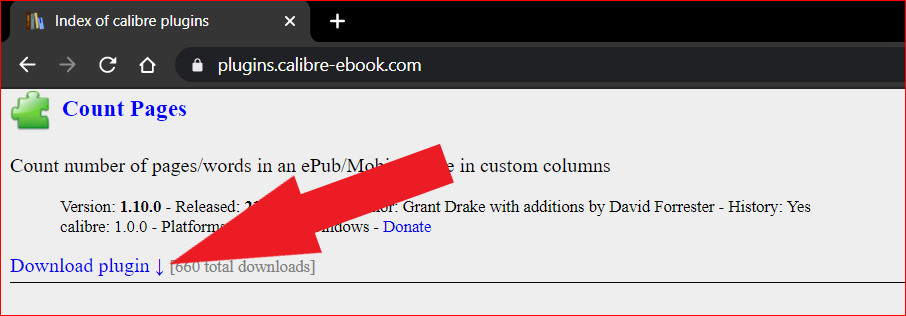
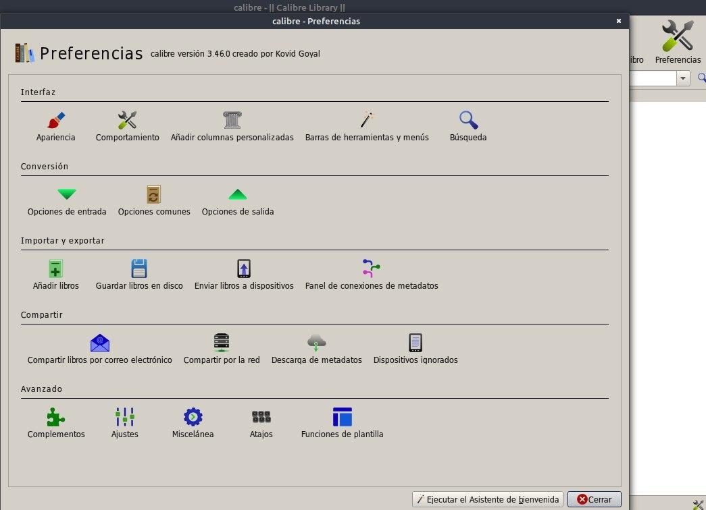
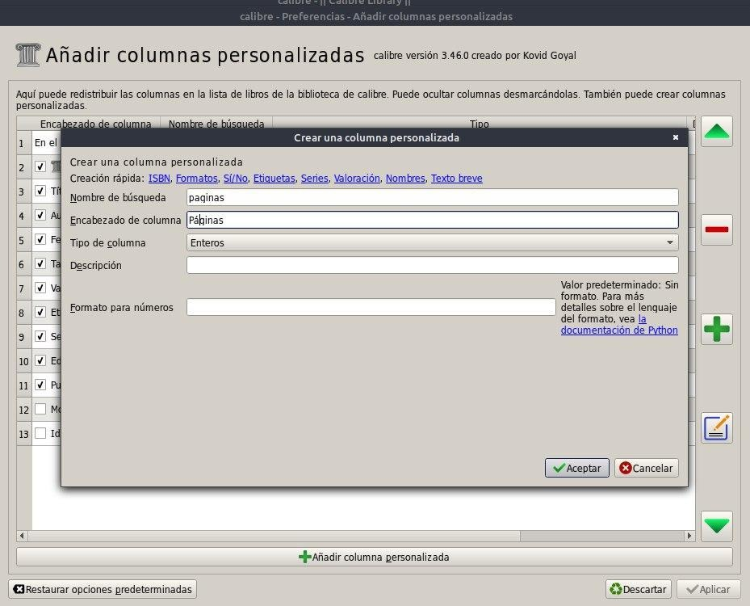
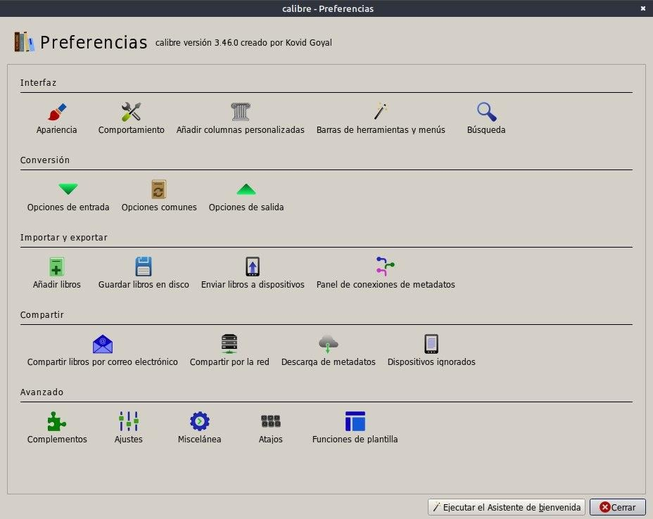
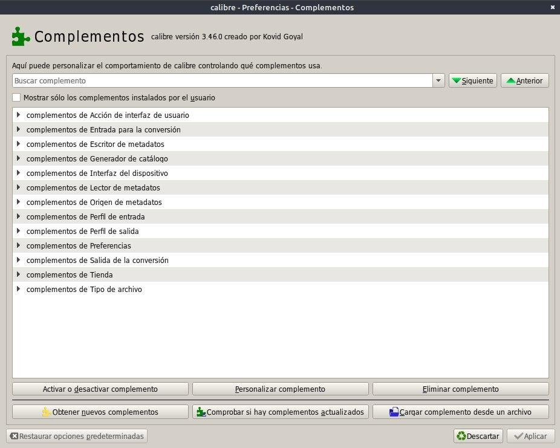
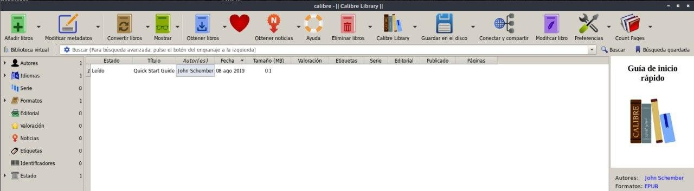
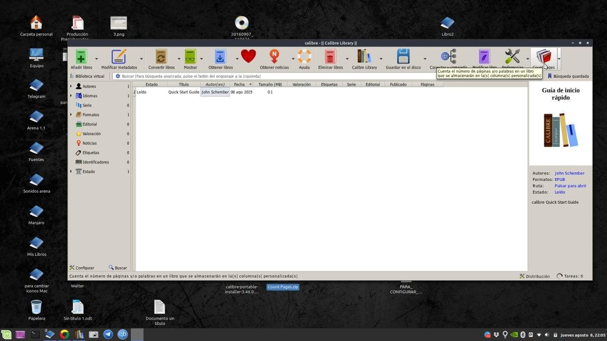
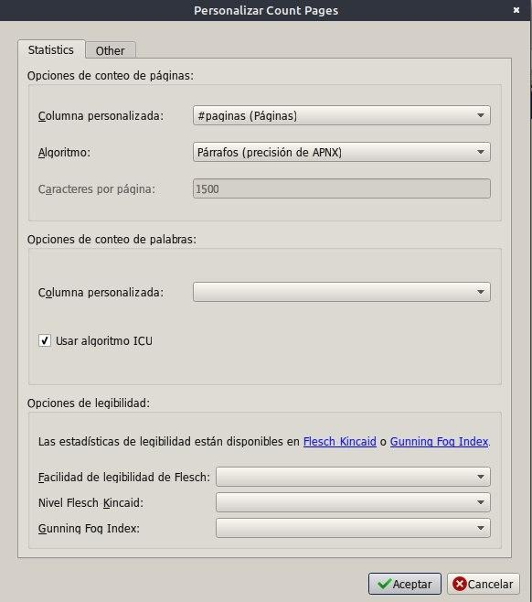

# Complemento - Count Pages

:material-account: [Walter](https://t.me/Dunhill69){ target=_blank } · :material-link-variant: [Ver el original en Telegraph](https://telegra.ph/Plugin---Count-Pages-09-07){ target=_blank }
{ .tut-datos }

---

Buenas noches hoy vamos a instalar un plugin para que nos cuente las páginas del libro

El plugin lo descargamos de la pagina oficial de los plugin para Calibre y se llama Count Pages.

Siguiendo los pasos anteriores explicados para hacer columnas personalizadas creamos una para que ahí se alojen los resultados.

Entrando en preferencias/Añadir columnas personalizadas

El nombre será paginas (en minúsculas)

Encabezado Páginas

Y tipo Enteros (números)

Tocamos Aceptar y Aplicar, Se reinicia Calibre.

Ahora vamos a Preferencias/ Complementos

Vamos a Cargar complemento desde un archivo y buscamos donde descargamos el archivo Count Pages que viene en formato zip (No hay que descomprimirlo)

También lo podríamos buscar tocando la opción Obtener nuevos complementos y buscamos por el nombre Count Pages.

Nos aparece unos cartelitos que nos preguntan si los queremos instalar, damos en si y en aplicar.

Reiniciamos Calibre y ya lo tenemos en la barra de Herramienta.

Tocamos en el icono para configurarlo y nos va a pedir que le digamos en que columna queremos los datos, Elegimos Paginas ( la que creamos)

Tocamos en el icono de Count Pages y veremos que el cartelito de tareas se mueve y sale un cartel tocamos en si y ya nos contó las paginas.

 

ir al mensaje: [https://t.me/calibreconfiguraciones/107](https://t.me/calibreconfiguraciones/107)

[https://telegra.ph/Plugin---Count-Pages-09-07](https://telegra.ph/Plugin---Count-Pages-09-07)

 

## [Volver al inicio](https://telegra.ph/Indice-Calibre-en-Espa%C3%B1ol-10-03)

 

---

[:material-arrow-left: Volver al índice](../../alfabetico.md) · [:fontawesome-brands-telegram: Preguntar en el grupo](https://t.me/calibreconfiguraciones){ target=_blank }
