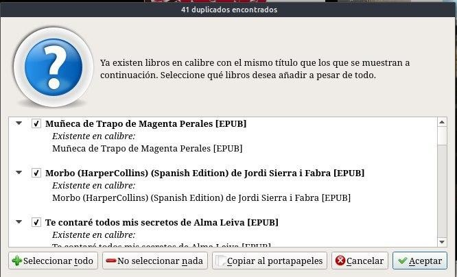
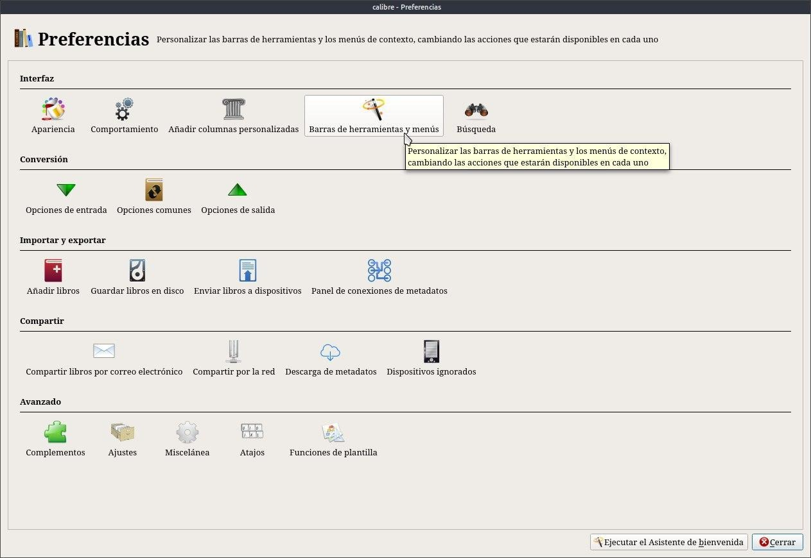
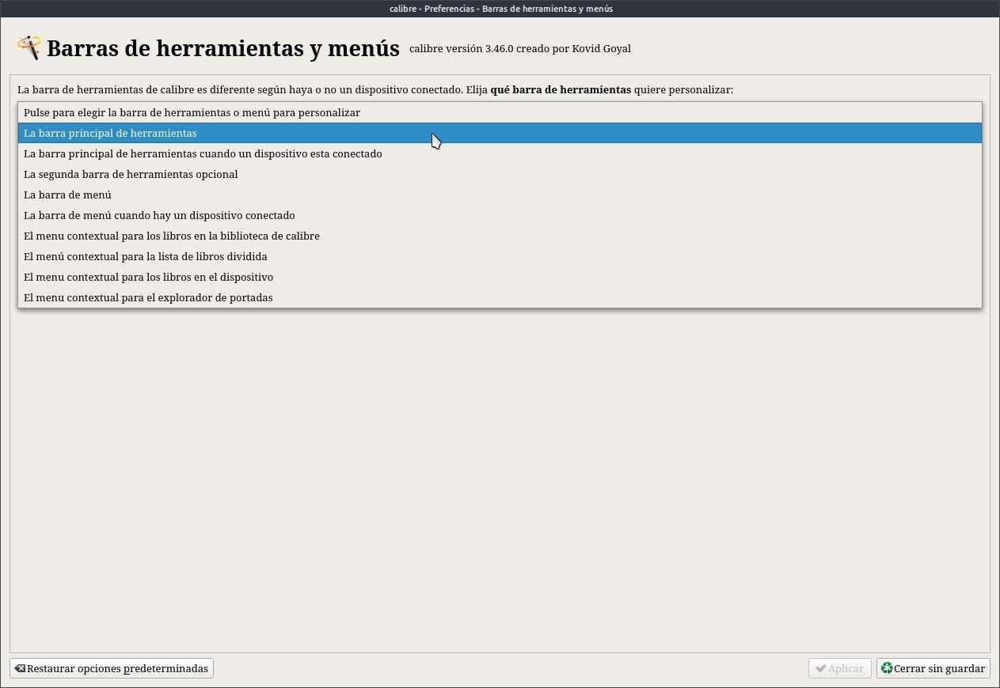
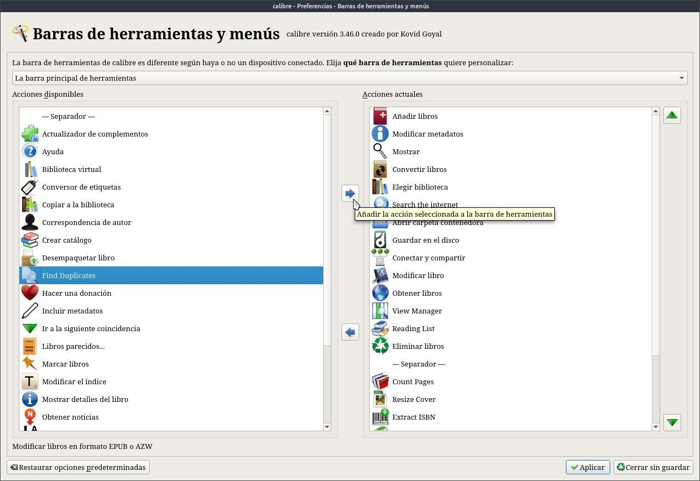
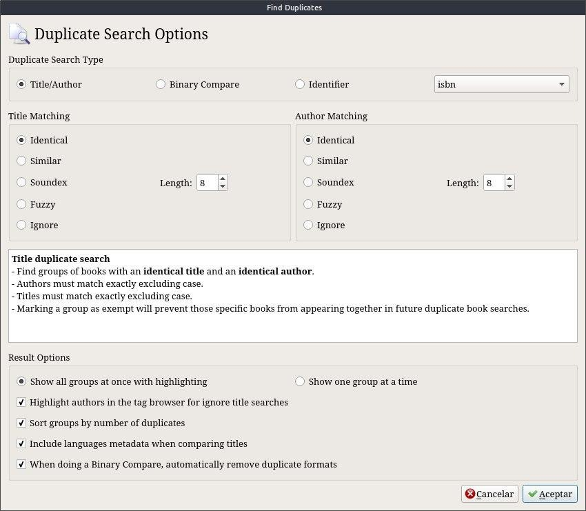
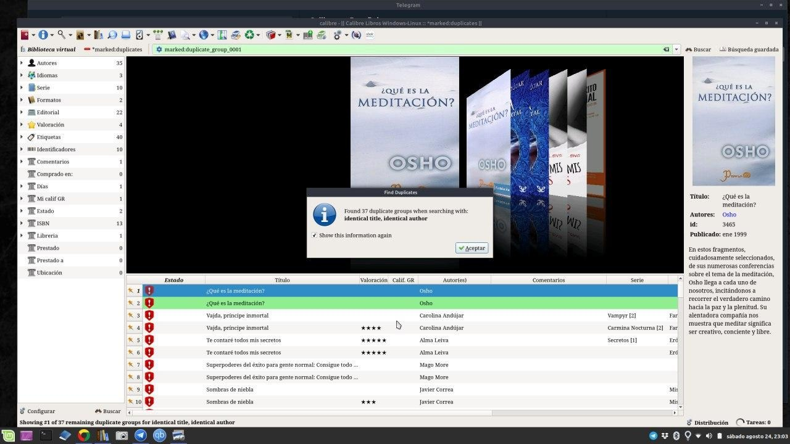

# Complemento - Find Duplicates

:material-account: [Walter](https://t.me/Dunhill69){ target=_blank } · :material-link-variant: [Ver el original en Telegraph](https://telegra.ph/Plugin---Find-Duplicates-09-18){ target=_blank }
{ .tut-datos }

---

Una vez que nuestra biblioteca va creciendo y en la ansiedad de seguir juntando libros, como sabemos si no tenemos el libro repetido??? Si bien Calibre nos informa si hay un duplicado, aveces puede pasar que el archivo del libro este escrito de diferente manera al que tenemos, Y para eso...

Existe el plugin Find Duplicates : [https://plugins.calibre-ebook.com/131017.zip](https://plugins.calibre-ebook.com/131017.zip)

Debemos ir a Preferencias / barra de herramientas y menú.

Pulsamos barra de herramientas principal

A la izquierda esta el plugin, lo tenemos que pasar a la derecha con la flechita azul y tocar aplicar, reiniciamos Calibre.

Tocamos el icono en la barra de herramientas y tenemos varias opciones de búsqueda, sugiero probarlas a todas para verificar mejor.

El plugin nos devuelve el resultado de los libros duplicados de esta forma.

Lo que resta es borrar el libro Duplicado

ir al mensaje: [https://t.me/calibreconfiguraciones/635](https://t.me/calibreconfiguraciones/635)

 

## [Volver al inicio](https://telegra.ph/Indice-Calibre-en-Espa%C3%B1ol-10-03)

 

---

[:material-arrow-left: Volver al índice](../../alfabetico.md) · [:fontawesome-brands-telegram: Preguntar en el grupo](https://t.me/calibreconfiguraciones){ target=_blank }
