# Complemento - Goodreads: cantidad de valoraciones y popularidad (método actualizado)

:material-account: [Walter](https://t.me/Dunhill69){ target=_blank } · :material-link-variant: [Ver el original en Telegraph](https://telegra.ph/Plugin-goodreads-cuenta-rating-popularidad-del-libro-08-09){ target=_blank }
{ .tut-datos }

---

Les explico la idea que tuve con este complemento, existe un complemento que trae el valor decimal de la calificaciones pero yo queria el conteo del rantig que se ve acá.

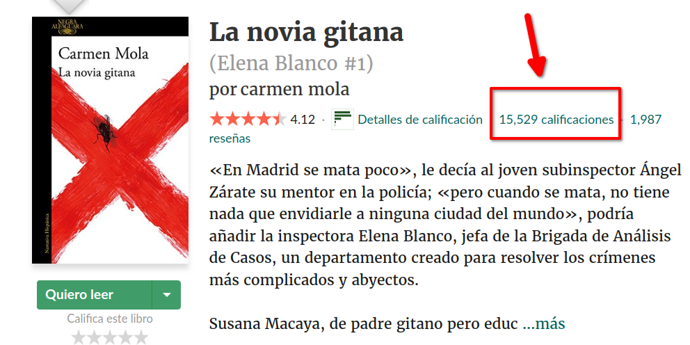

Con este conteo puedo determinar la popularidad de un libro.

Entonces me puse en contacto con wiso y con jonas y despues de tanto pelear con el complemento hemos dado con el resultado.

Para usarlo vamos a seguir estos pasos.

Son dos complementos los que hay que instalar uno que recoje los metadatos de goodreads y pone en el campo editorial el valor de las estrellas en numeros y el de las calificaciones de los usuarios y el otro pasa esos dos valores a dos columnas personales de debemos crear. En realidad serian tres columnas la última nos dirá el grado de popularidad que tiene el libro.

Entonces empecemos creando las columnas de esta manera:

Preferencia/Añadir columna personalizada

Le damos en el + verde para crear una y le ponemos estos datos como esta en la imagen

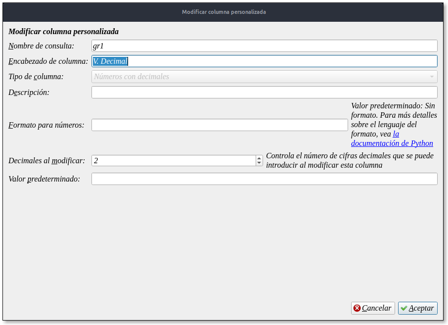

En ella ira el resultado del numero del valor de las estrellas, pero en números decimales. Ponemos aceptar y ya tenemos el primer campo.

Para el valor de las calificaciones de los usuarios creamos otra columna como se ve en la imagen

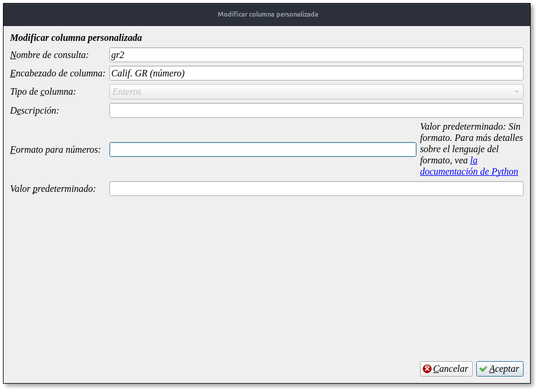

Pueden cambiar el nombre que ustedes deseen del segundo renglón pero no el del primero ya que ese es el que va a leer el complemento para completar los datos.

Y la última columna seria así:

Es una columna que depende de otras columnas eso debe decir el tercer campo

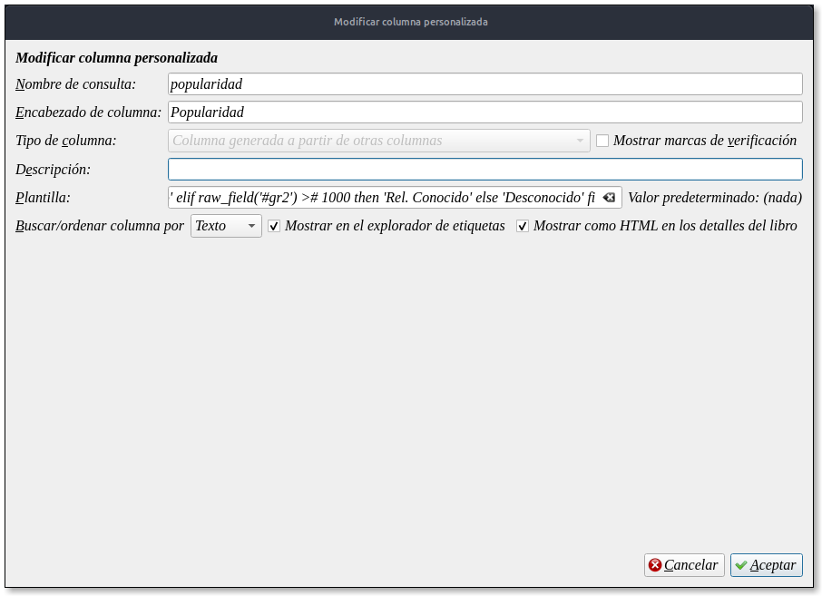

En el campo plantilla copian y pegan esto:

program:

# returns the "fame" of a book based on number of goodreads reviews

if raw\_field('#gr2') \># 500000 then

'Muy Famoso'

elif raw\_field('#gr2') \># 100000 then

'Famoso'

elif raw\_field('#gr2') \># 50000 then

'Muy conocido'

elif raw\_field('#gr2') \># 10000 then

'Conocido'

elif raw\_field('#gr2') \># 1000 then

'Rel. Conocido'

else

'Desconocido'

fi

Y le damos aceptar.

Cuando se cierra esa pantalla le damos en Aplicar para que se guarden los cambios y se reinicará Calibre.

Las columnas creadas se ubican a lo ultimo de todos los campos cada quien le puede dar la ubicación que les parezca tocando en el encabezado y arrastandola a la ubicación que quieran.

Ahora instalamos los complementos:

El GoodreadsReviews.zip es un complemento para obtener los metadatos y lo tenemos que tener seleccionado en el engranaje de la pantalla de edición de metadatos

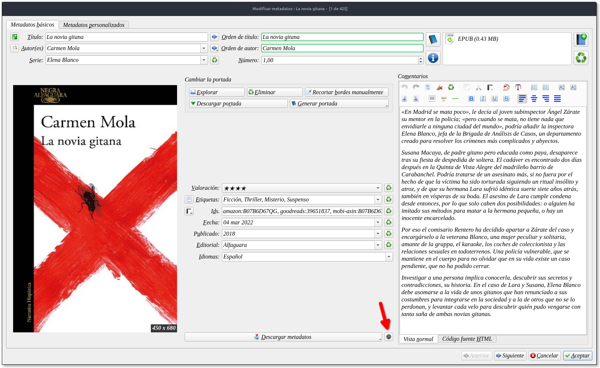

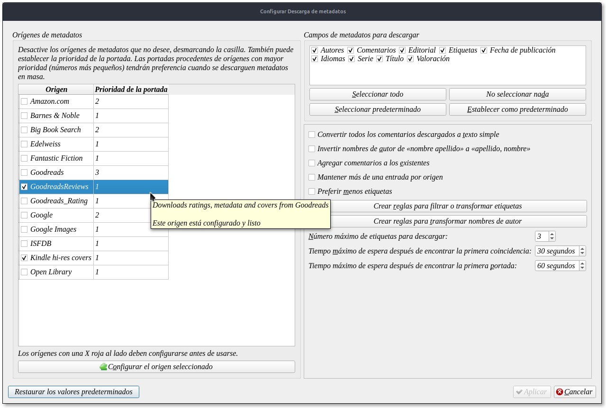

En los campos de metadatos a descargar marcamos todos y le damos en aplicar

Instalamos el segundo, f\_rating\_3.3.0 español.zip que es el que pasa los valores a sus campos una vez instalado va a pedir reiniciar Calibre.

El la barra de herramienta nos saldrá el logo de goodreads

Ahora todo normal !!!

Seleccionamos un libro para descargar metadato

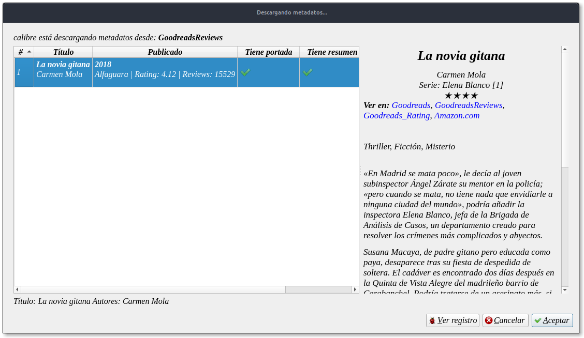

Como les comentaba en el campo editorial veran que tiene los valores Rating: y Reviews a no preocuparse que acá viene la magia.

Tocamos el icono con el logo de goodreads y nos sale esta advertencia que ha limpiado el campo editorial para x libro/s

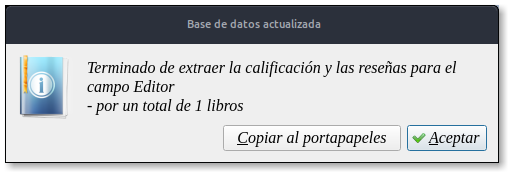

Le damos en aceptar

Y se completan los datos quedando así

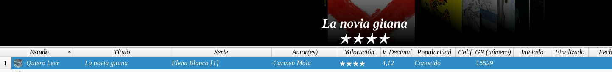

Y si abrimos la edicion de metadatos veremos que en el campo editorial solo figura ella.

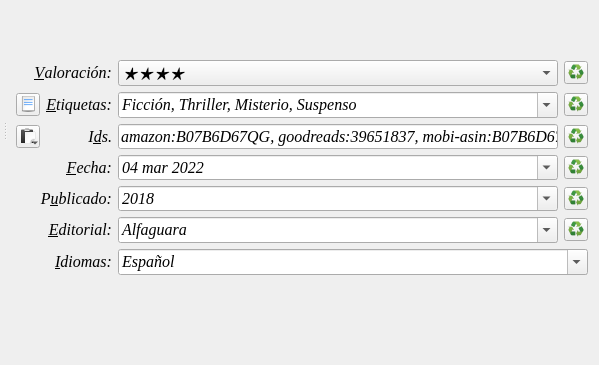

Otra vez mi agradecimiento a wiso y a jonas por ser tan paciente conmigo y haber hecho realidad esto para compartir en el grupo.

Los complementos en este link [https://t.me/calibreconfiguraciones/90398](https://t.me/calibreconfiguraciones/90398)

[:material-play-circle: Ver video](https://telegra.ph/embed/telegram?url=https%3A%2F%2Ft.me%2Fcalibreconfiguraciones%2F90398){ target=_blank }

### Método Actualizado:

Tras hablar con el programador del plugin de goodreads ( en septiembre 22, le solicite si podría incorporar que su plugin tomara estos datos también

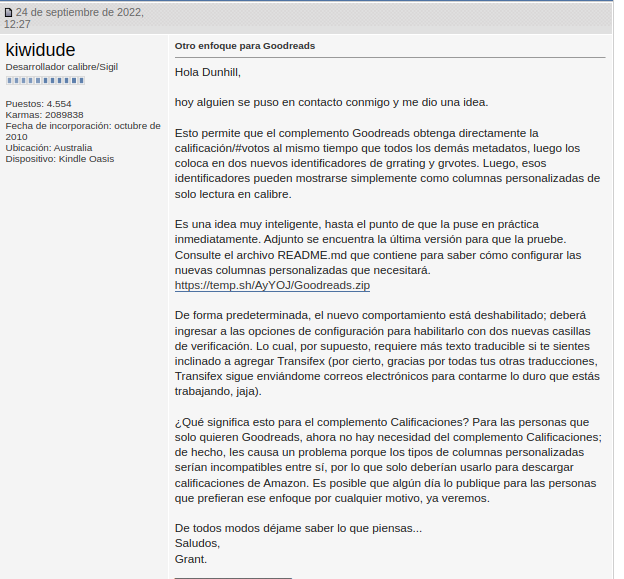

Entonces sucedió la magia... Descargando el plugin de metadatos de goodreads lo debemos configurar de esta manera

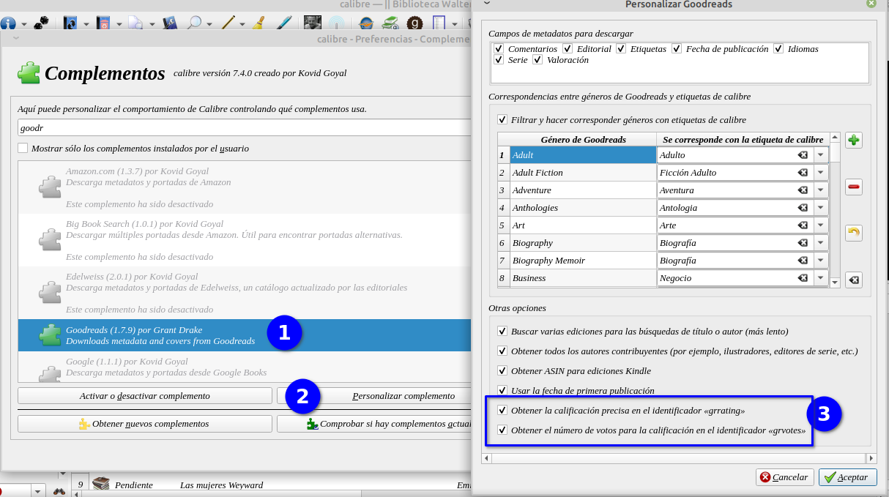

Entramos en preferencia complementos y para instalarlo tocamos el botón obtener nuevos complementos y buscamos goodreads (en la descripción dirá descarga de metadatos). Una vez instalado volvemos a preferencia complementos y buscamos goodreads (1) y con el plugin seleccionado tocamos el botón personalizar complemento ( esto tambien se puede hacer desde otro lugar) y marcamos las dos ultimas casillas. Damos en aceptar.

Creamos nuestras columnas personalizadas grrating y grvotes ( **en nombre de consulta mantener este nombre para que funcione, en el encabezado, pueden poner el que les guste**)

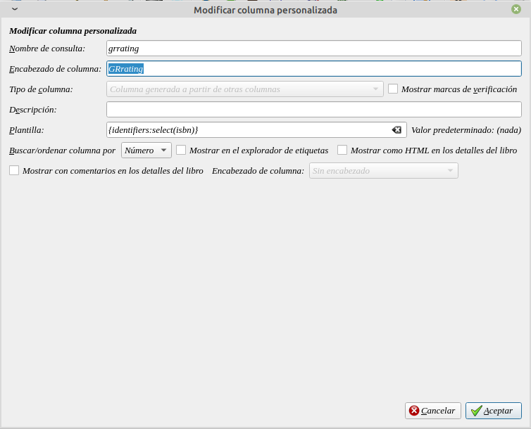

 

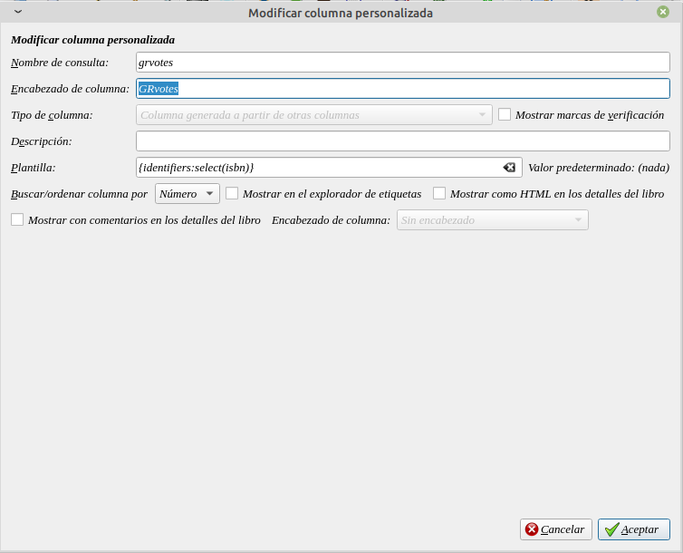

 

Estas columnas pueden estar visibles u ocultas y creamos la columna para la popularidad

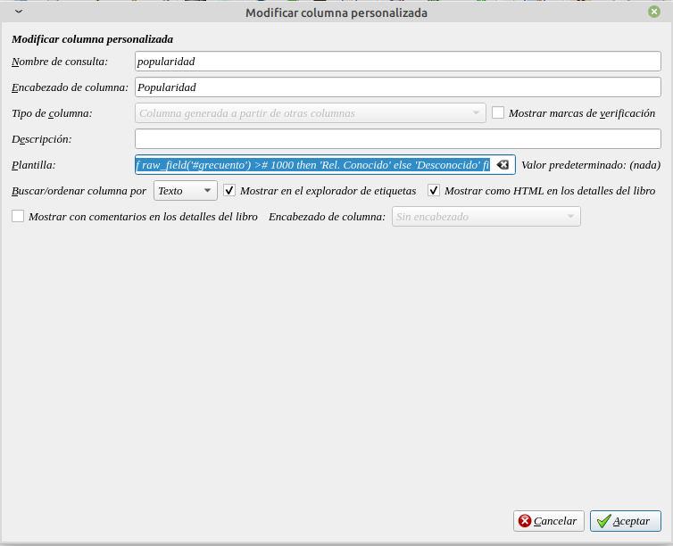

y en el campo plantilla pegamos este codigo:

program:

 

# devuelve la "fama" de un libro según el número de reseñas de Goodreads

 

if raw\_field('#grvotes') \># 500000 then

'Muy Famoso'

elif raw\_field('#grvotes') \># 100000 then

'Famoso'

elif raw\_field('#grvotes') \># 50000 then

'Muy conocido'

elif raw\_field('#grvotes') \># 10000 then

'Conocido'

elif raw\_field('#grvotes') \># 1000 then

'Rel. Conocido'

else

'Desconocido'

fi

 

Ir al mensaje: [https://t.me/calibreconfiguraciones/112333/154791](https://t.me/calibreconfiguraciones/112333/154791)

 

 

## [Volver al inicio](https://telegra.ph/Indice-Calibre-en-Espa%C3%B1ol-10-03)

 

 

 

 

 

---

[:material-arrow-left: Volver al índice](../../alfabetico.md) · [:fontawesome-brands-telegram: Preguntar en el grupo](https://t.me/calibreconfiguraciones){ target=_blank }
