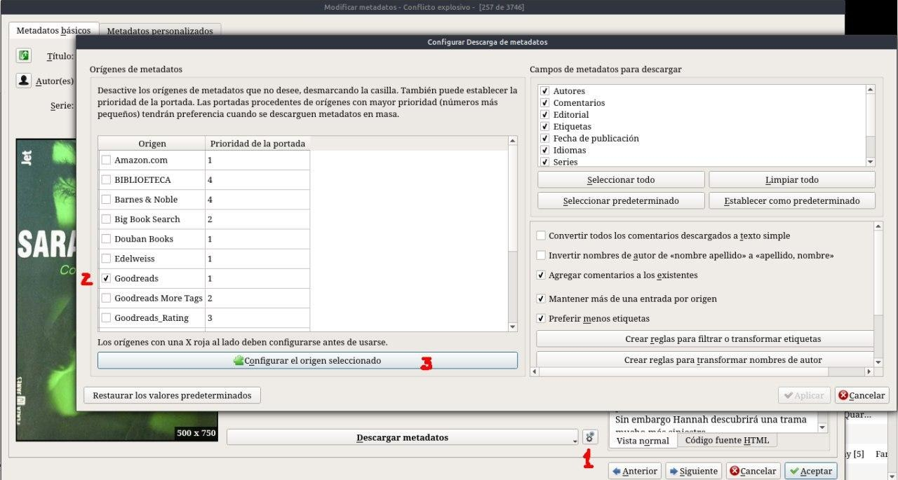
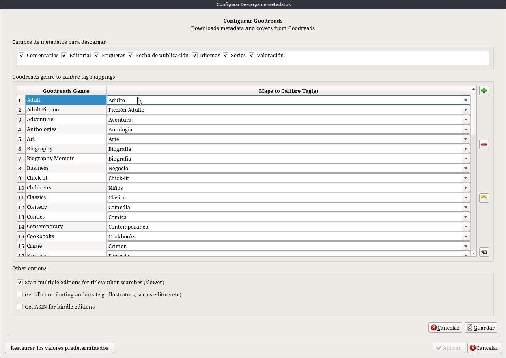

# Complemento - Goodreads

:material-account: [Walter](https://t.me/Dunhill69){ target=_blank } · :material-link-variant: [Ver el original en Telegraph](https://telegra.ph/Plugin---Goodreads-08-23){ target=_blank }
{ .tut-datos }

---

Yo para completar los metadatos utilizo el plugin de Goodreads, lo considero uno de los más completos en cuanto a sinopsis, puntuación y etiquetas es el que dejo acá.

[https://plugins.calibre-ebook.com/130638.zip](https://plugins.calibre-ebook.com/130638.zip)

Una vez instalado el plugin también lo podemos configurar para obtener los datos de etiquetas en español, les muestro como. Cuando editamos o cargamos metadatos tenemos que tocar en el engranaje ( 1 ) al lado del botón Descargar Metadatos. Tocamos el plugin que vamos a configurar, en nuestro caso Goodreads ( 2 ) (el renglón se tiene que poner azul) y después tocamos Configurar el origen seleccionado ( 3. )

Se abre una pantalla con los nombres de las etiquetas en ingles y una columna en blanco donde ponemos el nombre en nuestro idioma. tocamos guardar y ya siempre descargaremos etiquetas en español. Si hay alguna que por esas casualidades les saldría en ingles hay que volver a hacer estos pasos, encontrar la que esta en ingles y ponerle el nombre en español.

## [Volver al inicio](https://telegra.ph/Indice-Calibre-en-Espa%C3%B1ol-10-03)

 

---

[:material-arrow-left: Volver al índice](../../alfabetico.md) · [:fontawesome-brands-telegram: Preguntar en el grupo](https://t.me/calibreconfiguraciones){ target=_blank }
