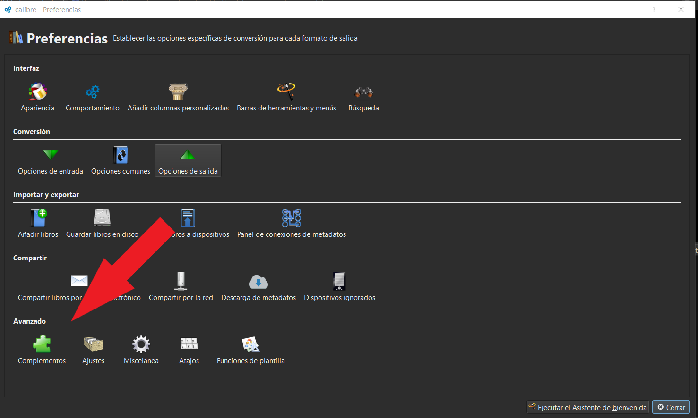
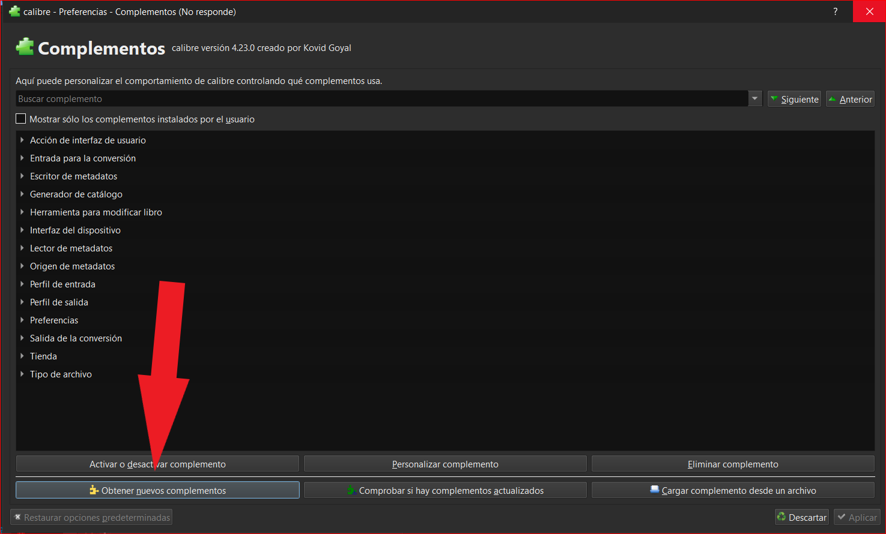
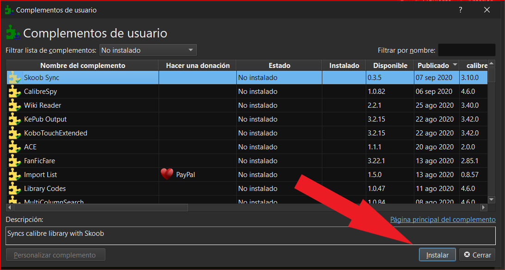

# Complementos oficiales de Calibre (listado)

:material-account: [Walter](https://t.me/Dunhill69){ target=_blank } · :material-link-variant: [Ver el original en Telegraph](https://telegra.ph/Plugin-Oficiales-de-Calibre-09-07){ target=_blank }
{ .tut-datos }

---

Esta es la pagina de plugin oficiales de Calibre

[https://plugins.calibre-ebook.com/](https://plugins.calibre-ebook.com/)

Que también se pueden descargar desde Preferencias / Avanzados / Complementos

Entramos en obtener nuevos complementos y nos saldrá la misma lista que esta en la página.

Seleccionamos el complemento que quisiéramos y tocamos instalar.

Se reinicia Calibre y ya lo tenemos instalado.

[https://telegra.ph/Plugin-Oficiales-de-Calibre-09-07](https://telegra.ph/Plugin-Oficiales-de-Calibre-09-07)

 

## [Volver al inicio](https://telegra.ph/Indice-Calibre-en-Espa%C3%B1ol-10-03)

 

---

[:material-arrow-left: Volver al índice](../../alfabetico.md) · [:fontawesome-brands-telegram: Preguntar en el grupo](https://t.me/calibreconfiguraciones){ target=_blank }
