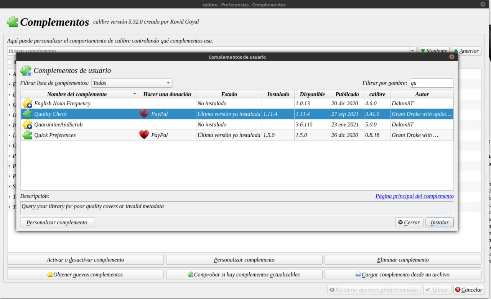
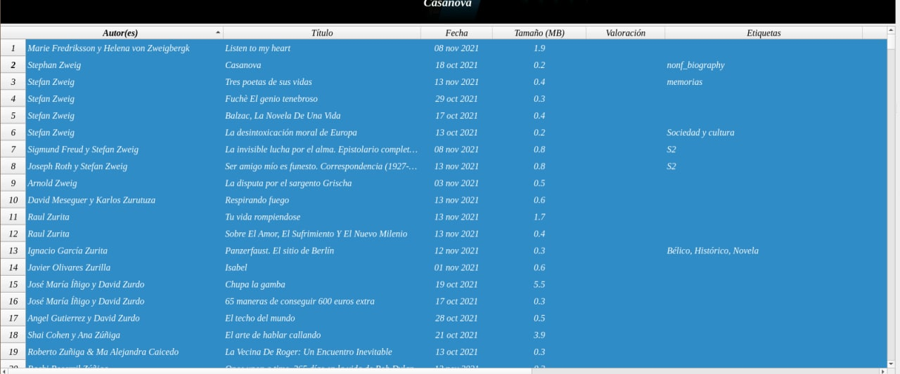
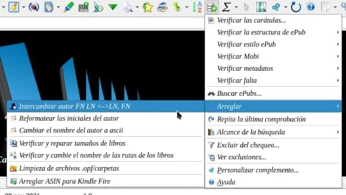
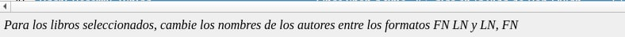

# Complemento - Quality Check: invertir «Apellido, Nombre» a «Nombre Apellido»

:material-account: [Walter](https://t.me/Dunhill69){ target=_blank } · :material-link-variant: [Ver el original en Telegraph](https://telegra.ph/Plugin-Quality-Check---Revertir-Apellidos-Nombre-por-Nombre-Apellido-11-21){ target=_blank }
{ .tut-datos }

---

Con Quality check se pueden hacer muchas cosas entre ellas modificar libros que vengan con Nombre y Apellidos o viceversa.

Para eso instalamos el plugin desde Calibre. Vamos a Preferencias/ Complementos/ Obtener nuevos Complementos, buscamos Quality Check

Instalamos y se nos va a reiniciar Calibre.

Seleccionamos todos los libros con las teclas ctrl+A o ctrl+E según el sistema.

En el complemento buscamos Arreglar / Intercambiar autor FN LN \<-\> LN, FN

Y esperas sin tocar nada hasta que se desmarquen todos los libros.

En el pie de Calibre te va a salir esto

Ir al mensaje: [https://t.me/calibreconfiguraciones/54310](https://t.me/calibreconfiguraciones/54310)

Ir al pdf realizado por @jane\_morris [https://t.me/calibreconfiguraciones/54326](https://t.me/calibreconfiguraciones/54326)

 

## [Volver al inicio](https://telegra.ph/Indice-Calibre-en-Espa%C3%B1ol-10-03)

 

---

[:material-arrow-left: Volver al índice](../../alfabetico.md) · [:fontawesome-brands-telegram: Preguntar en el grupo](https://t.me/calibreconfiguraciones){ target=_blank }
