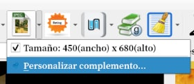
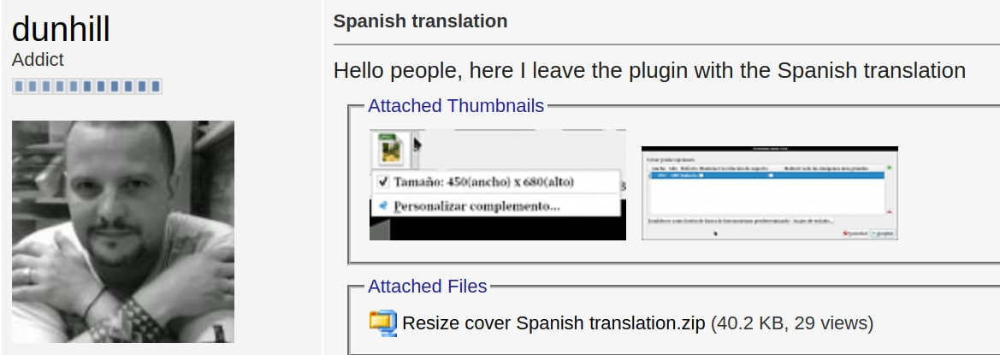
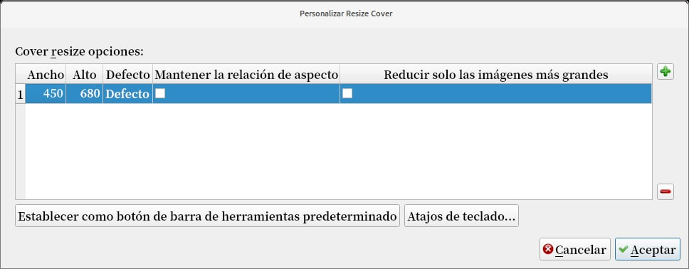
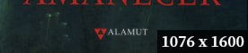
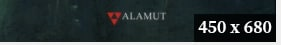
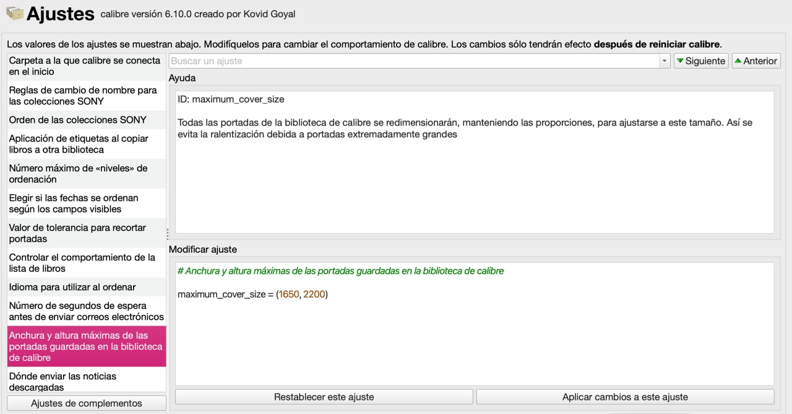

# Complemento - Resize Cover

:material-account: [Walter](https://t.me/Dunhill69){ target=_blank } · :material-link-variant: [Ver el original en Telegraph](https://telegra.ph/Plugin-Resize-Cover-04-13){ target=_blank }
{ .tut-datos }

---

Con este complemento podemos tener el mismo tamaño de portada en todos nuestros libros.

No es para nada difícil de configurar, este complemento permite a los usuarios cambiar el tamaño de la imagen de portada de calibre que se muestra para los libros en los detalles del libro y el navegador de portadas de Calibre a uno de los tamaños configurables.

El complemento viene predefinido con una configuración de 450x680, que algunos pueden encontrar útil para cambiar las cubiertas de 510x680 estilo Overdrive de una relación de aspecto de 3: 4 a una más convencional de 2: 3. Sin embargo, puede configurar cualquier combinación de tamaño que prefiera en las preferencias del complemento.

Una vez instalado se ve así en la barra de herramientas, tocamos en personalizar complemento.

( Ahora que está en español ).

Apretamos el signo + (en verde) para agregar las medidas a nuestro gusto y ya nos queda configurado.

Lo podemos usar libro por libro o seleccionando varios libros y tocando el icono.

Un suponer tengo un libro con este tamaño de caratula.

Toco el icono y me lo pone a mi configuración de elección.

 

Ir al mensaje: [https://t.me/calibreconfiguraciones/1/32441](https://t.me/calibreconfiguraciones/1/32441)

 

Sin embargo en las configuraciones de calibre se puede establecer nuestro tamaño de portada desde la siguiente opción:

**Preferencia**/**Ajustes** y buscamos  **Anchura y altura de las portadas**

Reemplazamos los números por los de nuestro tamaño preferido.

 

## [Volver al inicio](https://telegra.ph/Indice-Calibre-en-Espa%C3%B1ol-10-03)

 

 

---

[:material-arrow-left: Volver al índice](../../alfabetico.md) · [:fontawesome-brands-telegram: Preguntar en el grupo](https://t.me/calibreconfiguraciones){ target=_blank }
