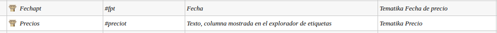
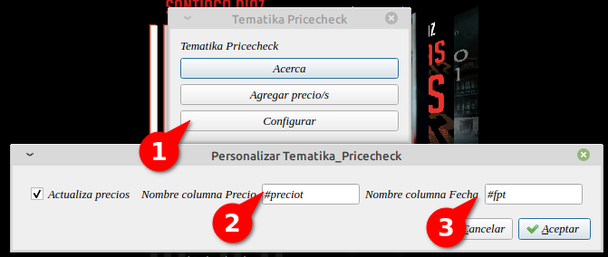
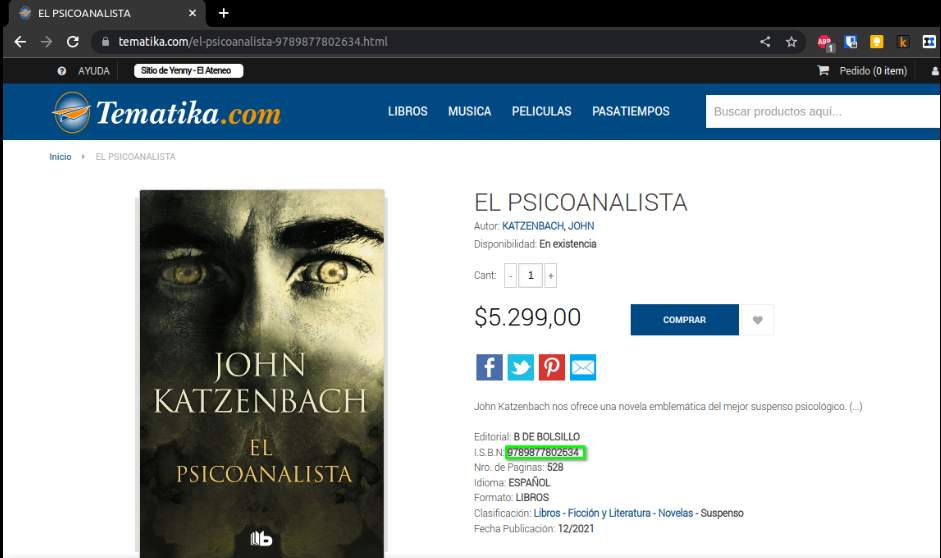
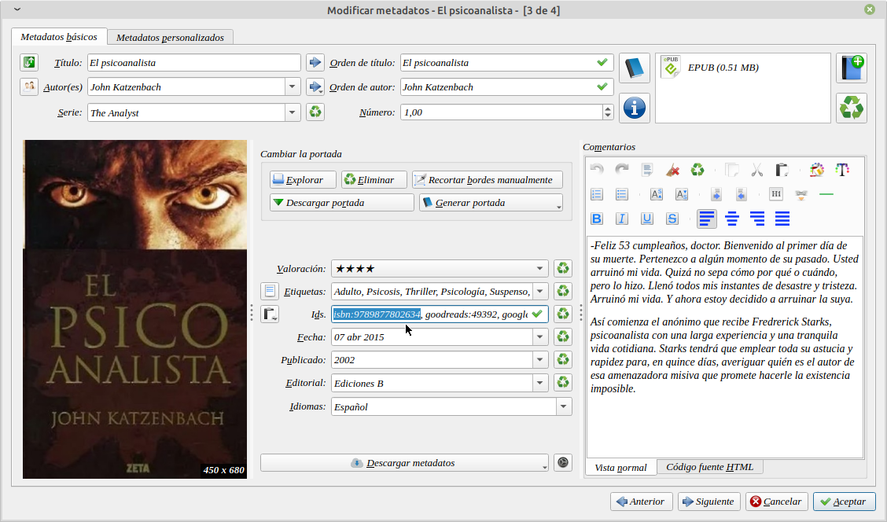
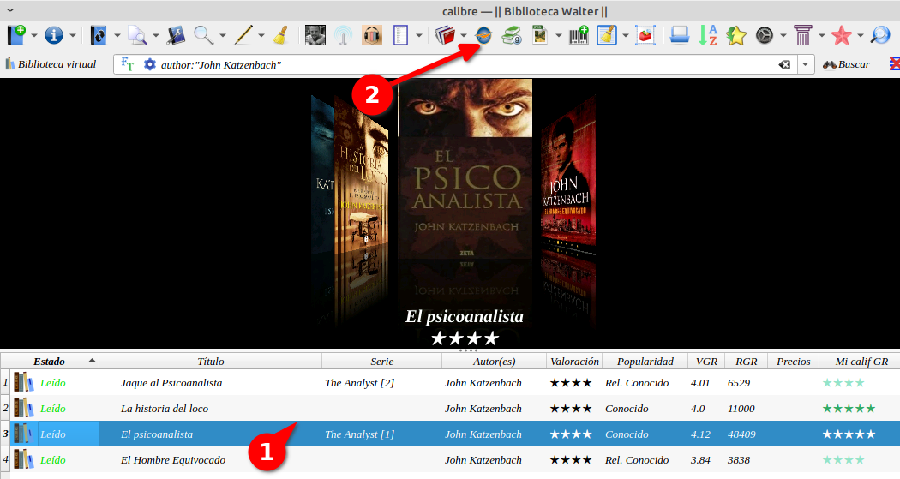
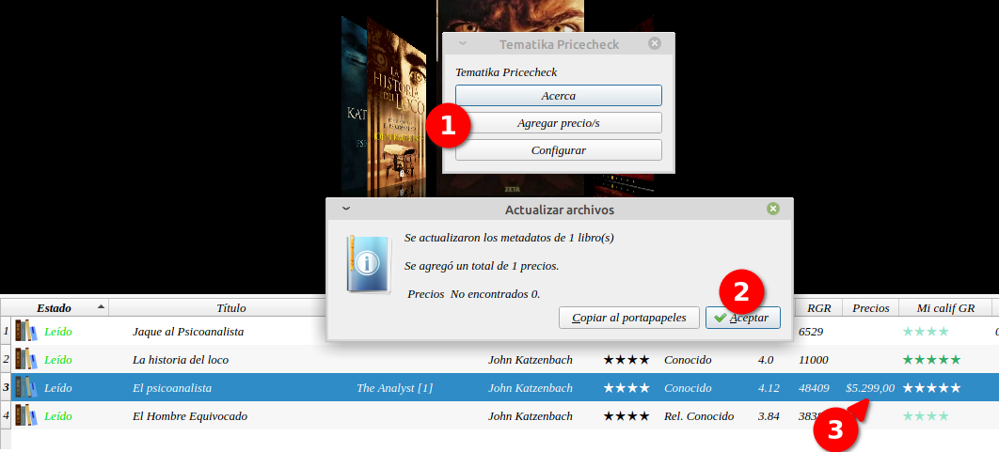

# Complemento - Tematika (solo Argentina)

:material-account: [Walter Paterno](https://t.me/Dunhill69){ target=_blank } · :material-link-variant: [Ver el original en Telegraph](https://telegra.ph/Plugin-Tematika-03-04){ target=_blank }
{ .tut-datos }

---

Este plugin nació tras una necesidad mía en poder darle un valor a mi biblioteca.

Tomando las valores desde la página de una de las librerías más importantes de argentina Yenny - El ateneo ( [https://www.tematika.com/](https://www.tematika.com/) )

Plugin:

**ir al mensaje**: [https://t.me/calibreconfiguraciones/112643/130118](https://t.me/calibreconfiguraciones/112643/130118)

**Como funciona:**

Nosotros ya tenemos nuestros libros cargados en Calibre y queremos saber el valor del mismo.

Entonces deberemos crear dos columnas personalizadas.

1. Para el valor del Precio
2. Otra para la fecha que obtuvimos ese importe.

Instalamos el complemento y una vez reiniciado Calibre le damos en el icono del complemento y en el botón de configurar.

Ponemos nuestras columnas correspondientes en cada campo, como son columnas personales van con #

En este caso "El Psicoanalista" de John Katzenbach, que ya tenemos cargado en nuestro Calibre.

El único paso que deberemos hacer manualmente es copiar el isbn de la página de la librería a nuestro libro que quisiéramos el precio.

Pegarlo en el campo isbn de nuestro Calibre.

Damos en aceptar para que se guarden los datos.

Con el libro seleccionado tocamos el icono del complemento y en el botón Agregar precio para que nos traiga el precio.

## [Volver al inicio](https://telegra.ph/Indice-Calibre-en-Espa%C3%B1ol-10-03)

 

---

[:material-arrow-left: Volver al índice](../../alfabetico.md) · [:fontawesome-brands-telegram: Preguntar en el grupo](https://t.me/calibreconfiguraciones){ target=_blank }
