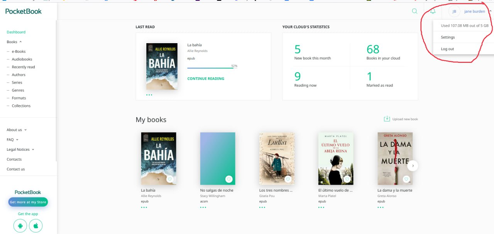
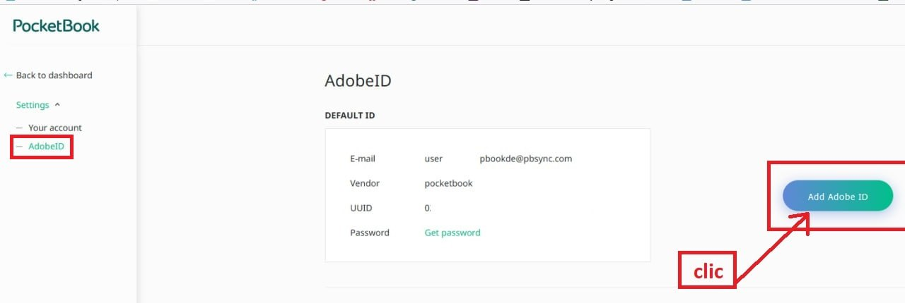
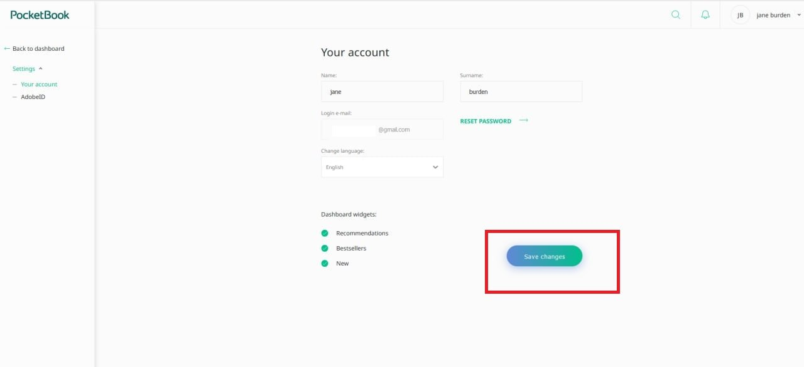
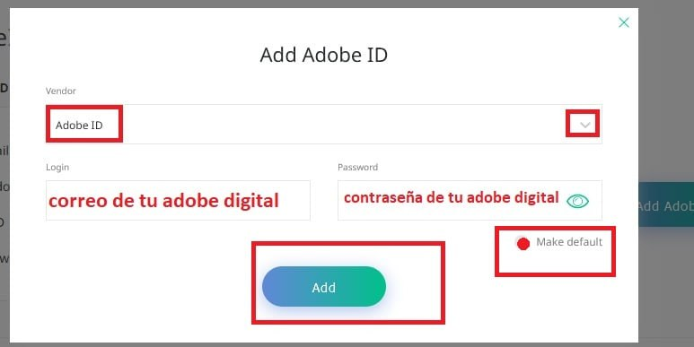
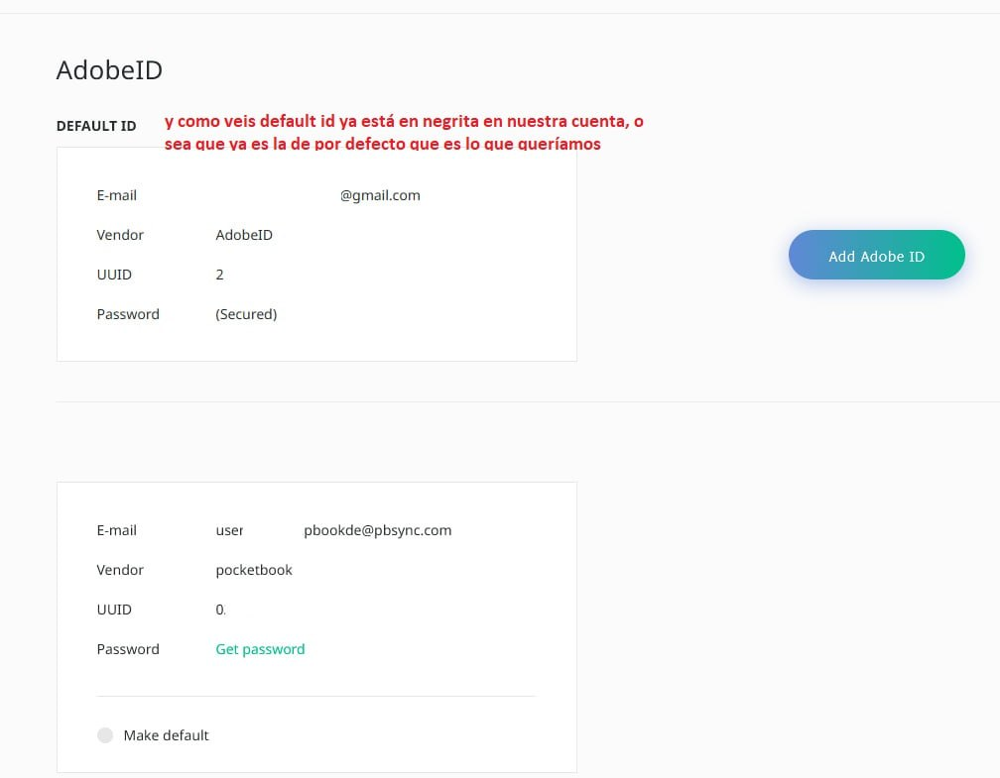

# PocketBook - PocketBook Cloud

:material-account: [Walter Paterno](https://t.me/Dunhill69){ target=_blank } · :material-link-variant: [Ver el original en Telegraph](https://telegra.ph/Pocketbook-Cloud-01-27){ target=_blank }
{ .tut-datos }

---

Explicado por @jane\_morris

Como indicarle en la web de Pocketbook Cloud, en nuestro ordenador que cuenta de Adobe es la de por defecto.

(Esto es muy importante para poder leer en cualquier lado libros con DRM comprados por nosotros)

1.- Entramos en nuestro pocketbook cloud y clicamos en settings

2.- Añade tu cuenta y la haces por defecto

3.- Y tendrás dos, la tuya y esa que te crea de forma automática pocketbook. Aunque la tuya será la que se use por defecto.

5.- Rellenais lo que he puesto en rojo

6.- Y como veis ya teneis por defecto la vuestra.

Y ya está terminado, ya teneis vuestro pocketbook cloud en la web a través de vuestro ordenador preparado para manejar libros con DRM, y poderlos leer en vuestro ereader, en vuestro movil…

 

Ir al mensaje: [https://t.me/calibreconfiguraciones/124635/125774](https://t.me/calibreconfiguraciones/124635/125774)

## [Volver al inicio](https://telegra.ph/Indice-Calibre-en-Espa%C3%B1ol-10-03)

 

---

[:material-arrow-left: Volver al índice](../../alfabetico.md) · [:fontawesome-brands-telegram: Preguntar en el grupo](https://t.me/calibreconfiguraciones){ target=_blank }
