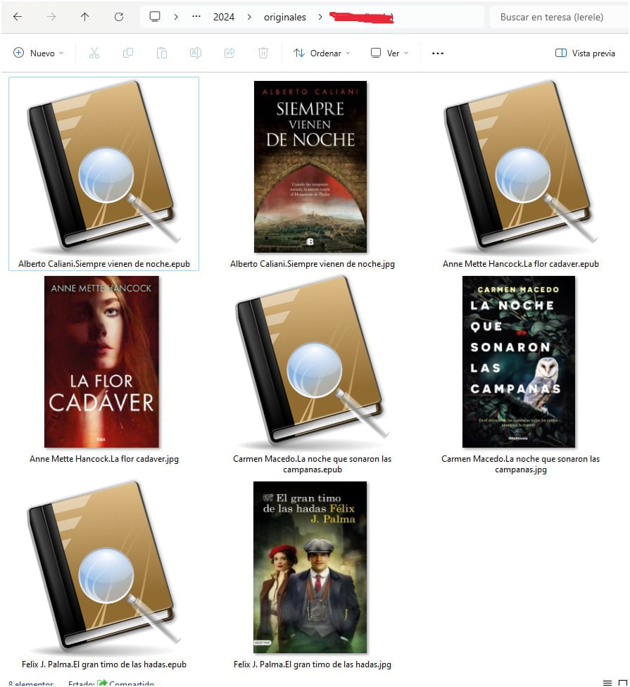
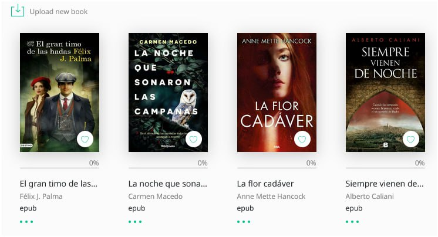
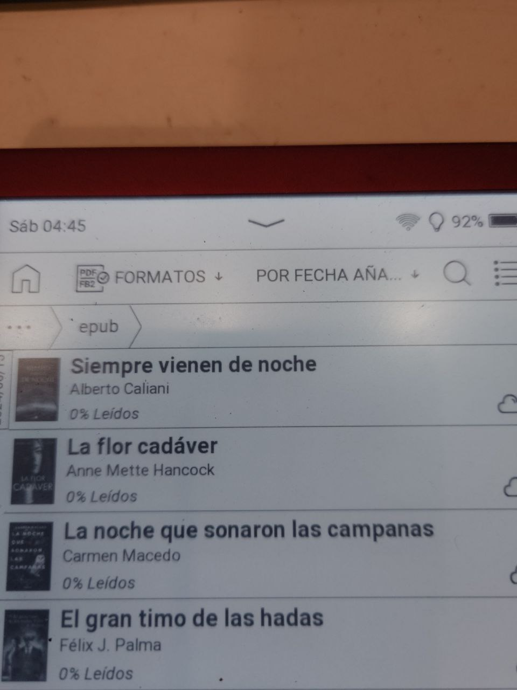
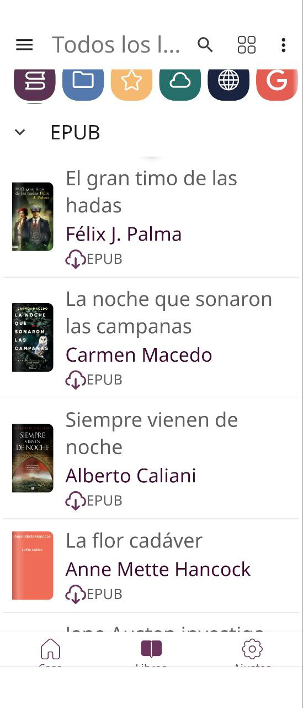
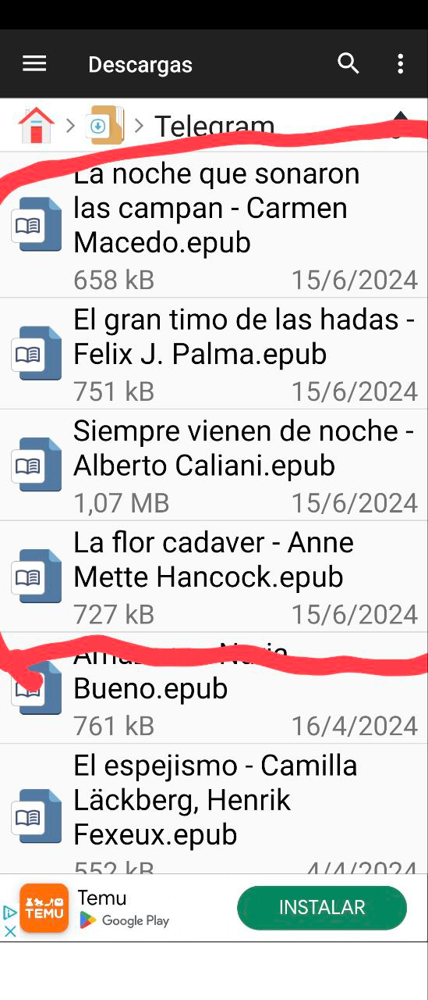
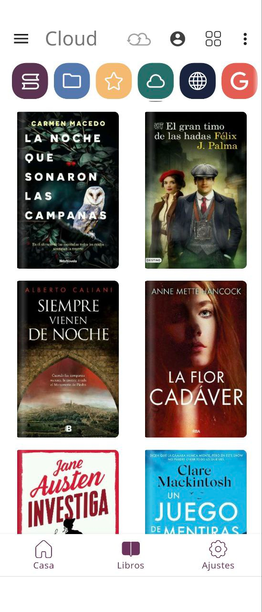
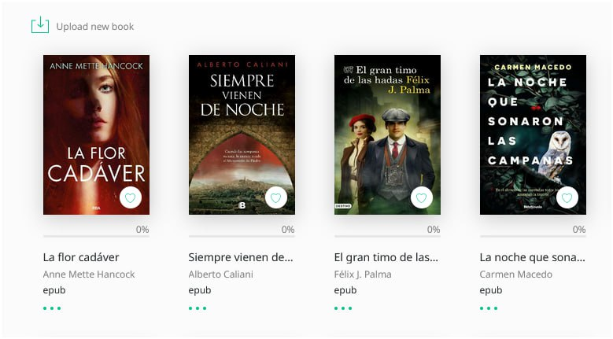
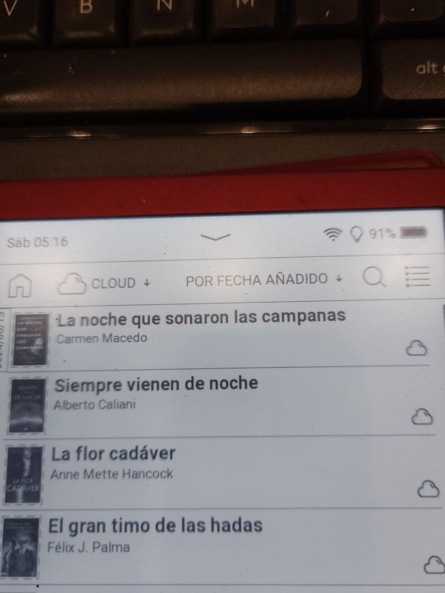

# PocketBook - dos formas de cargar libros sin cable

:material-account: [Walter](https://t.me/Dunhill69){ target=_blank } · :material-link-variant: [Ver el original en Telegraph](https://telegra.ph/Pocketbook---Dos-formas-de-cargar-libros-sin-cable-06-15){ target=_blank }
{ .tut-datos }

---

### Primer método: Descargados en el ordenador directamente.

 

Subidos al cloud directamente de la carpeta del ordenador.

Automáticamente llegan al ebook

Y también a la app del móvil

### Segundo método: Descargados en el móvil desde telegram.

Te van a descargas, los tocas, y ya se abren en la app del mismo movil

Automáticamente van a la app del movil

Y al cloud

 

Ir al mensaje: [https://t.me/calibreconfiguraciones/124635/166307](https://t.me/calibreconfiguraciones/124635/166307)

## [Volver al inicio](https://telegra.ph/Indice-Calibre-en-Espa%C3%B1ol-10-03)

 

 

---

[:material-arrow-left: Volver al índice](../../alfabetico.md) · [:fontawesome-brands-telegram: Preguntar en el grupo](https://t.me/calibreconfiguraciones){ target=_blank }
