# Bibliografía de autor

:material-account: Walter · :material-link-variant: [Ver el original en Telegraph](https://telegra.ph/Poner-bio-del-autor-en-todos-sus-libros-10-18){ target=_blank }
{ .tut-datos }

---

Antes que nada creamos una columna personalizada.

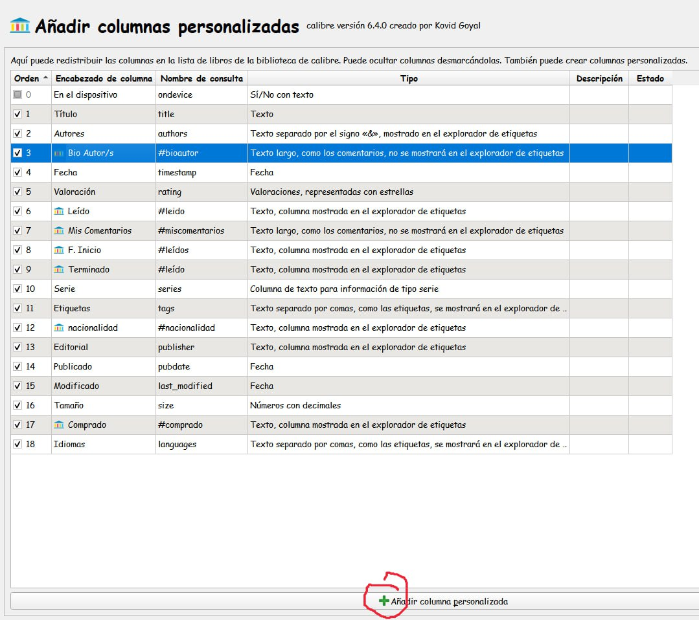

1) Crear una columna personalizada

nota: es Bio Autor/a no s

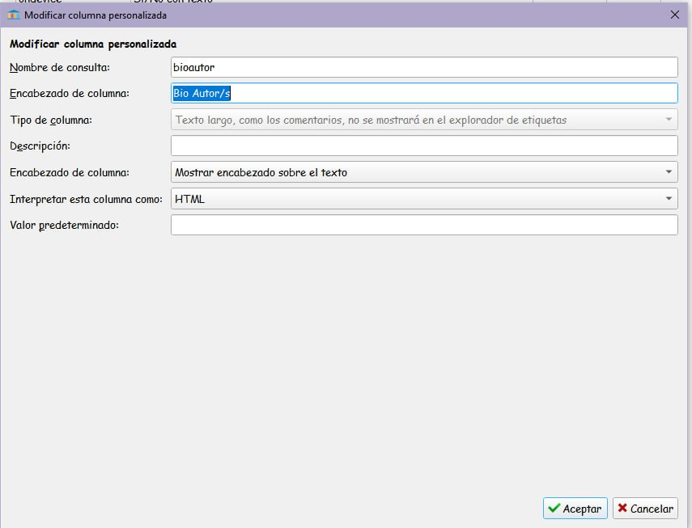

Para el icono de esa columna hacemos esta regla.

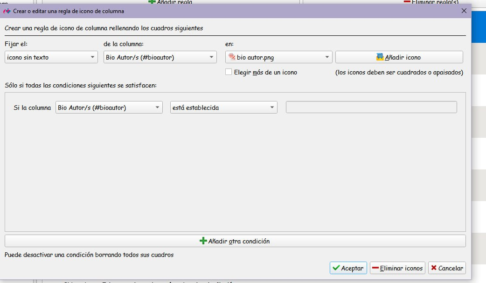

Apariencia—\>iconos de columna—\>añadir regla

nota: es Bio Autor/a no s

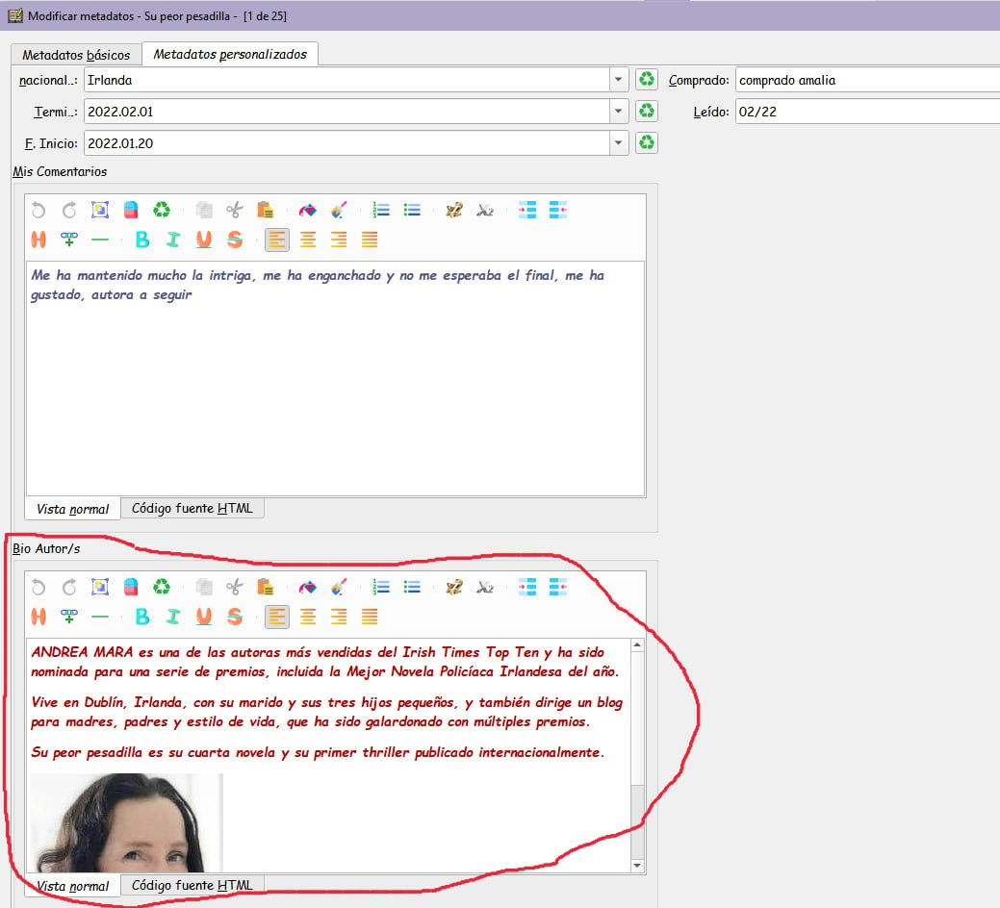

Ir Modificar metadatos por separado —\>pestaña Metadatos personalizados y rellenar la ficha.

Para rellenar esta ficha:

Lo primero de todo hacer una carpeta que se llame fotos autores, en un sitio que sepamos donde esta, siempre el mismo sitio y que no se puede cambiar de nombre ni quitar las fotos de ahí, solo añadir. Buscar en google la foto del autor que nos ocupe descargarla en nuestro ordenador y reducirla hasta que mida como mucho 200x200 (no tiene que ser igual el ancho que el largo, pero máximo el lado más largo 200)

ir a la ficha que he redondeado en rojo.

 

Escribir la bio, si se quiere eligiendo cursiva, negrita, color de letra ...

 

situarse justo debajo de lo que hemos escrito, y clicar en el circulito chiquitin que he puesto en rojo.

No comunicara con nuestro ordenador, buscamos la carpeta nueva que se llama Bio Autor buscamos dentro la foto de nuestro autor y encima le damos doble click, veremos que sale debajo del texto en nuestra ficha.

aceptamos y ya está

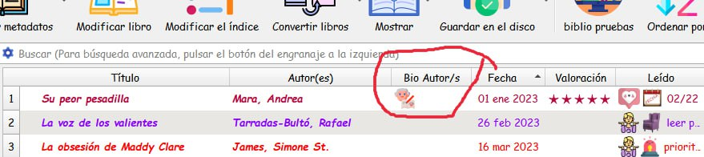

Y ya en calibre si lo hemos hecho todo bien, nos aparecerá así.

Y si pasamos el ratón suavemente por el muñequito nos aparecerá así

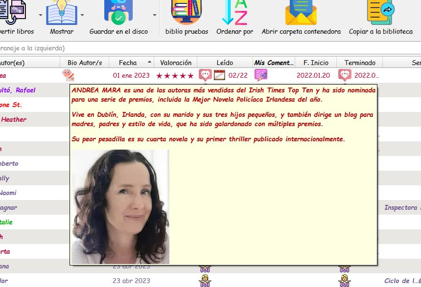

Para que la imagen quede rodeada del texto

Primero haceis todo en vista normal porque en html no salen los iconitos de poner cursiva negrita colores ... lo unico es que poneis lo primero de todo la foto en vez de abajo y luego os pasais a html, y al final de la foto , justo despues de png le pegais esto

style="float:left;"

y la imagen por supuesto la cogeis ya con transparente derecha y abajo claro

Ir al mensaje: https://t.me/calibreconfiguraciones/112333/146781

Poner bio del autor en todos sus libros usando metadatos en masa 01

(muchas gracias a @wiso\_wolo , que es quien ha descubierto como hacerlo y nos lo ha explicado)

ya hemos hecho la bio en uno de los libros del autor pero queremos que salga en todos a l vez sin necesidad de volverla a hacer.

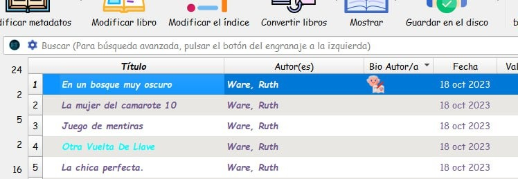

Seleccionamos todos

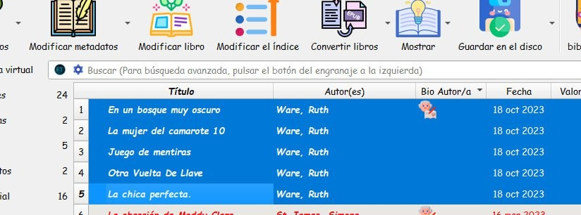

Con ellos seleccionados abrimos metadatos en masa.

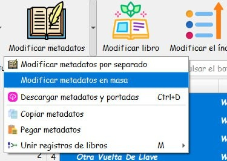

En la pantalla que nos sale nos situamos en la pestaña "Buscar y sustituir

Nos copiamos este comando en un sitio seguro y a mano, lo vamos a usar siempre para esto, asi que más vale que lo guardemos como oro en paño, este comando es lo más importante del tuto, sin él no se puede hacer.

^\[.\]{0}$

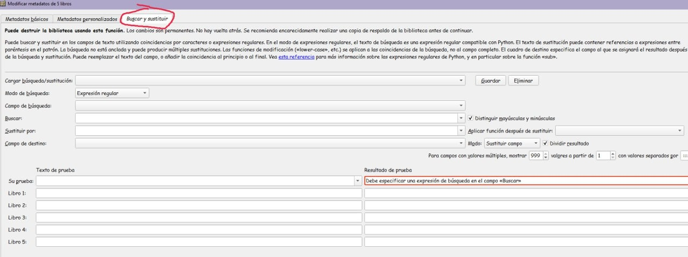

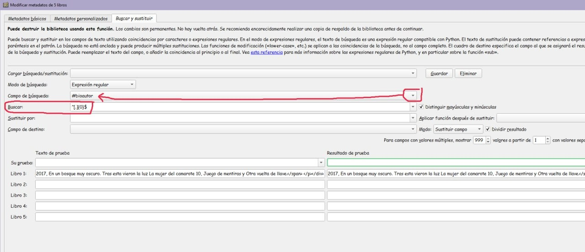

Copiamos y pegamos en buscar el comando que nos hemos guardado en lugar seguro,

y en el desplegable de justo arriba elegimos #bioautor

veremos que el campo del libro 1 se nos rellena solito, esa es la bio que hemos escrito antes en el primer libro de la autora, como de ahí es donde queremos copiarla en todos los demas, clicamos justo encima con el boton derecho y elegimos la opcion "seleccionar todo" veremos que se pone en azul, sin salir de ahí, otra vez boton derecho y elegimos copia.

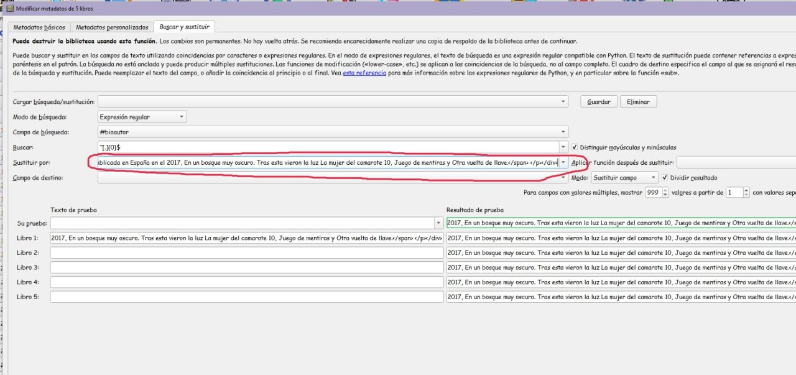

Pegamos lo que llevamos en el ratón del pantallazo anterior, en el campo "sustituir por"

y veremos que automaticamente se rellanan todos los campos de la derecha en el resultado de la prueba de todos los libros que tenemos de esa autor/a.

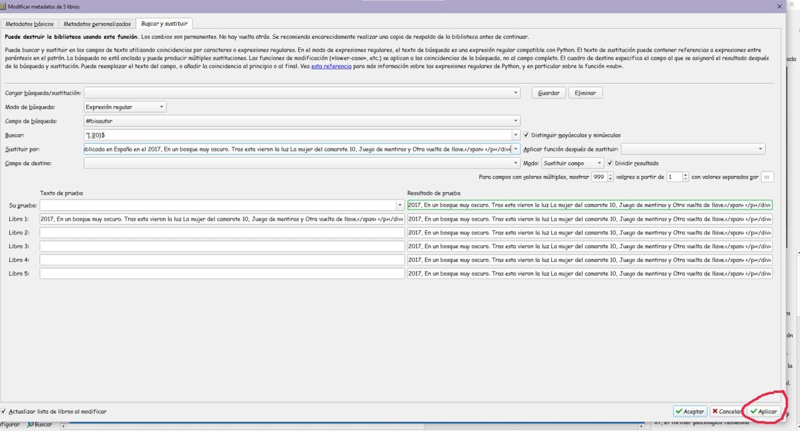

Y ya solo tenemos que clicar en aplicar , veremos que nos cambia de pantalla.

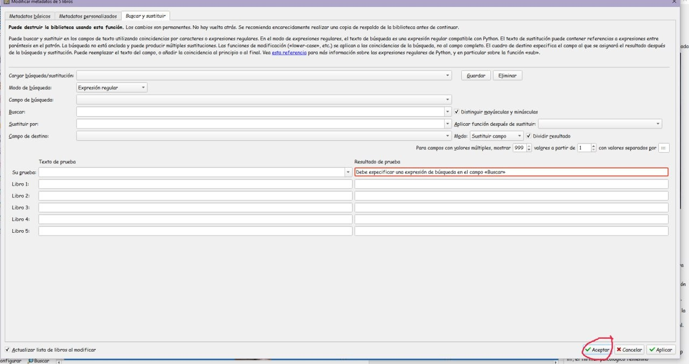

Y que nos sale esta que está vacia pero en la que tenemos que aceptar.

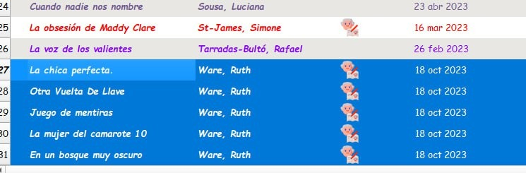

Y veremos ya nuestro calibre con el muñequito en todos los libros de la autora, por cualquier que pasemos el raton suavemente nos aparecerá la bio que habíamos escrito en el primero.

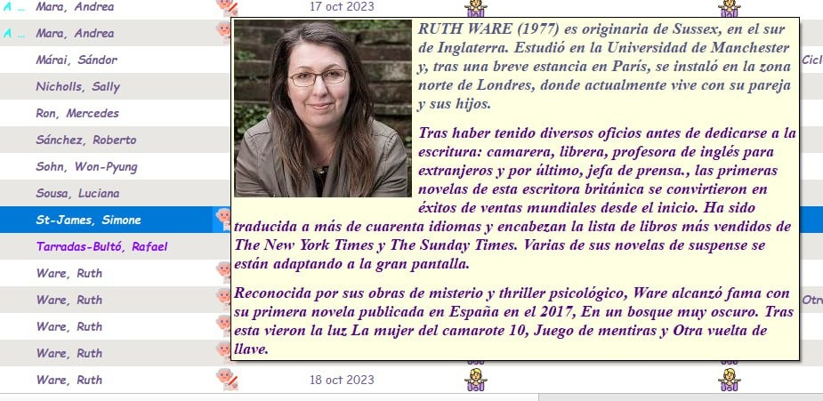

Y en la ficha de los metadatos por separado en nuestra pestaña de metadatos personalizados tambien sale en todos los libros de la autor/a

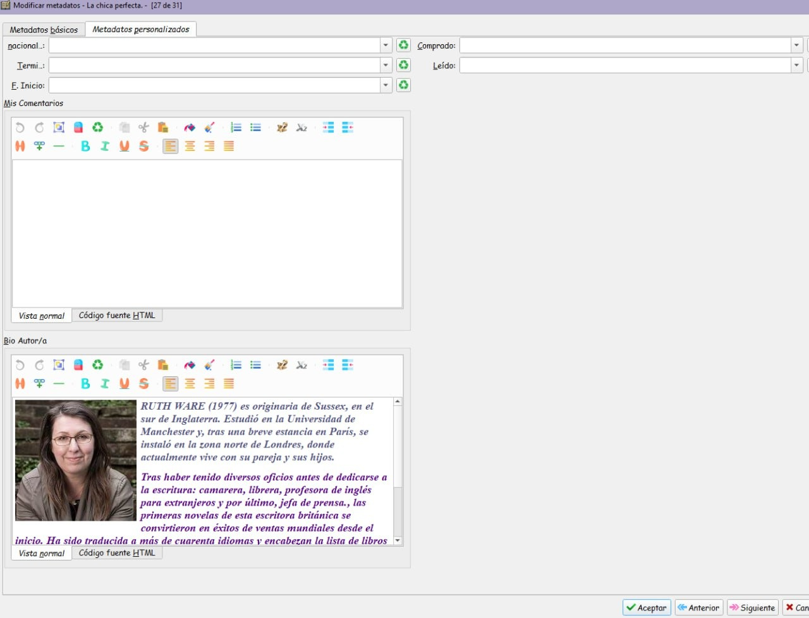

Ir al mensaje: https://t.me/calibreconfiguraciones/112333/146956

 

## Volver al inicio

 

---

[:material-arrow-left: Volver al índice](../../alfabetico.md) · [:fontawesome-brands-telegram: Preguntar en el grupo](https://t.me/calibreconfiguraciones){ target=_blank }
