# Poner nuestra dedicatoria en la portadilla de un libro

:material-account: [Walter](https://t.me/Dunhill69){ target=_blank } · :material-link-variant: [Ver el original en Telegraph](https://telegra.ph/Poner-dedicatoria-nuestra-en-un-libro-en-la-portadilla-02-03){ target=_blank }
{ .tut-datos }

---

Explicado por @jane\_morris

Pueden darse dos casos: el primero, que la portadilla sea una imagen, y el segundo, que la portadilla sea un [html](https://telegra.ph/Para-poner-nombre-o-dedicatoria-en-una-portadilla-de-un-ebook-09-07) (hoja normal)

Empezaremos por el caso de que es una imagen, como todos mis arreglos está hecho en el formato azw3, me gusta mucho más hacerlo en azw3 que en epub, porque así veo la columna de la izquierda con los html limpios y me entiendo mucho más. Después, cuando haya terminado con todos los arreglos ya lo convierto otra vez en azw3, elimino el viejo y el nuevo lo convierto en epub.

1) Como siempre abriremos el libro del modo "modificar libro"

miraremos entre las imágenes (columna izqda) si está la de la portadilla, así estaremos seguros de que la portadilla es una imagen y no un html.

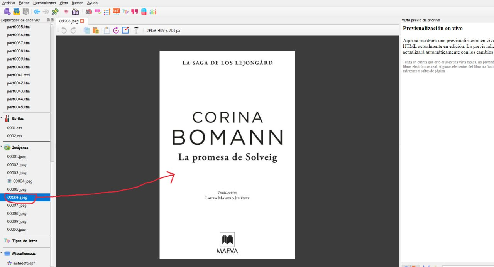

2) Una vez localizada, clicaremos encima justo de lo que he redondeado, con el botón derecho del ratón y eligiremos la opción " **exportar** 0006 o el número que sea en cada caso, lo clicaremos con el izqdo , y nos comunicará con nuestro ordenador, la guardaremos en un sitio que sepamos donde está, para trabajar en la imagen y para importarla luego.

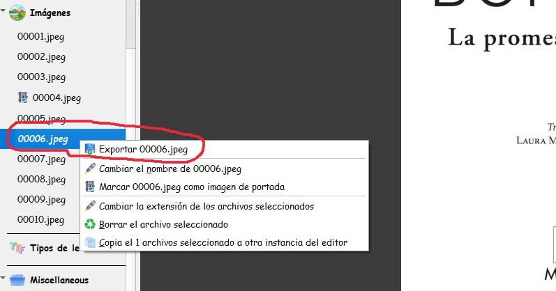

3) Iremos a nuestro ordenador y abriremos la imagen guardada con photoshop o con paint o con el editor de imágenes que prefiramos, y escribiremos la dedicatoria que queramos, con el tipo de letra y color que nos guste más . Una vez hecha guardaremos los cambios en la imagen con otro número o variado el que tenemos, si por ejemplo era el 0006, pues yo pongo el 0006.2

4) Ahora volveremos a calibre que no lo habíamos cerrado, seguimos en Modificar libro

y clicaremos en Archivo—\>nuevo archivo

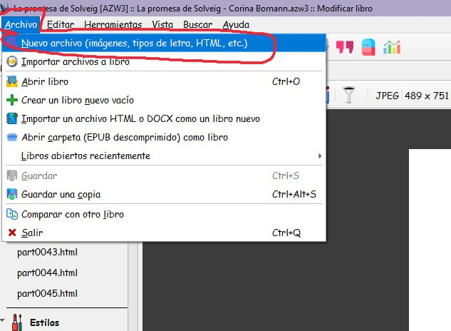

5) En la ventanita que se nos abre, clicaremos en Importar archivos de recursos, y nos comunicará con nuestro ordenador, buscaremos la imagen arreglada, pincharemos encima de ella con un doble click y veremos que nuestra ventanita se ha rellenado con los datos de la imagen arreglada.

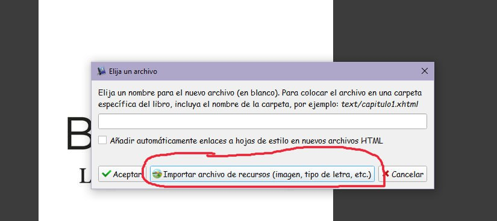

6) Aceptaremos

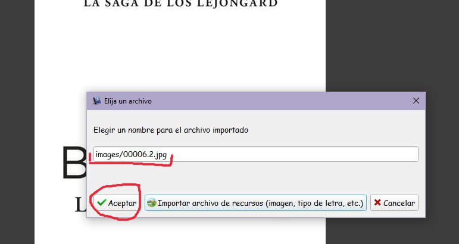

7) Y automáticamente veremos que ya la tenemos como una imagen más en nuestro libro en calibre.

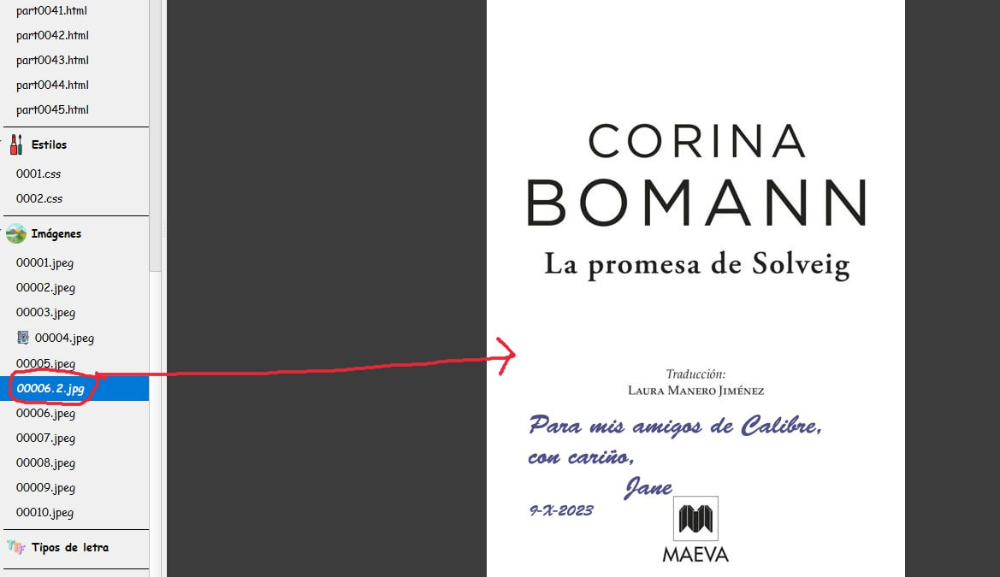

8) Ahora nos iremos en la columna de la izqda, al html de arriba del todo (o donde esté) pero el html que corresponda a la imagen de la portadilla

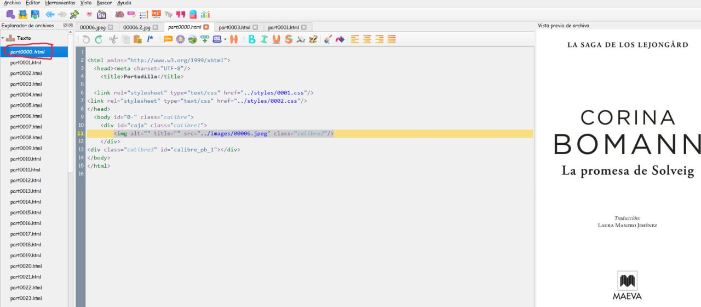

9) Seleccionaremos toda la linea de la imagen

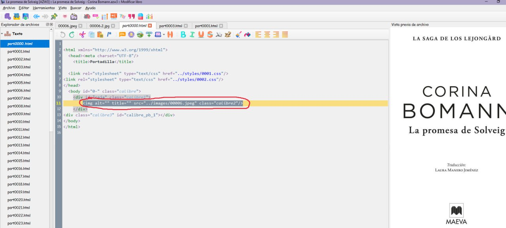

10) Y con ella seleccionada clicaremos arriba en Insertar imagen

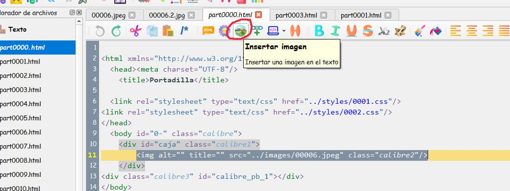

11) Buscamos nuestra imagen arreglada y le damos encima doble click (en un libro que estuviese yo arreglando, nunca me saldrían estos logos, porque es lo primero que elimino al empezar a arreglar un libro, pero los he dejado para que el libro me sirva para más tutoriales.

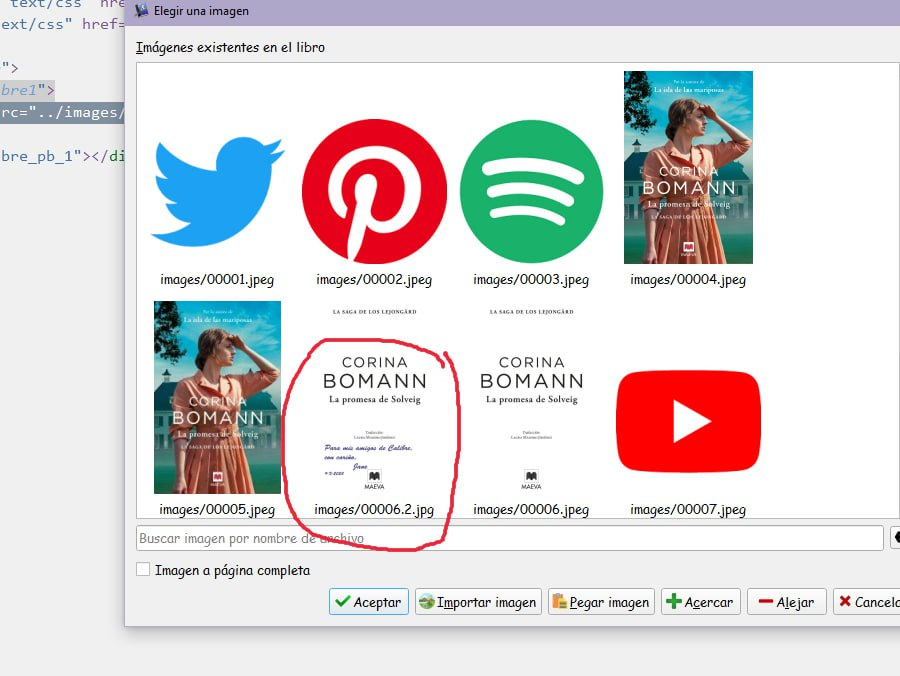

12) Y ya veremos que nuestra portadilla ha cambiado la imagen por la que hemos arreglado

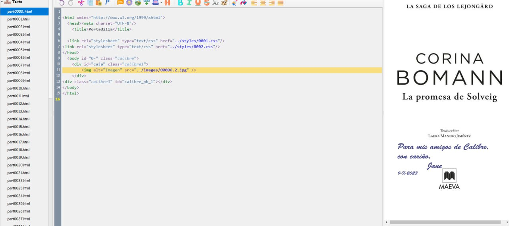

13) Ahora si queremos eliminamos del libro la portadilla sin arreglar y si queremos no, si no queremos eliminarla pues ya está, si queremos eliminarla, buscamos en imágenes la 0006 que era la antigua, botón derecho encima y elegimos borrar el archivo seleccionado.

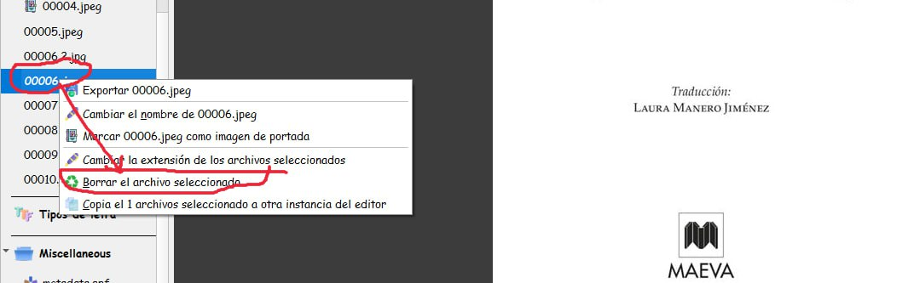

14) Luego nos vamos arriba a archivo y guardamos los cambios, súper importante porque si no, no valdrá de nada lo que hemos hecho.

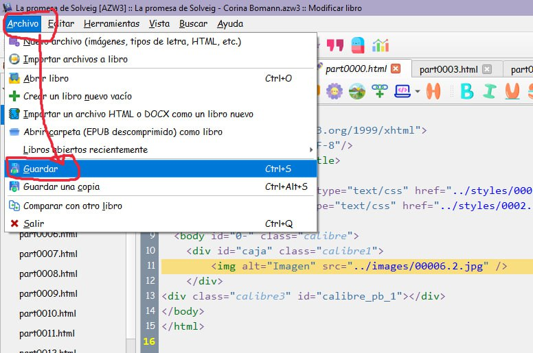

15) Y ya estaría este cambio terminado, con guardarlo así nos vale, si queremos seguir trabajando en él, pero si ya hemos terminado todos los cambios del libro, no os olvidéis después de guardar como os he dicho cada uno de ellos, convertir el azw3 otra vez en azw3 , esto es para que ademas de vosotros a quien se lo regaléis o paséis pueda verlos también de forma segura.

16) y así sería como se vería en vuestro ebook

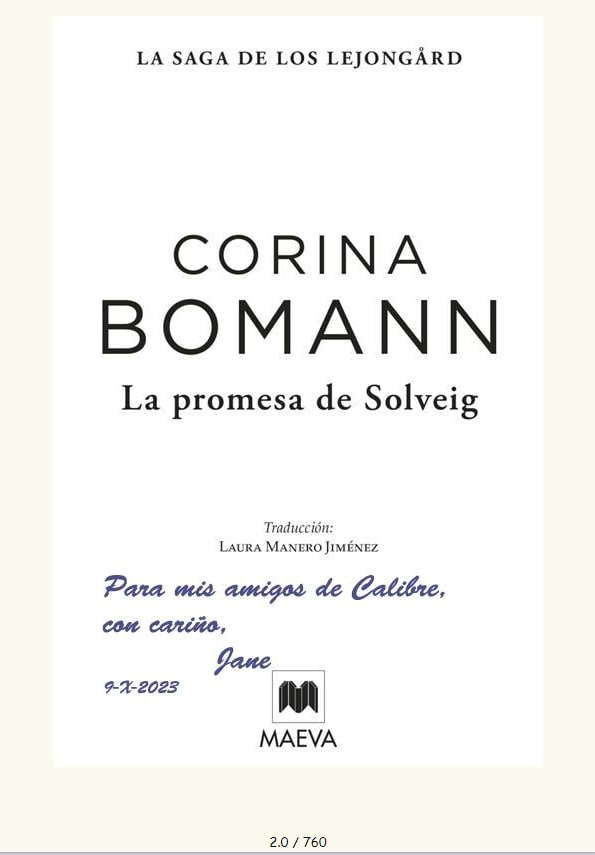

 

Ir al mensaje: [https://t.me/calibreconfiguraciones/144967/145547](https://t.me/calibreconfiguraciones/144967/145547)

## [Volver al inicio](https://telegra.ph/Indice-Calibre-en-Espa%C3%B1ol-10-03)

 

---

[:material-arrow-left: Volver al índice](../../alfabetico.md) · [:fontawesome-brands-telegram: Preguntar en el grupo](https://t.me/calibreconfiguraciones){ target=_blank }
