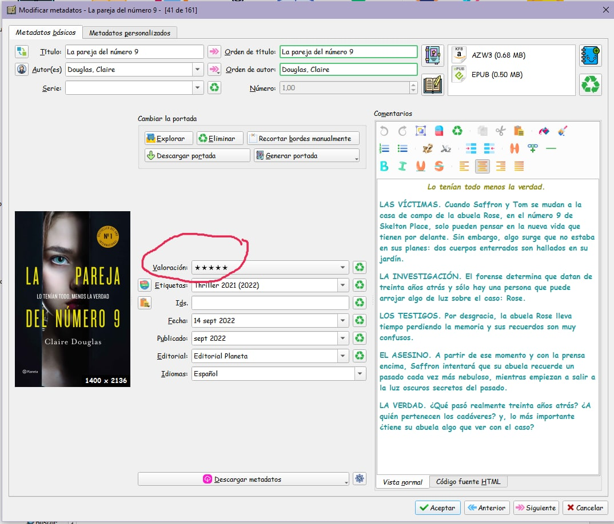
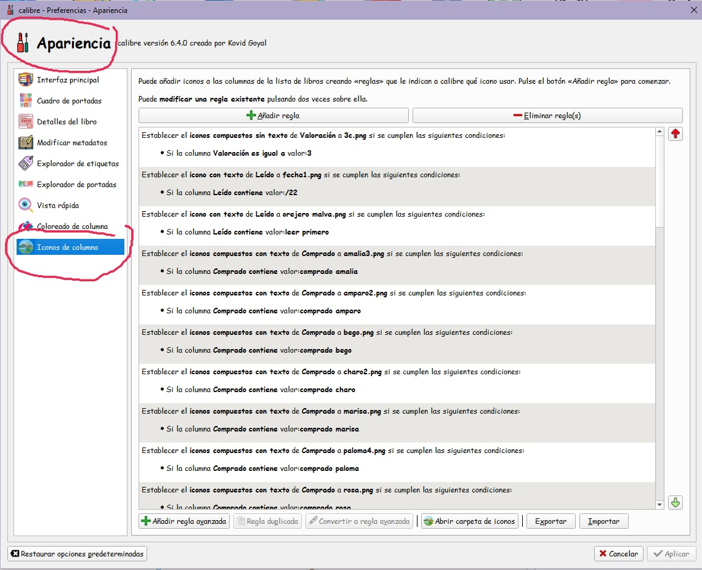
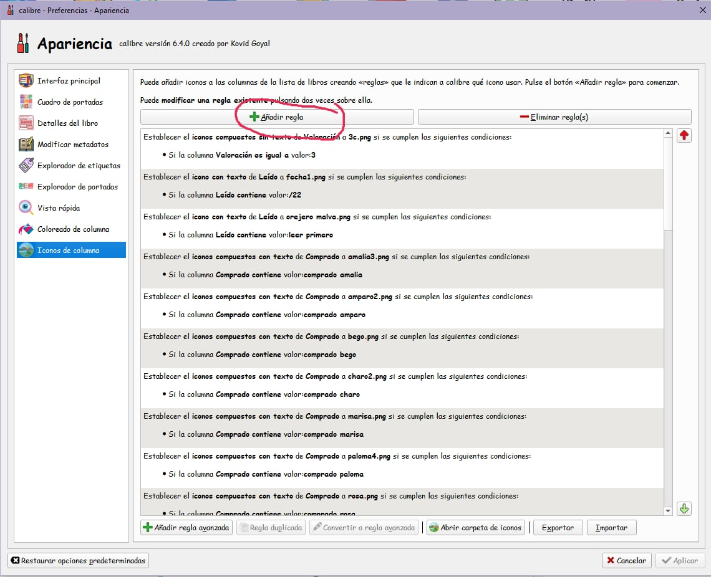
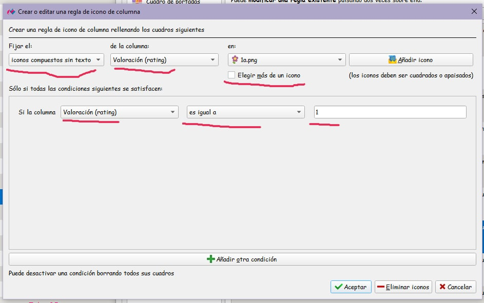
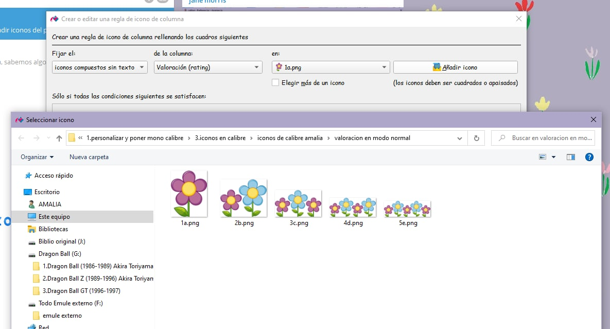
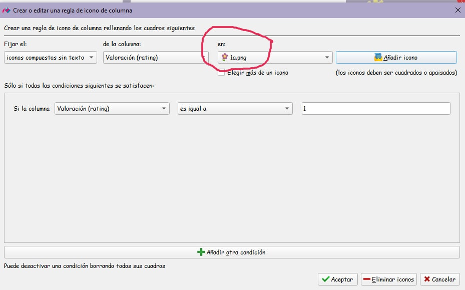
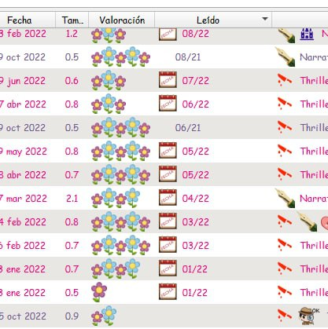

# Reemplazar las estrellas de calificación por una imagen a elección

:material-account: [Walter Paterno](https://t.me/Dunhill69){ target=_blank } · :material-link-variant: [Ver el original en Telegraph](https://telegra.ph/PONER-EL-ICONO-QUE-SE-QUIERA-EN-LUGAR-DE-LAS-ESTRELLITAS-EN-LA-COLUMNA-VALORACI%C3%93N-11-03){ target=_blank }
{ .tut-datos }

---

Explicado por @jane\_morris

EN MODO NORMAL DE VISTA CALIBRE (SIN MODO PORTADAS):

01) Primero preparar las imágenes según valoración del 1 al 5, en formato png para que se conserve la transparencia del fondo, y numerando cada imagen, por ejemplo, en mi caso son flores, aunque se puede hacer con lo que se quiera, guardarlas en una carpeta en el ordenador en un sitio que se sepa donde están para "traerlas" luego desde calibre:

02) Ir a calibre, y en cada libro poner la valoración en la ficha de metadatos por separado.

03) Clic en Preferencias —\>Apariencia —\> Iconos de columna

04) Click en añadir regla.

05) en la ficha que se nos abre, tiene que estar rellenada exactamente como esta (este ejemplo es para valoración 1 de 5):

06) para traer el icono, clic en añadir iconos del paso 05) al clicar en añadir icono, comunica directamente con el ordenador, hay que buscar la carpeta donde hemos guardado los dibujitos y elegir, en este caso el 1 ( si fuera 2 la valoración, pues el 2, si fuera un 3 pues la 3 y así hasta la 5)  cuando se encuentra doble clic justo encima de la imagen deseada, en este ejemplo de la 1

07) y ya vemos que nos queda igual que el pantallazo 05) Aceptamos en esa pantalla, aplicamos en la siguiente que nos sale, y cerramos en la siguiente, y ya está.

08) Eso mismo hay que hacer con cada valoración del 1 al 5 (para que sustituya a las estrellitas) si lo hemos hecho bien, exacto todo como cada uno de los pantallazos, nos quedará así nuestro calibre cuando esté en modo normal, no en modo portadas, (ahora veremos como hacerlo para modo portadas) y como digo siempre, descargaos los pantallazos numerados para que respeteis el orden al hacerlo.

Ir al mensaje: [https://t.me/calibreconfiguraciones/109615](https://t.me/calibreconfiguraciones/109615)

 

## [Volver al inicio](https://telegra.ph/Indice-Calibre-en-Espa%C3%B1ol-10-03)

 

 

 

 

 

 

 

 

---

[:material-arrow-left: Volver al índice](../../alfabetico.md) · [:fontawesome-brands-telegram: Preguntar en el grupo](https://t.me/calibreconfiguraciones){ target=_blank }
