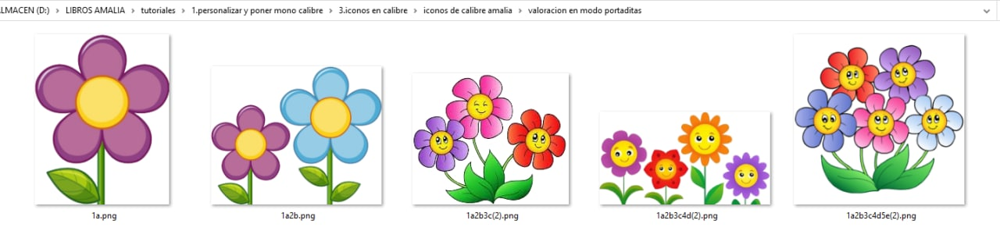
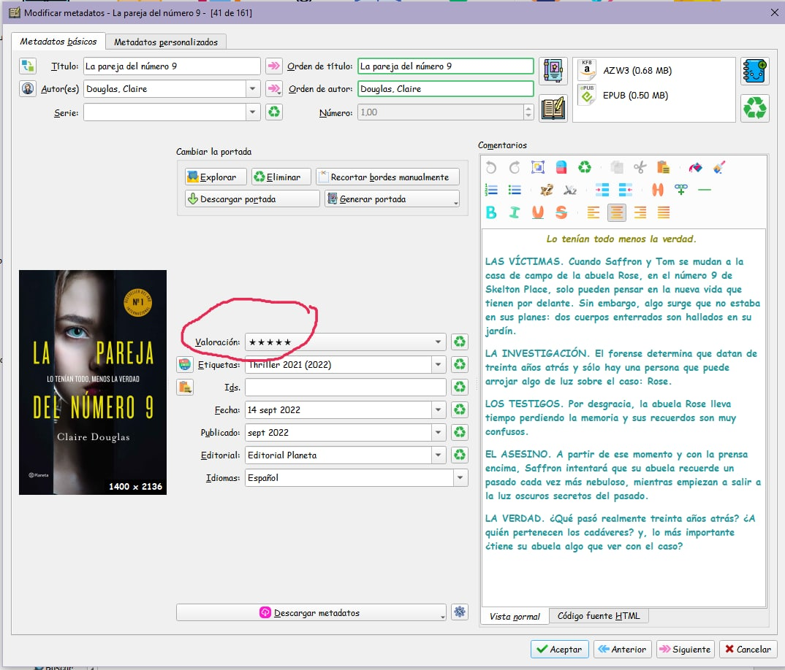
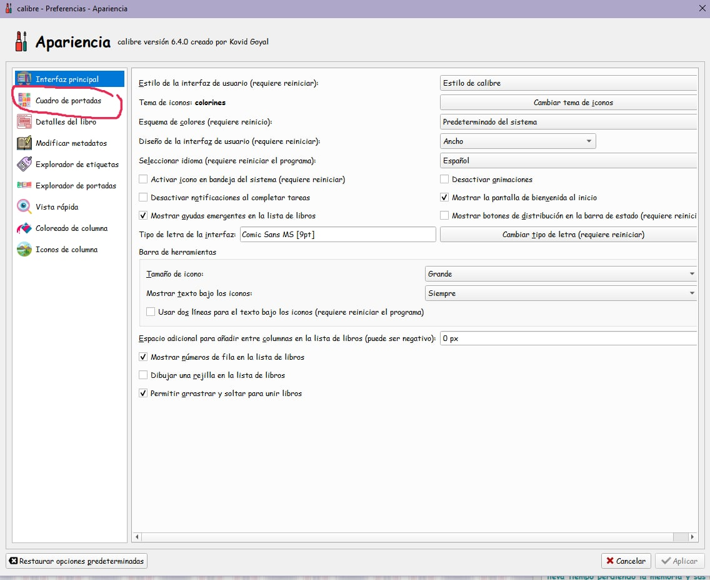
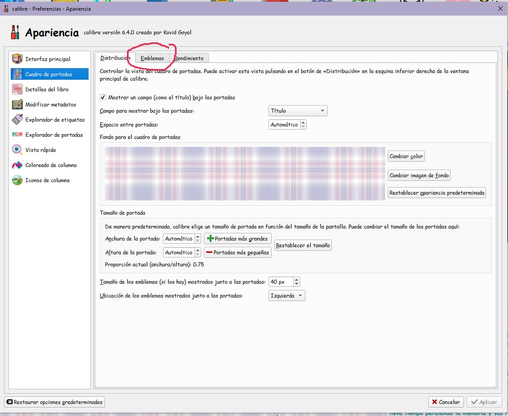
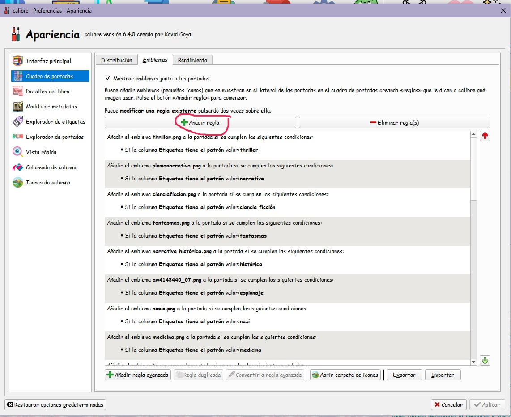
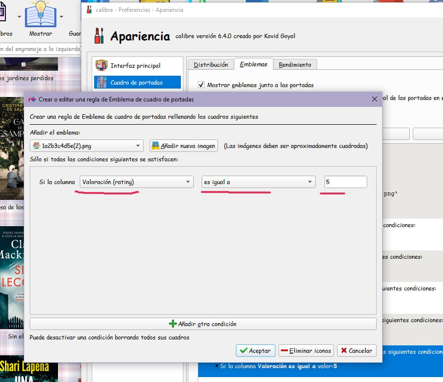
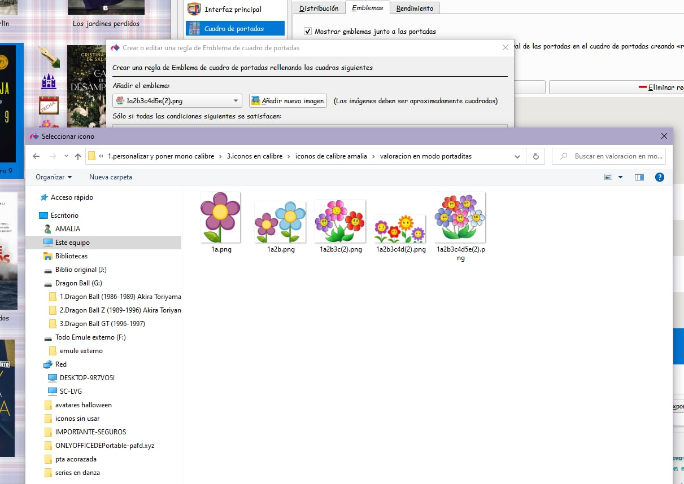

# Poner el ícono que se quiera en lugar de las estrellas (modo portadas)

:material-account: [Walter Paterno](https://t.me/Dunhill69){ target=_blank } · :material-link-variant: [Ver el original en Telegraph](https://telegra.ph/PONER-EL-ICONO-QUE-SE-QUIERA-EN-LUGAR-DE-LAS-ESTRELLITAS-EN-VALORACI%C3%93N-EN-MODO-PORTADAS-11-03){ target=_blank }
{ .tut-datos }

---

Explicado por @jane\_morris

01) Primero preparar las imágenes según valoración del 1 al 5, en formato png para que se conserve la transparencia del fondo, y numerando cada imagen, por ejemplo, en mi caso son flores, aunque se puede hacer con lo que se quiera, guardarlas en una carpeta en el ordenador en un sitio que se sepa donde están para "traerlas" luego desde calibre:

02) Ir a calibre, y en cada libro poner la valoración en la ficha de metadatos por separado

03) Clic en preferencias —\>apariencia —\> cuadro de portadas

04) en la pantalla que sale, clic en emblemas

05) en la pantalla que saldrá, añadir regla

06) la pantalla que os saldrá teneis que rellenarla exactamente igual que esta, en este caso el ejemplo es valoración 5, según cada valoración hay que poner el número que sea.

07) al clicar en añadir nueva imagen en el pantallazo anterior, el 06) os comunica con vuestro ordenador, vais a buscar la carpeta donde habeis guardado las imágenes y haceis doble clic en la que sea segun valoración, y al hacerlo vereis que se os rellena la casilla Añadir el emblema. Aceptais en esa pantalla, aplicais en la siguiente y cerrar en la siguiente.

y ya está, si lo habeis hecho todo bien, os quedará así vuestro calibre en modo portadas.

Ir al mensaje: [https://t.me/calibreconfiguraciones/109627](https://t.me/calibreconfiguraciones/109627)

## [Volver al inicio](https://telegra.ph/Indice-Calibre-en-Espa%C3%B1ol-10-03)

 

---

[:material-arrow-left: Volver al índice](../../alfabetico.md) · [:fontawesome-brands-telegram: Preguntar en el grupo](https://t.me/calibreconfiguraciones){ target=_blank }
