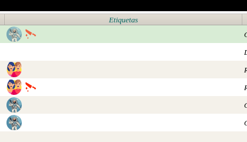
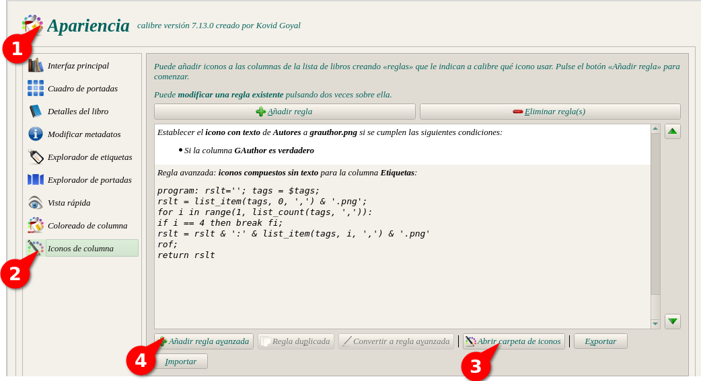
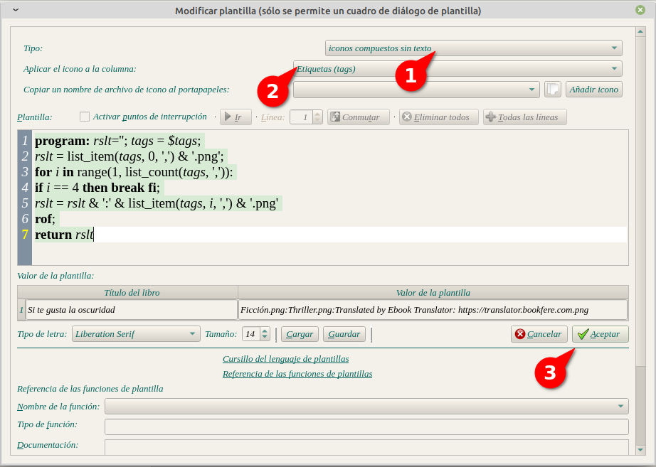
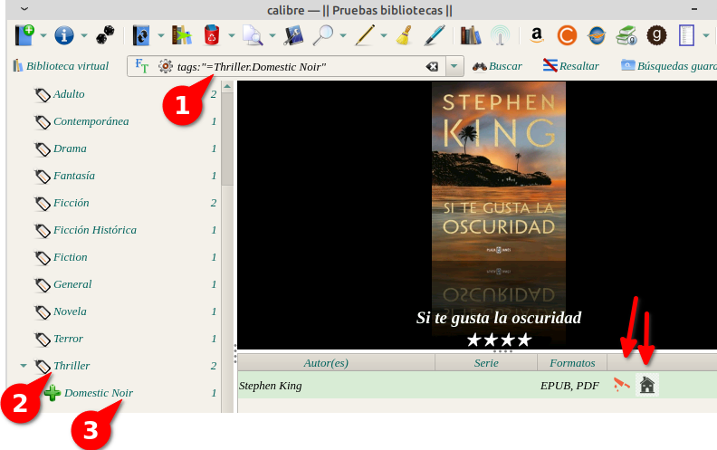

# Poner íconos en etiquetas

:material-account: [Walter](https://t.me/Dunhill69){ target=_blank } · :material-link-variant: [Ver el original en Telegraph](https://telegra.ph/Poner-Iconos-en-etiquetas-07-14){ target=_blank }
{ .tut-datos }

---

Bueno acá les traigo la formula para evitar crear una regla por cada categoría y que se vea una imagen en lugar del nombre de la etiqueta:

Vamos a usar esta formula en una regla avanzada:

program: rslt=''; tags = $tags;

rslt = list\_item(tags, 0, ',') & '.png';

for i in range(1, list\_count(tags, ',')):

if i == 4 then break fi;

rslt = rslt & ':' & list\_item(tags, i, ',') & '.png'

rof;

return rslt

El número 4 se puede cambiar por las cantidades de imágenes que queremos que se muestren

Se verá así

Para eso vemos a (1)Preferencias/Apariencia (2) Iconos en columna y en (3) la carpeta de iconos copiamos las imágenes que deben ser en pgn con el nombre de la categoria ej: Terror.pgn (4) Pegamos la formula que tenemos arriba.

En el cuerpo de la regla avanzada en

Tipo: Iconos compuestos sin texto.

Aplicar icono en la columna: Etiquetas (tags)

y le damos en aplicar. Espero que les sea útil y practico.

Ir al mensaje: [https://t.me/calibreconfiguraciones/112333/168105](https://t.me/calibreconfiguraciones/112333/168105)

 

**Categorías de Forma Jerárquicas:**

Si tenemos las etiquetas de categorías de forma jerárquicas deberemos tener cada icono por separado ej: Triller.png Domestic Noir.png y la formula avanzada será:                                                                                                       program: rslt=''; tags = $tags;

rslt = list\_item(tags, 0, '.') & '.png';

for i in range(1, list\_count(tags, '.')):

if i == 4 then break fi;

rslt = rslt & ':' & list\_item(tags, i, '.') & '.png'

rof;

return rslt

Ir al mensaje: [https://t.me/calibreconfiguraciones/112333/168233](https://t.me/calibreconfiguraciones/112333/168233)

 

[Volver al inicio](https://telegra.ph/Indice-Calibre-en-Espa%C3%B1ol-10-03)

 

 

---

[:material-arrow-left: Volver al índice](../../alfabetico.md) · [:fontawesome-brands-telegram: Preguntar en el grupo](https://t.me/calibreconfiguraciones){ target=_blank }
