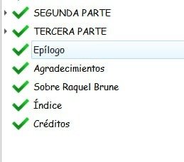
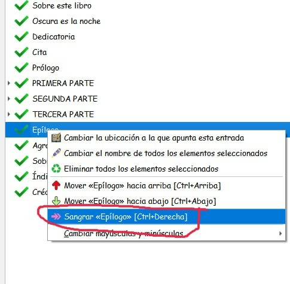

# Poner una entrada en una parte

:material-account: [Walter](https://t.me/Dunhill69){ target=_blank } · :material-link-variant: [Ver el original en Telegraph](https://telegra.ph/Poner-una-entrada-en-una-parte-Arreglo-libros-11-08){ target=_blank }
{ .tut-datos }

---

01) Es decir si quereis meter epilogo en la tercera parte.

02) Boton derecho encima de epilogo

Ir al mensaje: [https://t.me/calibreconfiguraciones/144967/150039](https://t.me/calibreconfiguraciones/144967/150039)

 

Volver al inicio

 

 

 

---

[:material-arrow-left: Volver al índice](../../alfabetico.md) · [:fontawesome-brands-telegram: Preguntar en el grupo](https://t.me/calibreconfiguraciones){ target=_blank }
