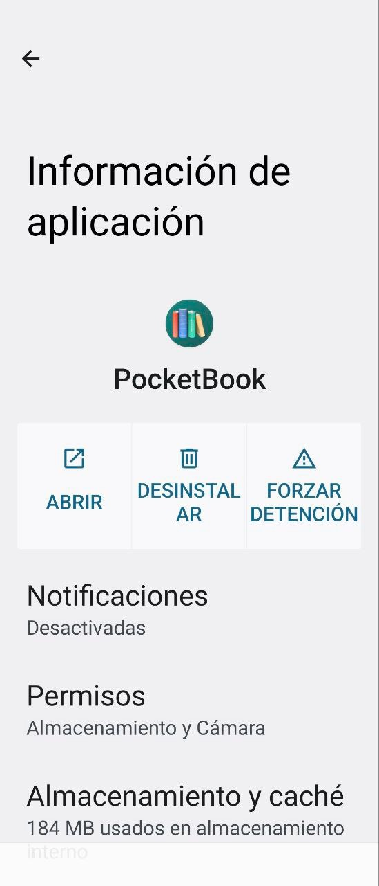
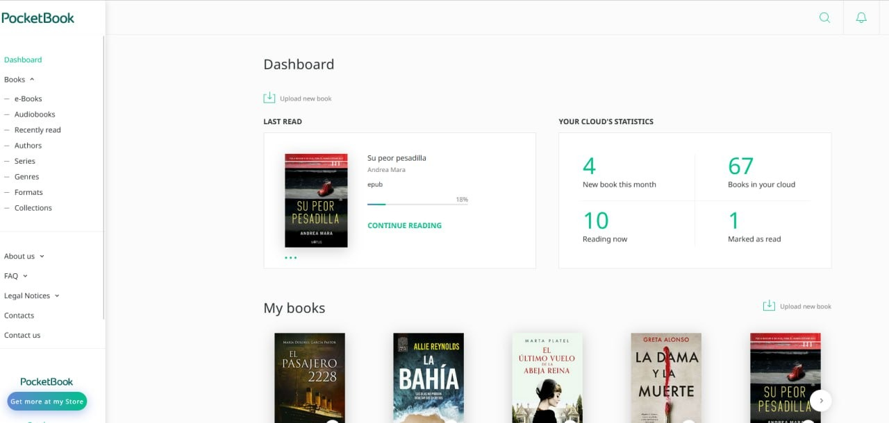
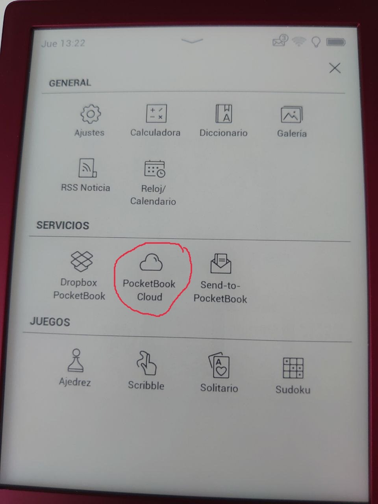

# PocketBook - primeros pasos

:material-account: [Walter Paterno](https://t.me/Dunhill69){ target=_blank } · :material-link-variant: [Ver el original en Telegraph](https://telegra.ph/Primeros-pasos-a-realizar-cuando-acabas-de-recibir-tu-pocketbook-01-27){ target=_blank }
{ .tut-datos }

---

Explico por @jane\_morris

1.- Descargarse en el movil esta aplicación, y registrarse en ella con un correo y una contraseña

2.- Entrar desde el ordenador en esta web, y registrarse con el mismo correo y la misma contraseña que se ha puesto en el movil, el orden es muy importante, primero en el movil y luego en el ordenador.

[https://cloud.pocketbook.digital/](https://cloud.pocketbook.digital/)

es esta página, no se puede poner en castellano pero se adivina bien lo que es

3.- Una vez registrados por este orden en el movil y en la nube de Pocketbook Cloud, coged vuestro ereader nuevecito y os registrais con el mismo correo y contraseña de siempre aquí

y con esto ya, todos los libros que tengais en uno de los tres sitios, ya sea el movil, la nube o el pocket apareceran a la vez en los tres sitios.

luego tendreis que poner en vuestro ereader el correo que tengais en adobe digital, pero aún no, porque ahora toca como descargar e instalar adobe

 

Ir al mensaje; [https://t.me/calibreconfiguraciones/124635/125084](https://t.me/calibreconfiguraciones/124635/125084)

 

 

## [Volver al inicio](https://telegra.ph/Indice-Calibre-en-Espa%C3%B1ol-10-03)

 

 

 

 

 

---

[:material-arrow-left: Volver al índice](../../alfabetico.md) · [:fontawesome-brands-telegram: Preguntar en el grupo](https://t.me/calibreconfiguraciones){ target=_blank }
