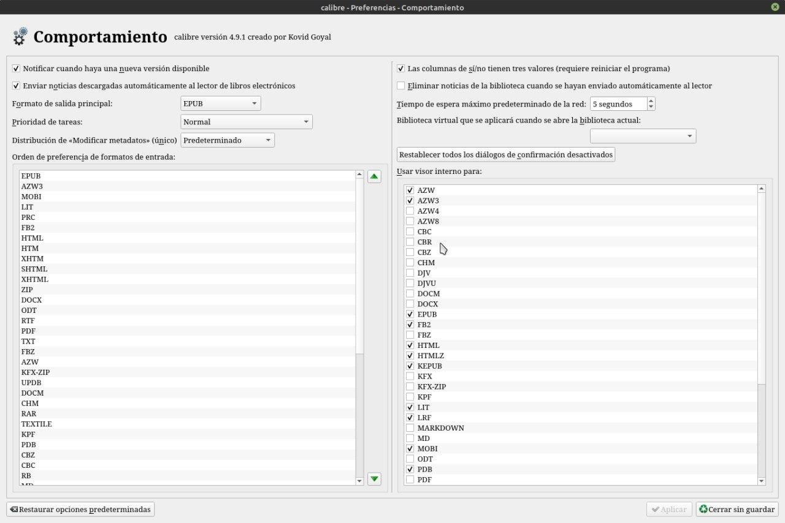

# Qué formatos abre Calibre

:material-account: [Walter](https://t.me/Dunhill69){ target=_blank } · :material-link-variant: [Ver el original en Telegraph](https://telegra.ph/Que-formatos-abre-Calibre-08-23){ target=_blank }
{ .tut-datos }

---

¿Que formatos de libros electrónicos abre Calibre?

Calibre abre con su visor de libros integrado, la mayoría de los formatos de libros electrónicos.

Porqué no me abre el visor de libros de Calibre con cierto archivo ?

Eso lo podemos resolver mirando en comportamiento de Calibre marcamos la extensión del formato del libro, en la columna **usar visor interno para** y listo.

## [Volver al inicio](https://telegra.ph/Indice-Calibre-en-Espa%C3%B1ol-10-03)

 

 

---

[:material-arrow-left: Volver al índice](../../alfabetico.md) · [:fontawesome-brands-telegram: Preguntar en el grupo](https://t.me/calibreconfiguraciones){ target=_blank }
