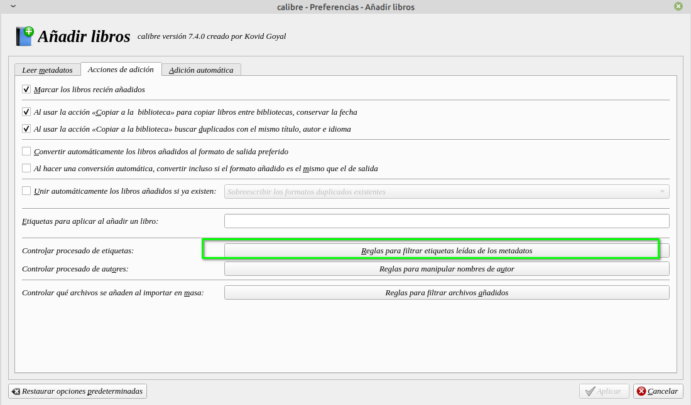
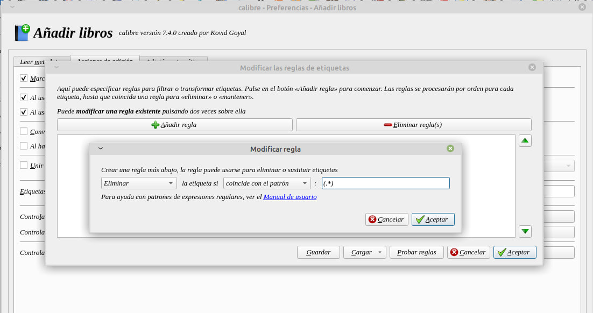
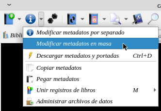
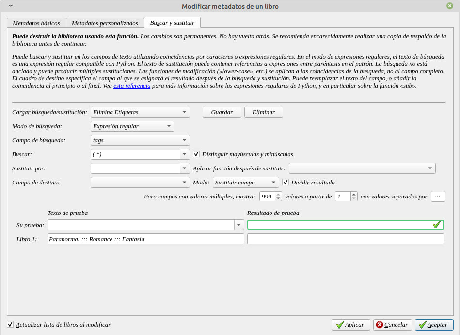

# Quitar etiquetas al añadir libros

:material-account: [Walter](https://t.me/Dunhill69){ target=_blank } · :material-link-variant: [Ver el original en Telegraph](https://telegra.ph/Quitar-etiquetas-al-a%C3%B1adir-libros-02-18){ target=_blank }
{ .tut-datos }

---

Esto es una herramienta para cuando estamos agregando libros, no cuando descargamos metadatos.

Vamos a Preferencias/Añadir libros

Y en la solapa Acciones de adición, tocamos el botón Reglas para filtrar etiquetas leídas de los metadatos.

Y creamos esta regla:

Y si queremos eliminar todas las etiquetas existentes creamos esta en la generación de metadatos en masa.

En la solapa Buscar y reemplazar.

## [Volver al inicio](https://telegra.ph/Indice-Calibre-en-Espa%C3%B1ol-10-03)

 

---

[:material-arrow-left: Volver al índice](../../alfabetico.md) · [:fontawesome-brands-telegram: Preguntar en el grupo](https://t.me/calibreconfiguraciones){ target=_blank }
