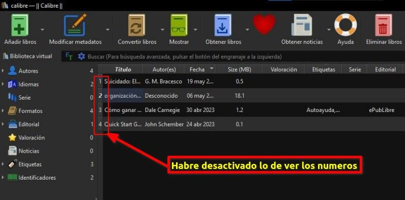
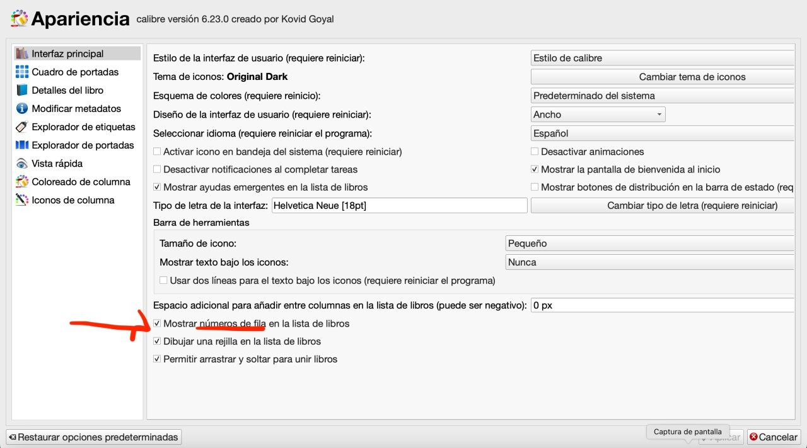

# Recuperar los números de registro en la vista principal

:material-account: [Walter](https://t.me/Dunhill69){ target=_blank } · :material-link-variant: [Ver el original en Telegraph](https://telegra.ph/Recuperar-n%C3%BAmeros-de-registros-en-la-vista-principal-08-03){ target=_blank }
{ .tut-datos }

---

Pregunta: He estado trasteando en Calibre y sin saber como he quitado los números que aparecen a la derecha del titulo.

Una manera de recuperar esos números??

Lo he buscado sin encontrar donde esta la opción de recuperar los.

Muchas gracias

Respuesta:

Ir al mensaje; [https://t.me/calibreconfiguraciones/112333/142342](https://t.me/calibreconfiguraciones/112333/142342)

## [Volver al inicio](https://telegra.ph/Indice-Calibre-en-Espa%C3%B1ol-10-03)

 

 

---

[:material-arrow-left: Volver al índice](../../alfabetico.md) · [:fontawesome-brands-telegram: Preguntar en el grupo](https://t.me/calibreconfiguraciones){ target=_blank }
