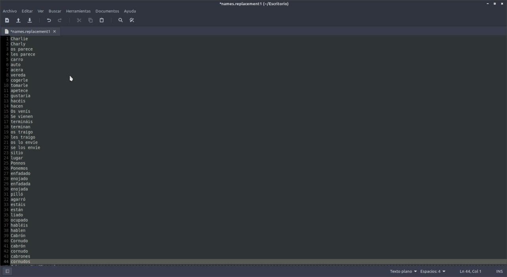
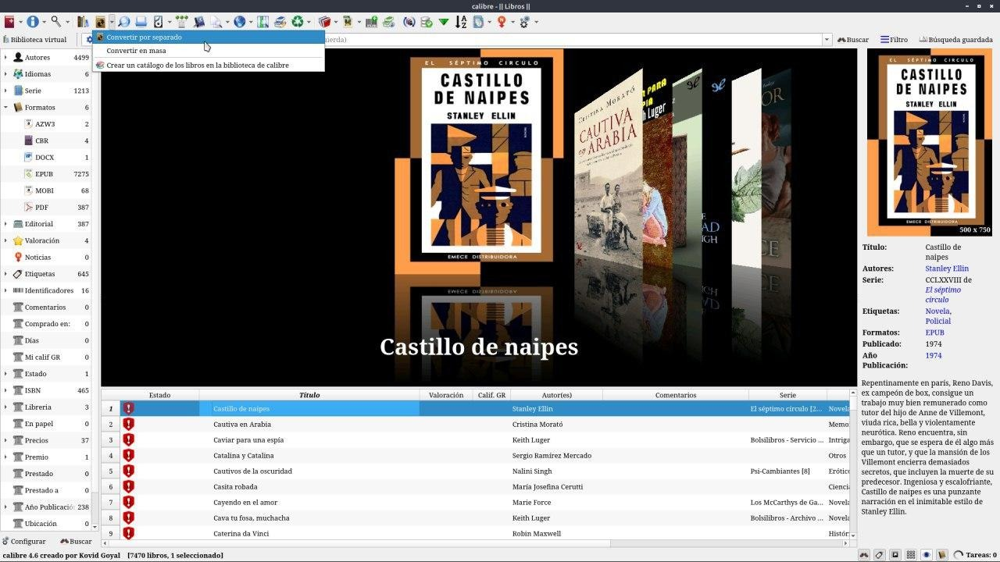
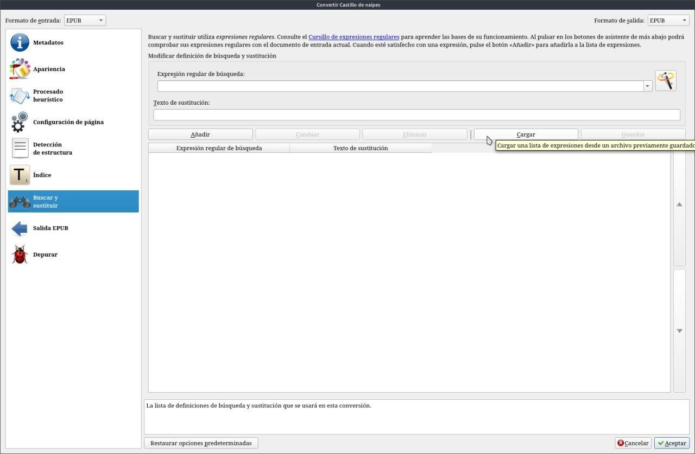
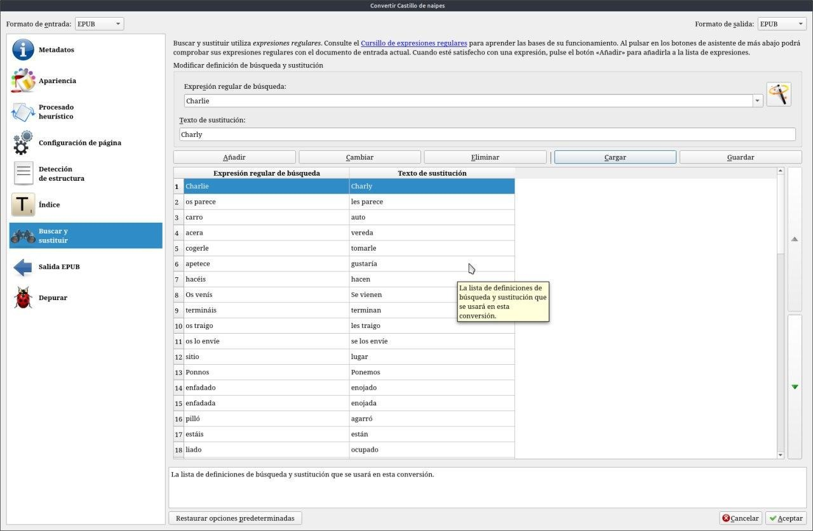
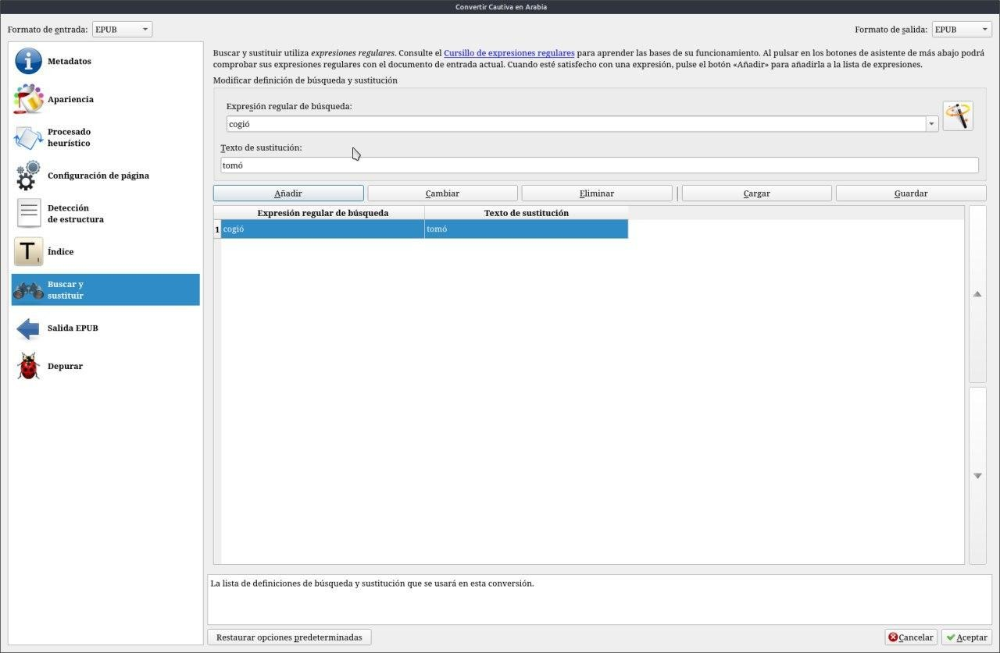
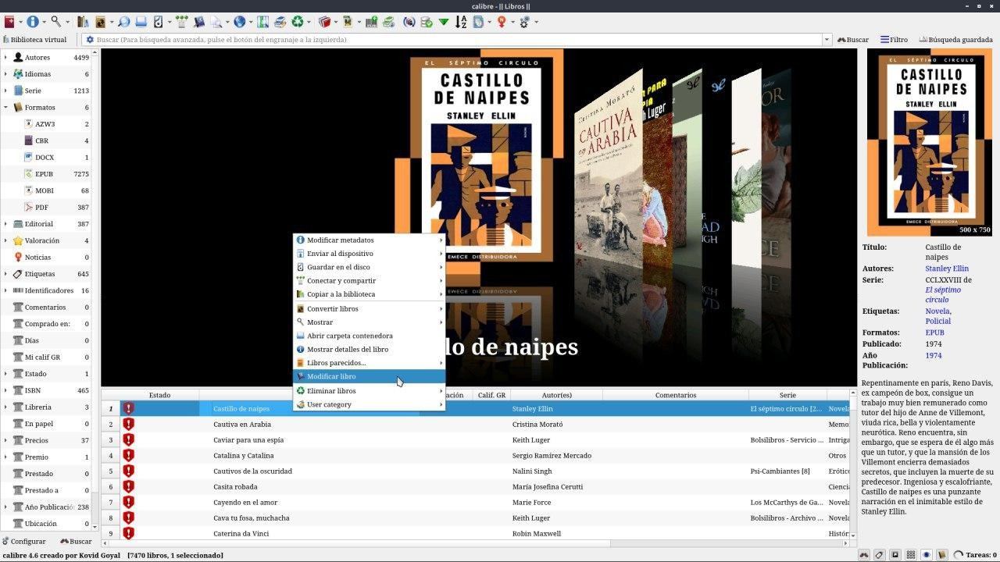
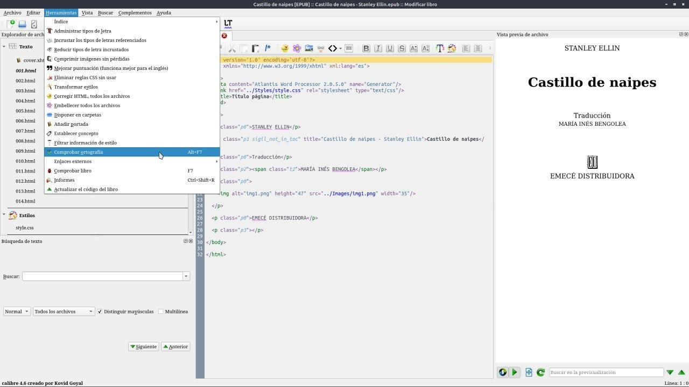
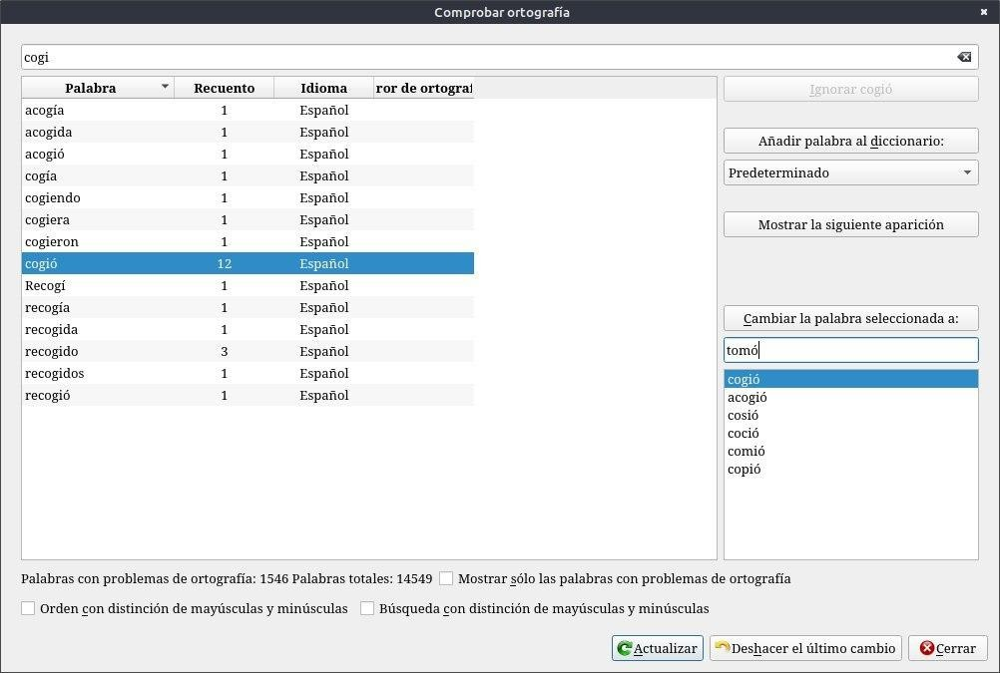

# Reemplazar palabras en el libro

:material-account: [Walter](https://t.me/Dunhill69){ target=_blank } · :material-link-variant: [Ver el original en Telegraph](https://telegra.ph/Reemplazar-palabras-en-el-libro-09-07){ target=_blank }
{ .tut-datos }

---

Hoy les voy a mostrar como paso del lenguaje español al lenguaje latino los libros. Hay dos maneras una automática y que puede fallar y otra personalizada y laboriosa. La Primera es tener un archivo de texto con palabras en español y su sinónimo en lengua latina, armado de la siguiente manera Palabra en lenguaje original y debajo la palabra al lenguaje a cambiar esto lo uso para los modismos españoles.

Vamos al icono convertir y tocamos la flechita del costado y marcamos convertir por separado.

Vamos a la opción Buscar y Sustituir y donde dice cargar buscamos donde tenemos nuestro archivo de texto anterior.

Y una vez seleccionado el archivo tenemos nuestra lista cargada.

En el caso de no tener un archivo podemos ir cargando las palabras en Expresión regular de búsqueda ( la palabra original) Texto de sustitución ( sinónimo) y ponemos añadir. Esto es para cada libro individualmente.

**La más laboriosa es:** Seleccionar el libro, botón izquierdo del mouse modificar libro.

Se nos abre el libro en formato html, donde podremos modificar todo el libro, y tocamos en Comprobar Ortografía.

Ahí nos aparece todas las palabras que tiene el libro y la cantidad de veces que esta. O podemos elegir por medio del filtro la palabra. Acá viene la parte difícil, ver el contexto de la palabra dentro de la oración. Si hacemos doble click en la palabra elegida nos la nuestra en la página del libro y la podemos editar manualmente o de forma automática, seleccionando la palabra y en el renglón debajo de Cambiar la palabra seleccionada a : ponemos el sinónimo. Una vez hecho el reemplazo cerramos y tenemos que guardar. Hay dos opciones guardar y guardar copia por las dudas.

Ir al mensaje: [https://t.me/calibreconfiguraciones/3119](https://t.me/calibreconfiguraciones/3119)

[https://telegra.ph/Reemplazar-palabras-en-el-libro-09-07](https://telegra.ph/Reemplazar-palabras-en-el-libro-09-07)

 

 

## [Volver al inicio](https://telegra.ph/Indice-Calibre-en-Espa%C3%B1ol-10-03)

 

 

---

[:material-arrow-left: Volver al índice](../../alfabetico.md) · [:fontawesome-brands-telegram: Preguntar en el grupo](https://t.me/calibreconfiguraciones){ target=_blank }
