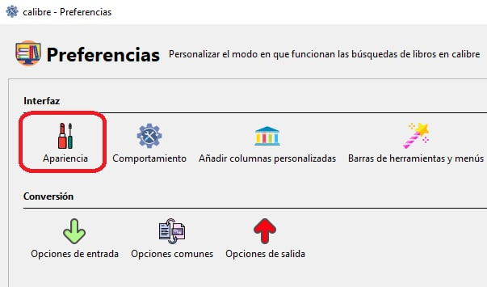
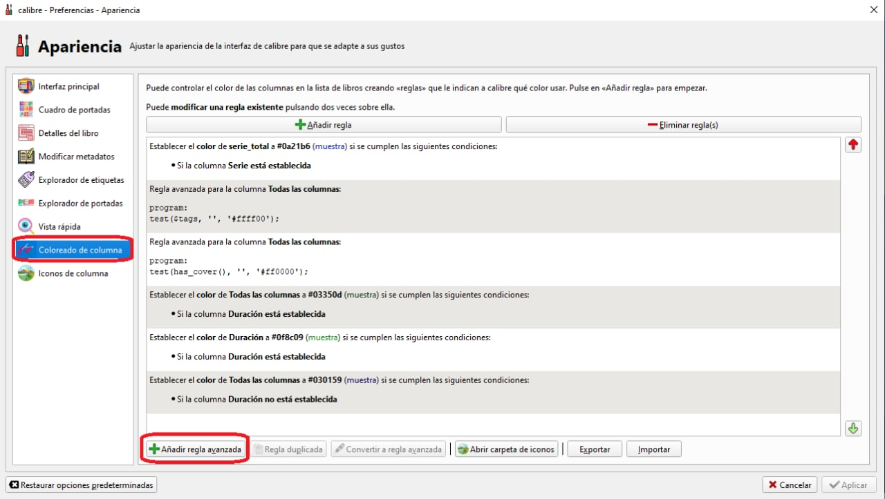
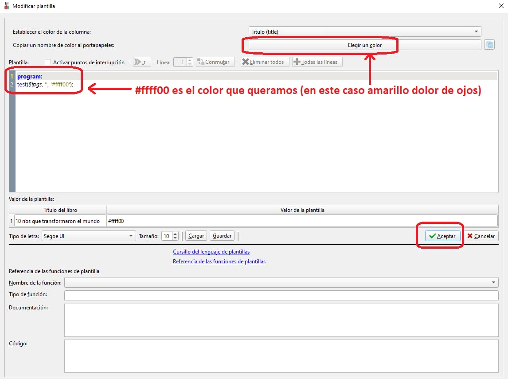

# Colorear título de libros sin etiqueta

:material-account: [@wiso\_wolo](https://t.me/Dunhill69){ target=_blank } · :material-link-variant: [Ver el original en Telegraph](https://telegra.ph/Regla-para-los-libros-sin-etiqueta-11-13){ target=_blank }
{ .tut-datos }

---

Por @wiso\_wolo

Como crear un Regla para colorear Columnas de los libros que NO tengan etiquetas (voy a colorear SOLO el titulo)

1º Vamos a Calibre/Preferencias/Apariencia

2º Creamos una regla avanzada

3º nuestra regla avanzada tendrá el siguiente código

program:

test($tags, '', '#ffff00');

 

Aplicamos la regla, la 1º del tito de colorear 1 columna de titulo y somos felices con el resultado.

1º Vamos a Calibre/Preferencias/Apariencia

2º Creamos una regla avanzada

3º nuestra regla avanzada tendrá el siguiente código

program:

test($tags, '', '#ffff00');

NOTA IMPORTANTE:

Nuestra regla para colorear la columna de titulo debe ser la 1º de las reglas que coloreen el titulo, para que no haya otra regla que pinte de otro color, ya que solo se aplica la 1º regla que cumple las condiciones.

Recordar que hay 2 tipos de reglas:

1) Las que se aplican a todas las columnas

2) Las que se aplican a una columna concreta (en este caso la columna titulo)

Solo se aplica la 1º regla que cumpla las condiciones, es decir, si tienes 2 o 3 reglas que coloreen la columna de titulo, solo se va a aplicar la 1a de ellas, por que lo yo pondría en orden las que mas nos interese.

En este caso nos interesa, si o si ver los libros sin portada o los libros sin etiquetas, así que esa regla será la 1º de tu clase.

Y cuando ya tengamos arreglada la biblioteca las podemos bajar al final del todo (en lugar de borrarlas), donde no se aplicaran, ya que habrán otras reglas que se apliquen antes.

 

Ir al mensaje: [https://t.me/calibreconfiguraciones/113218?thread=112333](https://t.me/calibreconfiguraciones/113218?thread=112333)

 

## [Volver al inicio](https://telegra.ph/Indice-Calibre-en-Espa%C3%B1ol-10-03)

 

---

[:material-arrow-left: Volver al índice](../../alfabetico.md) · [:fontawesome-brands-telegram: Preguntar en el grupo](https://t.me/calibreconfiguraciones){ target=_blank }
