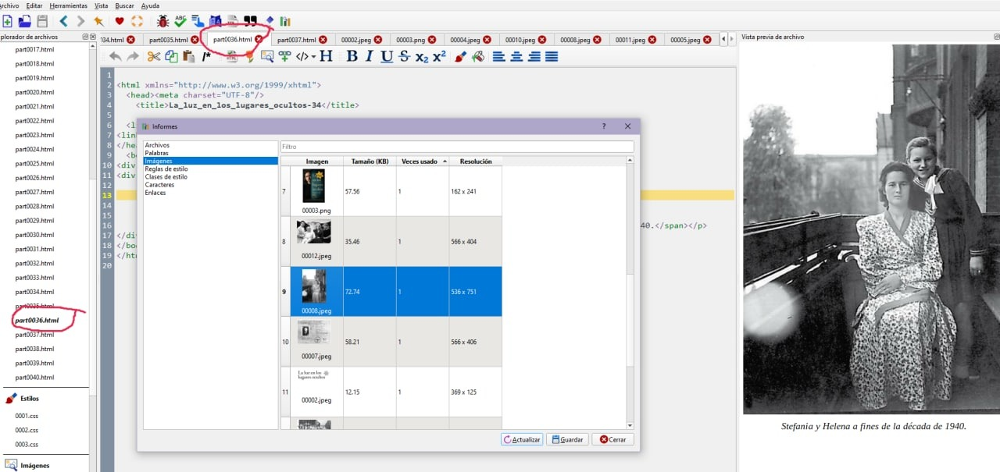

# Saber en qué HTML está una imagen determinada

:material-account: [@Bizentte](https://t.me/Dunhill69){ target=_blank } · :material-link-variant: [Ver el original en Telegraph](https://telegra.ph/SABER-EN-QUE-HTML-EST%C3%81-UNA-DETERMINADA-IMAGEN-04-20){ target=_blank }
{ .tut-datos }

---

 

(Desde "Modificar libro")

(MINI TUTO SIGUIENDO LAS ENSEÑANZAS DE @Bizentte)

Situados en Modificar libro, en la imagen que se quiera saber donde está, clicar en :

Herramientas —-\>Informes—\> Imágenes

Una vez que aparece la ventanita, doble clic justo encima de la imagen y te lleva al sitio, y a la vez te señala a la izquierda en los html cual es

Ir al mensaje: [https://t.me/calibreconfiguraciones/73529](https://t.me/calibreconfiguraciones/73529)

 

## [Volver al inicio](https://telegra.ph/Indice-Calibre-en-Espa%C3%B1ol-10-03)

 

 

---

[:material-arrow-left: Volver al índice](../../alfabetico.md) · [:fontawesome-brands-telegram: Preguntar en el grupo](https://t.me/calibreconfiguraciones){ target=_blank }
