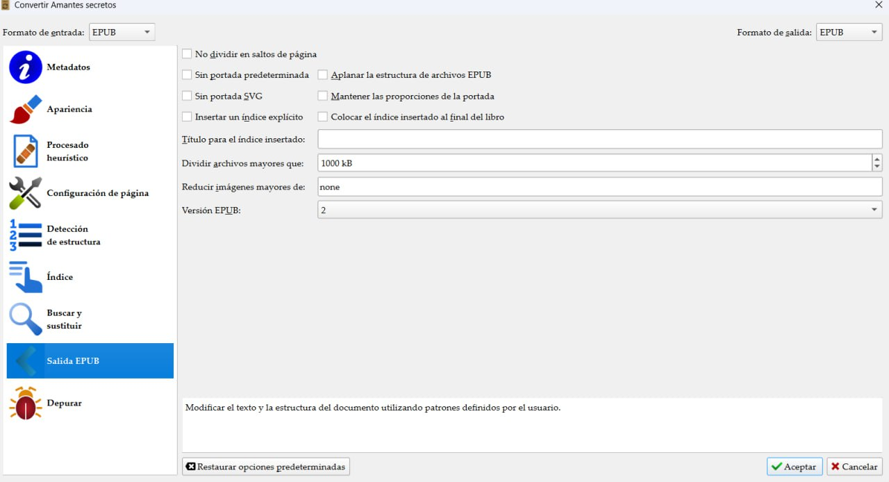

# Se corta un capítulo al convertir a EPUB

:material-account: [@aurorasu](https://t.me/Dunhill69){ target=_blank } · :material-link-variant: [Ver el original en Telegraph](https://telegra.ph/Se-corta-cap%C3%ADtulo-al-convertir-a-epub-08-21){ target=_blank }
{ .tut-datos }

---

Explicado por @aurorasu

Os comento algo, pero no se si ya lo sabéis. Cuando se convierte un libro, hay veces que sin llevar el código \<h1 o \<h2, se corta el capítulo y se convierte en dos, teniendo la misma numeración, pero siempre terminando en 0000 y el otro 0001. Hay una forma de evitar esto. Pongo una imagen,

Y veréis que donde pone Dividir archivos mayores que: he modificado y he puesto 1.000.

 

Ir al mensaje: [https://t.me/calibreconfiguraciones/112333/142863](https://t.me/calibreconfiguraciones/112333/142863)

## [Volver al inicio](https://telegra.ph/Indice-Calibre-en-Espa%C3%B1ol-10-03)

 

---

[:material-arrow-left: Volver al índice](../../alfabetico.md) · [:fontawesome-brands-telegram: Preguntar en el grupo](https://t.me/calibreconfiguraciones){ target=_blank }
