# Separar capítulos en archivos diferentes

:material-account: [Walter Paterno](https://t.me/Dunhill69){ target=_blank } · :material-link-variant: [Ver el original en Telegraph](https://telegra.ph/Separar-capitulos-en-archivos-diferentes-10-07){ target=_blank }
{ .tut-datos }

---

Explicado por @jane\_morris

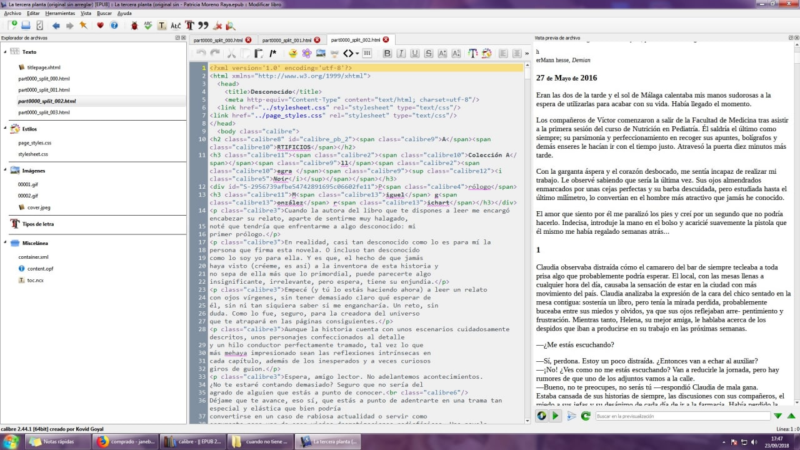

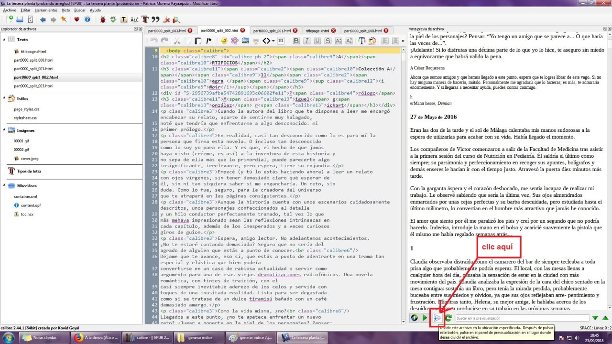

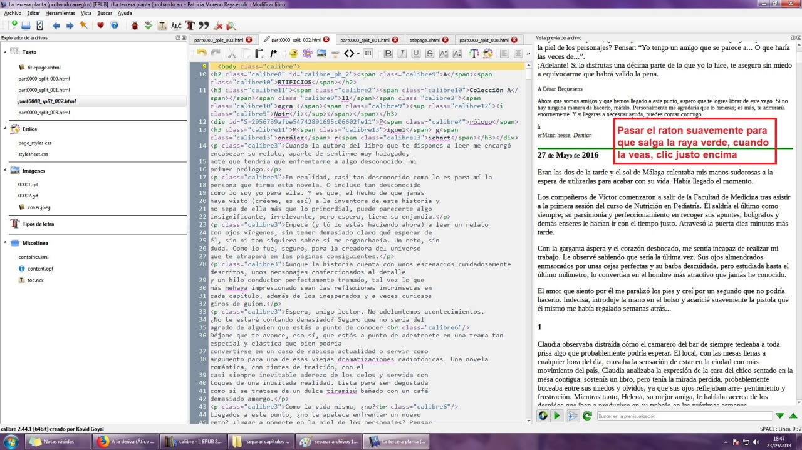

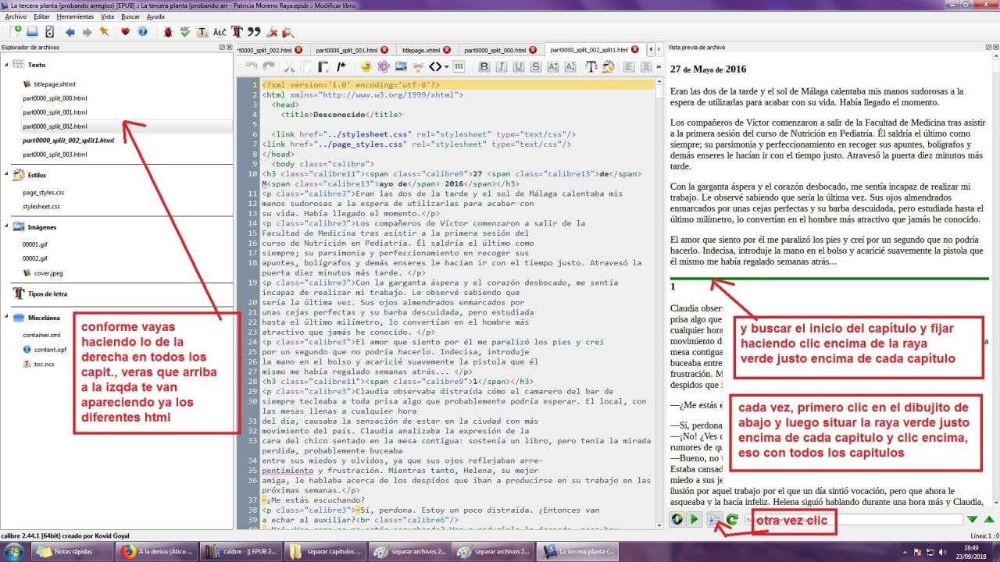

Y otra forma de hacerlo, quizás más directa porque a la vez generas el índice

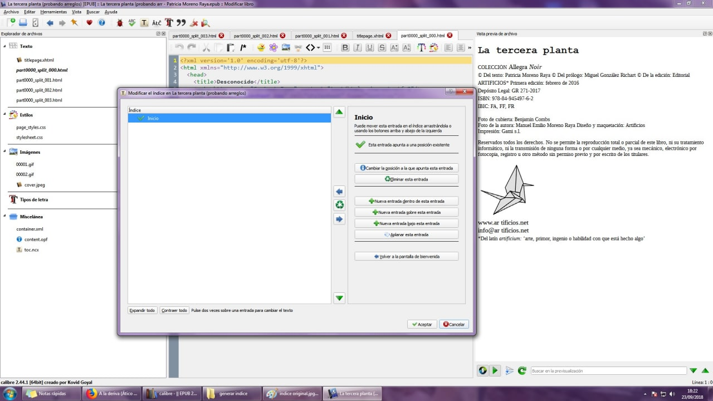

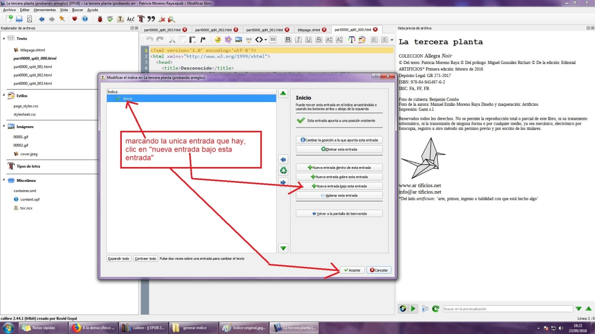

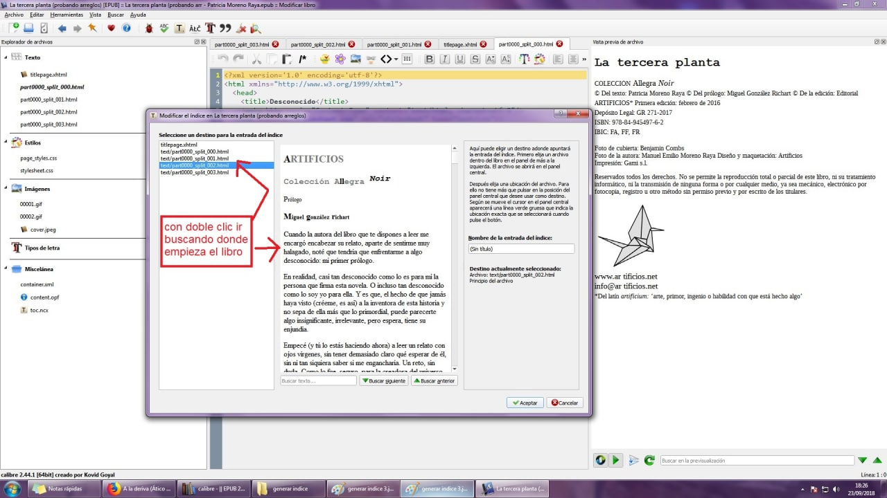

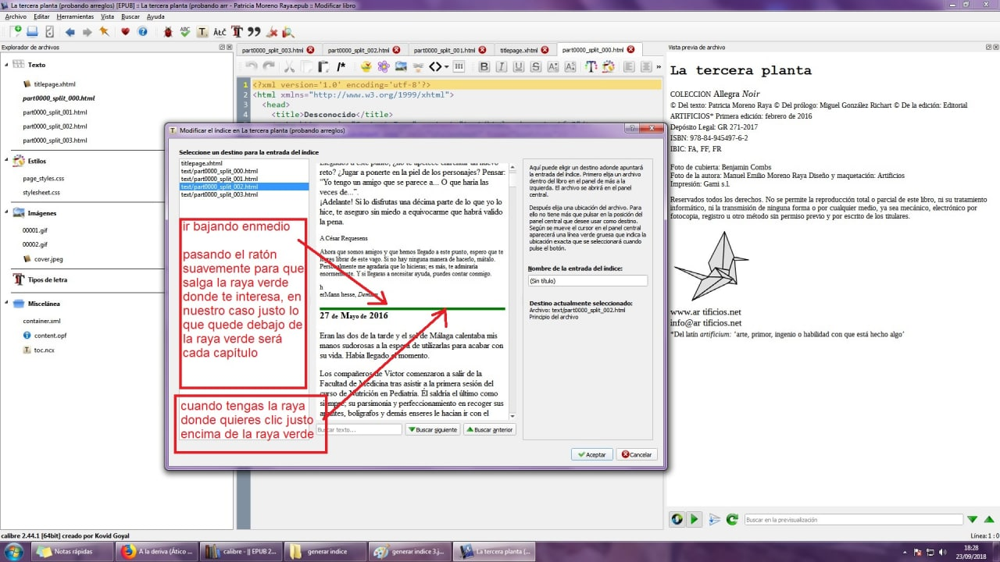

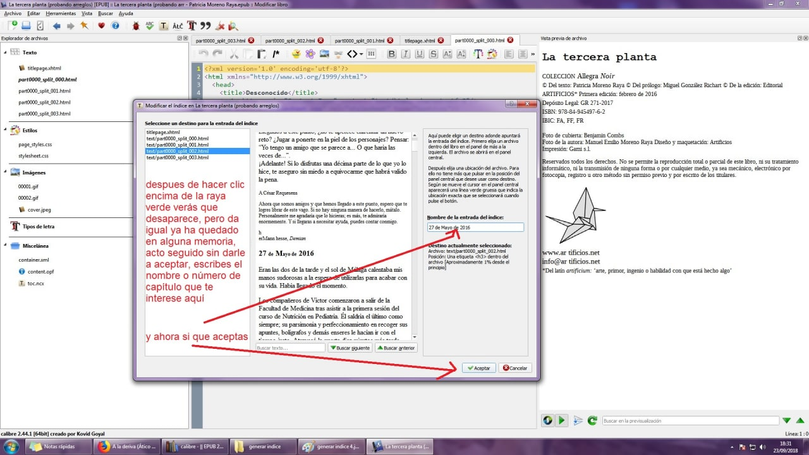

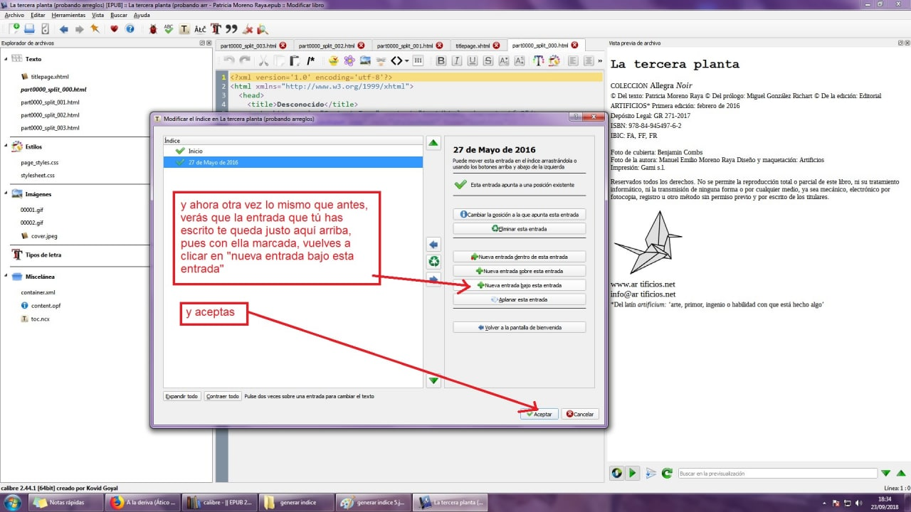

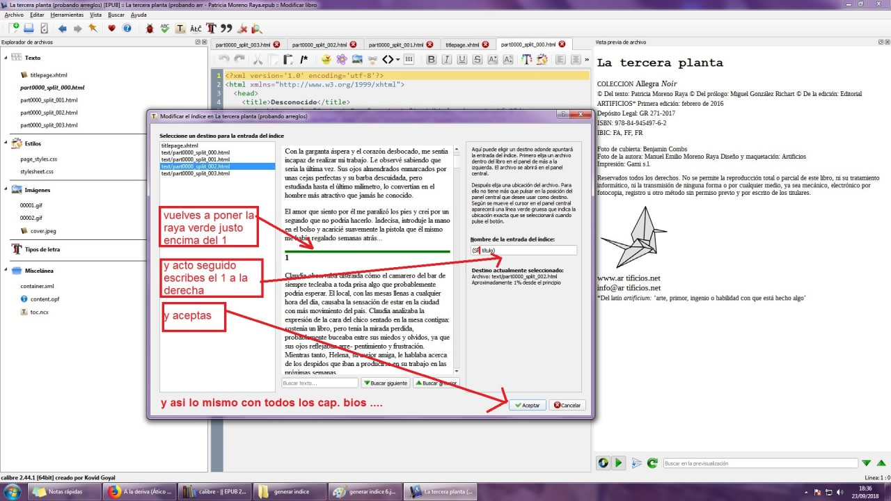

Ir al mensaje:[https://t.me/calibreconfiguraciones/104589](https://t.me/calibreconfiguraciones/104589)

 

## [Volver al inicio](https://telegra.ph/Indice-Calibre-en-Espa%C3%B1ol-10-03)

 

 

---

[:material-arrow-left: Volver al índice](../../alfabetico.md) · [:fontawesome-brands-telegram: Preguntar en el grupo](https://t.me/calibreconfiguraciones){ target=_blank }
