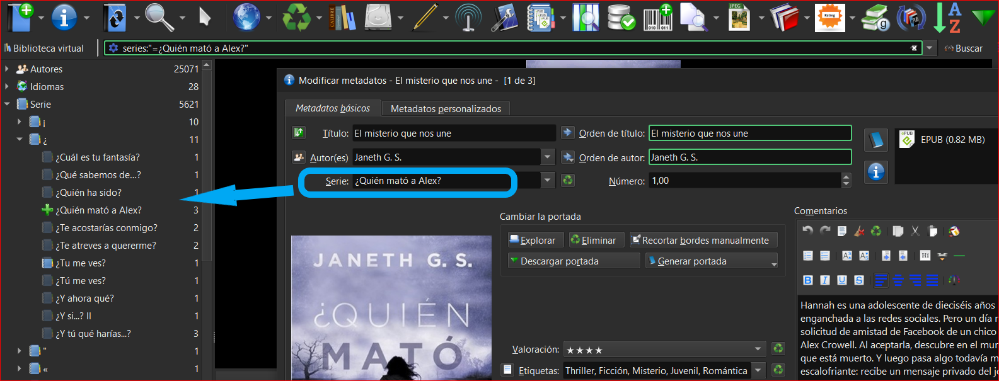

# Series - cómo se ordenan

:material-account: [Walter](https://t.me/Dunhill69){ target=_blank } · :material-link-variant: [Ver el original en Telegraph](https://telegra.ph/Series---Como-se-ordenan-09-07){ target=_blank }
{ .tut-datos }

---

Calibre organiza por Series ?

Si siempre y cuando se la hayamos puesto ya sea en forma manual o con la ayuda de algún plugin.

En la ventana central nos muestra donde debemos poner el nombre de la Serie y al costado izquierdo donde se van organizando.

ir al mensaje: [https://t.me/calibreconfiguraciones/1015](https://t.me/calibreconfiguraciones/1015)

[https://telegra.ph/Series---Como-se-ordenan-09-07](https://telegra.ph/Series---Como-se-ordenan-09-07)

 

## [Volver al inicio](https://telegra.ph/Indice-Calibre-en-Espa%C3%B1ol-10-03)

 

 

---

[:material-arrow-left: Volver al índice](../../alfabetico.md) · [:fontawesome-brands-telegram: Preguntar en el grupo](https://t.me/calibreconfiguraciones){ target=_blank }
