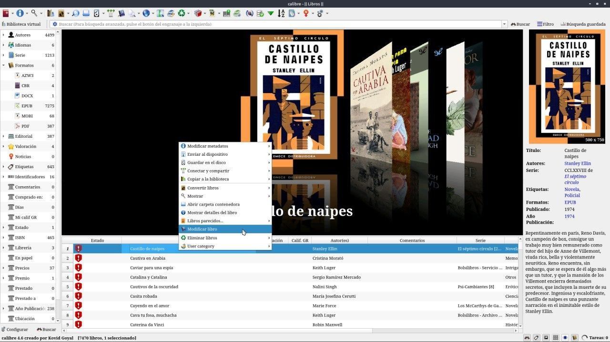
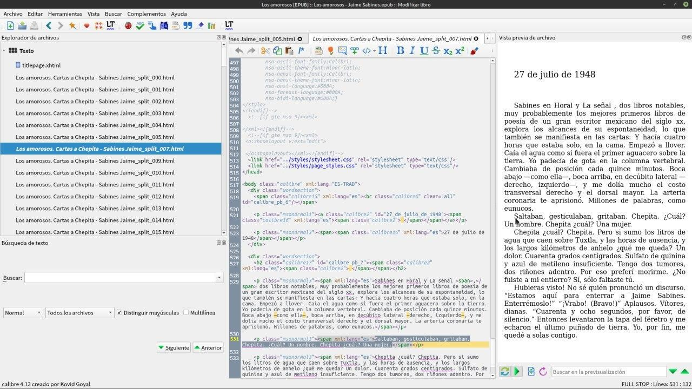
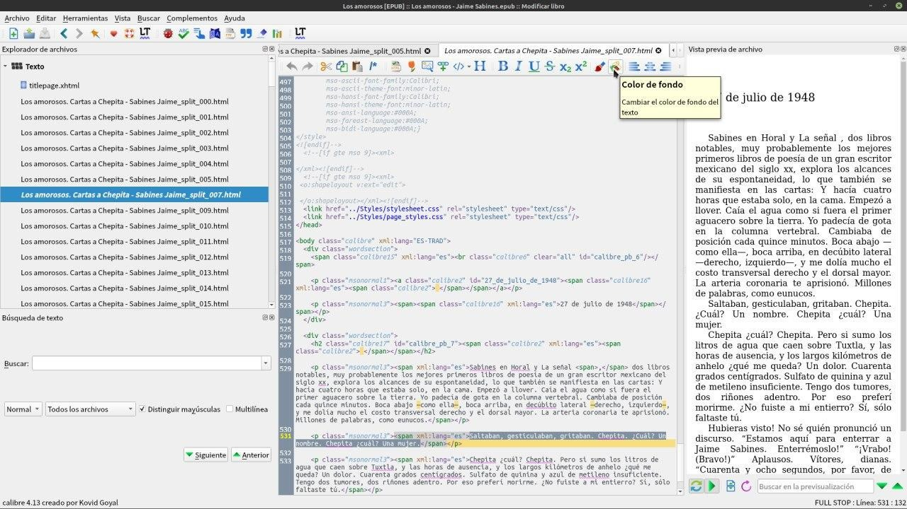
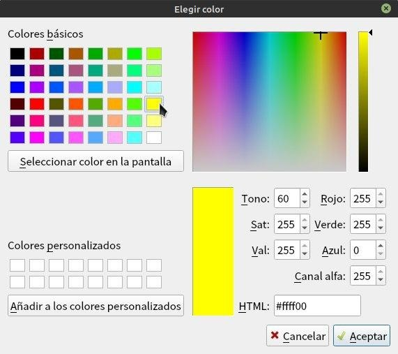
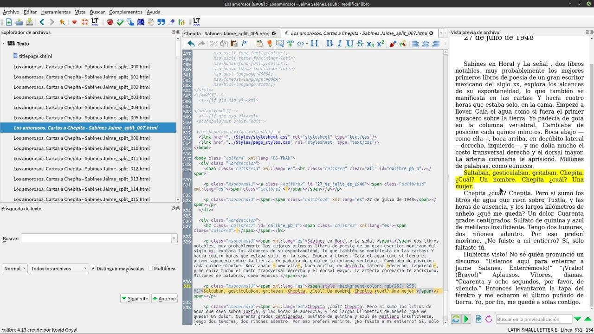
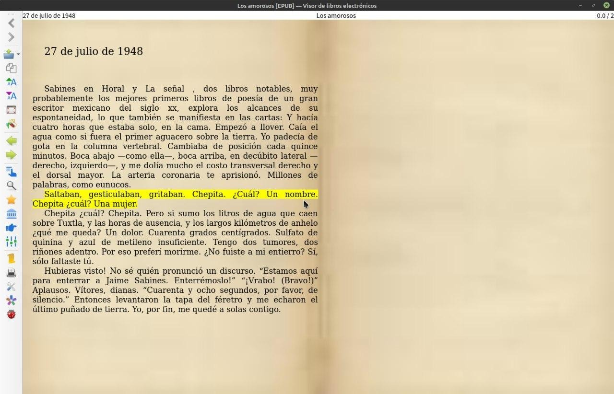

# Subrayar libros con Calibre

:material-account: [Walter](https://t.me/Dunhill69){ target=_blank } · :material-link-variant: [Ver el original en Telegraph](https://telegra.ph/Subrayar-libros-con-Calibre-09-07){ target=_blank }
{ .tut-datos }

---

Vamos a Modificar libro seleccionado el libro botón derecho del mouse modificar libro

Se nos abre esta pantalla, buscamos el texto que queremos subrayar.

Arriba y con el texto seleccionado seleccionamos color de fondo.

Así queda subrayado, ponemos guardar.

Abrimos el libro con el visor de Calibre y veremos que esta subrayado.

Ir al mensaje: [https://t.me/calibreconfiguraciones/9989](https://t.me/calibreconfiguraciones/9989)

[https://telegra.ph/Subrayar-libros-con-Calibre-09-07](https://telegra.ph/Subrayar-libros-con-Calibre-09-07)

 

## [Volver al inicio](https://telegra.ph/Indice-Calibre-en-Espa%C3%B1ol-10-03)

 

---

[:material-arrow-left: Volver al índice](../../alfabetico.md) · [:fontawesome-brands-telegram: Preguntar en el grupo](https://t.me/calibreconfiguraciones){ target=_blank }
