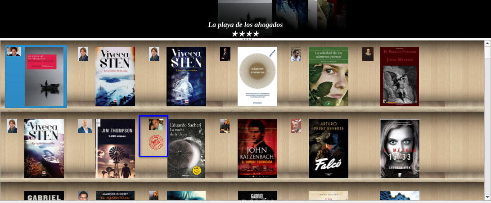
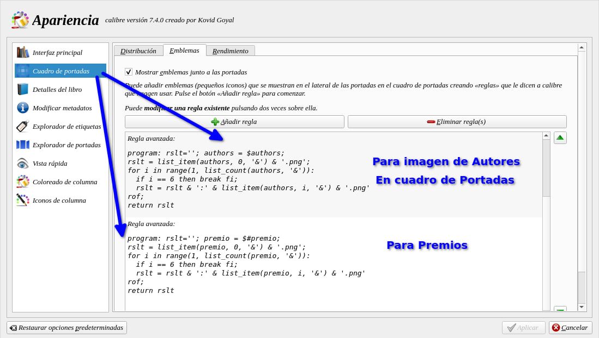
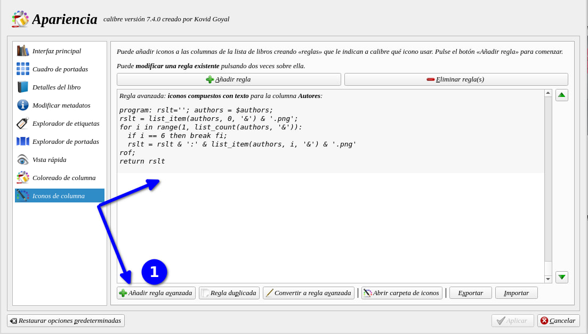
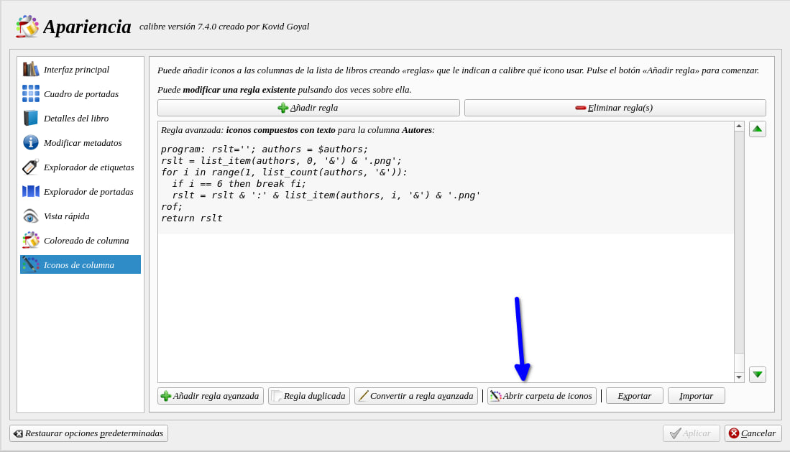
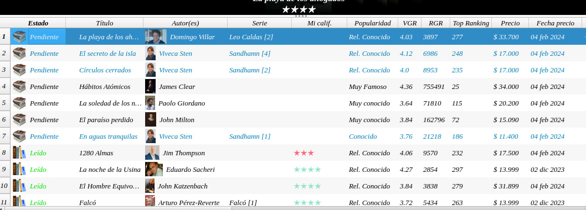

# Foto del autor en la vista principal

:material-account: [Walter](https://t.me/Dunhill69){ target=_blank } · :material-link-variant: [Ver el original en Telegraph](https://telegra.ph/Tener-la-foto-del-autor-en-vista-principal-02-05){ target=_blank }
{ .tut-datos }

---

Bueno como hoy es mi primer día de vacaciones y antes de irme a algún lado en familia estoy dedicándole tiempo a mi biblioteca. Como algunos sabrán yo en la vista de portadas tengo la foto de los autores y la foto de los premios o si son bestseller.

Y me preguntaba podré usar la misma formula en la vista principal de Calibre, para tener la foto del Autor sin tener que escribir el nombre del mismo en cada regla. Y ahí vamos.

Como se ven en Preferencia/Apariencia la formula que está en los emblemas quiero pasar la de los autores a iconos en columna.

Copio la formula que a continuación les voy a dejar como una regla avanzada y soporta 6 imágenes.

program: rslt=''; authors = $authors;

rslt = list\_item(authors, 0, '&') & '.png';

for i in range(1, list\_count(authors, '&')):

if i == 6 then break fi;

rslt = rslt & ':' & list\_item(authors, i, '&') & '.png'

rof;

return rslt

 

Recuerden que las imágenes tienen que estar en formato png porque la formula así lo dice. Y tienen que estar en esta carpeta. Después podríamos jugar de que todas las imágenes tuvieran el mismo formato de tamaño.

Y con las imágenes incorporadas que deben llevar el mismo nombre del autor así se ve el resultado.

Ir al mensaje: [https://t.me/calibreconfiguraciones/112333/155598](https://t.me/calibreconfiguraciones/112333/155598)

## [Volver al inicio](https://telegra.ph/Indice-Calibre-en-Espa%C3%B1ol-10-03)

 

 

---

[:material-arrow-left: Volver al índice](../../alfabetico.md) · [:fontawesome-brands-telegram: Preguntar en el grupo](https://t.me/calibreconfiguraciones){ target=_blank }
