# Traducir un complemento

:material-account: [Walter](https://t.me/Dunhill69){ target=_blank } · :material-link-variant: [Ver el original en Telegraph](https://telegra.ph/Traducir-un-plugin-11-26){ target=_blank }
{ .tut-datos }

---

Primero tener descargado el plugin como un archivo zip

En el escritorio creamos una carpeta para trabajar con los archivos que están dentro del zip,

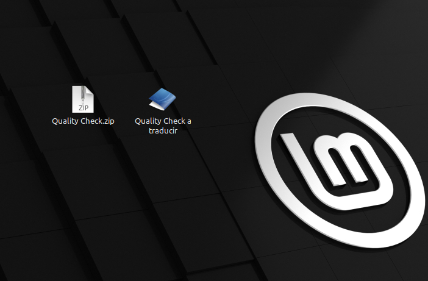

por lo tanto descomprimimos los archivos del zip del complemento dentro de la carpeta que hemos creado, (recomiendo que la carpeta lleve el nombre del complemento y que lo diferencie de la versión original). Dentro de esa carpeta deberemos crear otra carpeta que se llame **translations** que es donde deberemos poner los archivos los archivos po y mo que son los de la traducción.

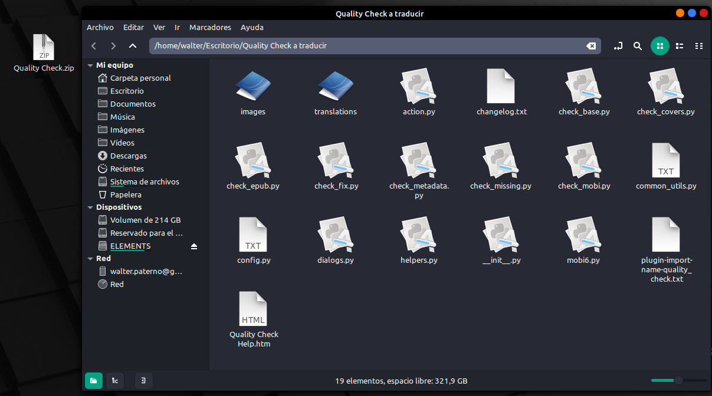

Vamos abriendo uno a uno los archivos para encontrar las cadenas de texto a marcar con \_( )

En el archivo que hayamos encontrado algo para traducir, hay que poner en las primeras líneas de los archivos este código:

 

try:

load\_translations()

except NameError:

pass # load\_translations() added in calibre 1.9

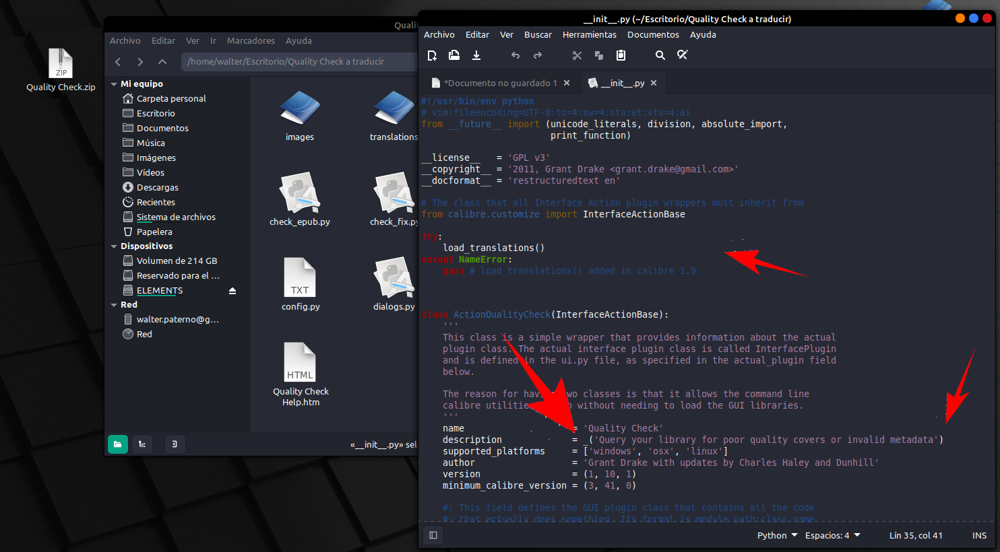

Yo para no tener problemas con el código, me voy haciendo capturas de pantallas para buscar las frases a traducir.

Una vez que estén marcados todos los archivos, yo uso el programa Eazy po, para generar el archivo po.

Abro Eazy po y toco File / new from source code files

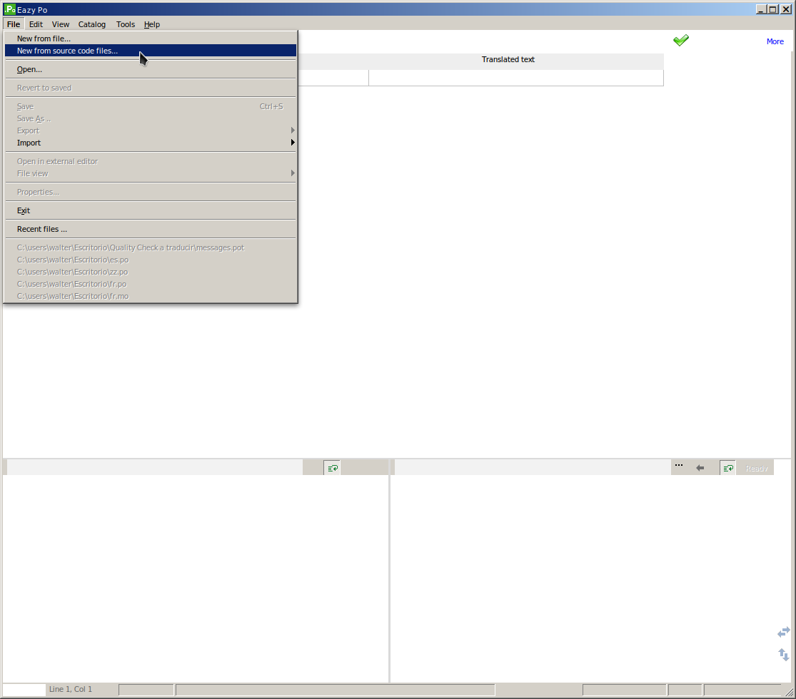

y busco la carpeta donde están los archivos del plugin marcados para traducir.

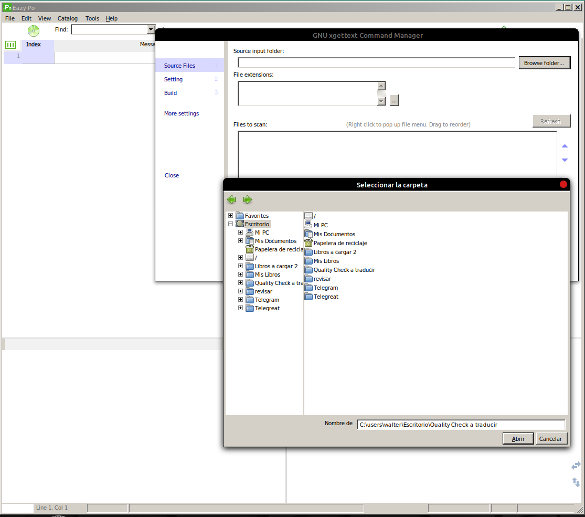

El programa junta los archivos. Voy a la opción Build

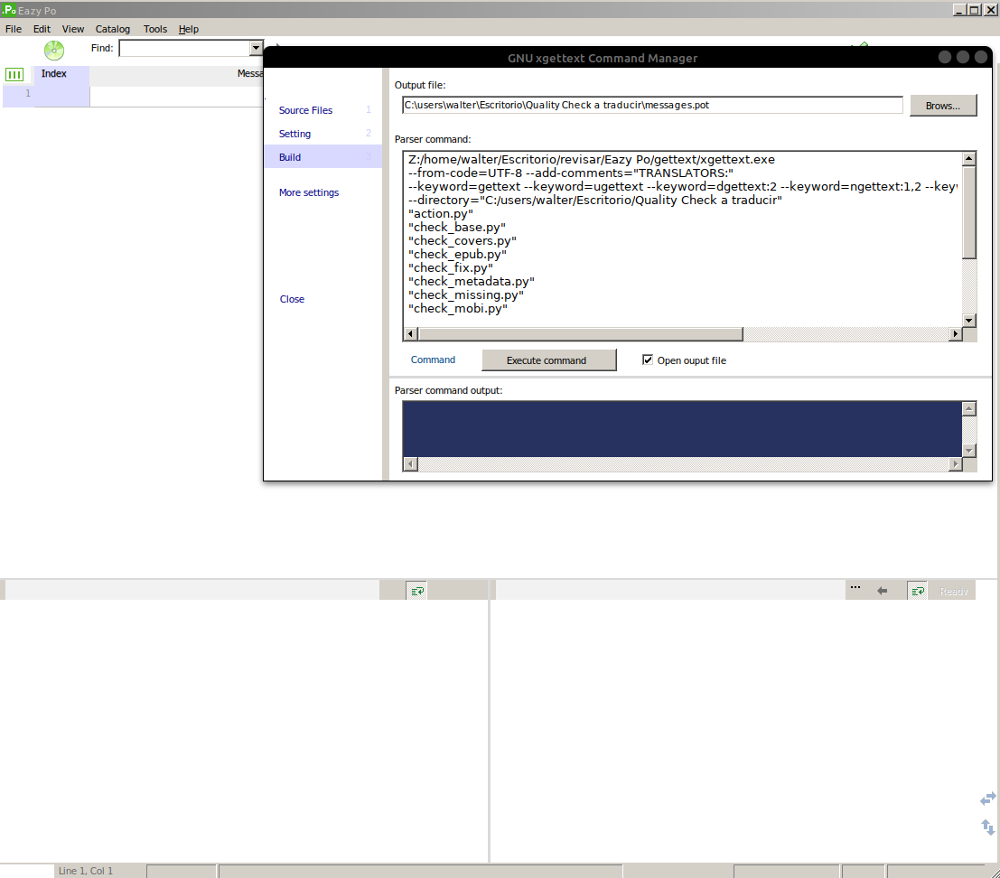

y toco Execute comando esto me junta en un archivo messages.pot todas las cadenas que marcamos para traducir.

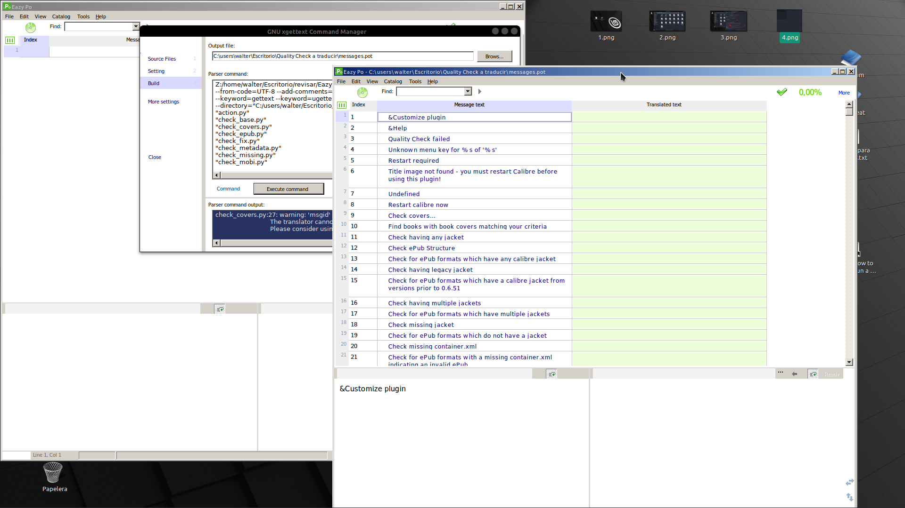

Ahora lo que nos queda es traducir y guardar el archivo como po y como mo. Estos dos archivos hay que guardarlos en la carpeta translations.

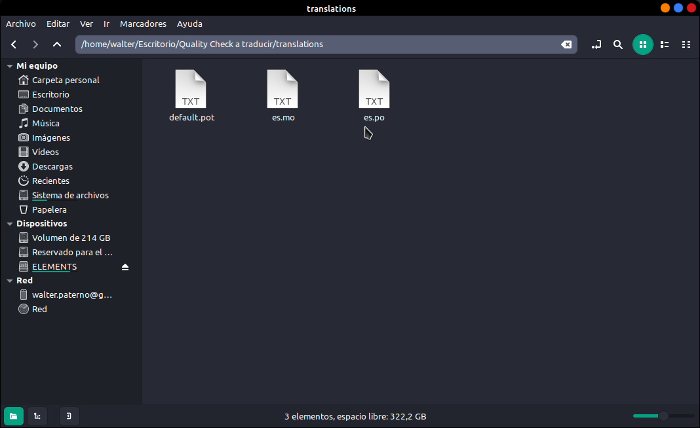

Cuando ya esta todo esto, seleccionamos todos los archivos

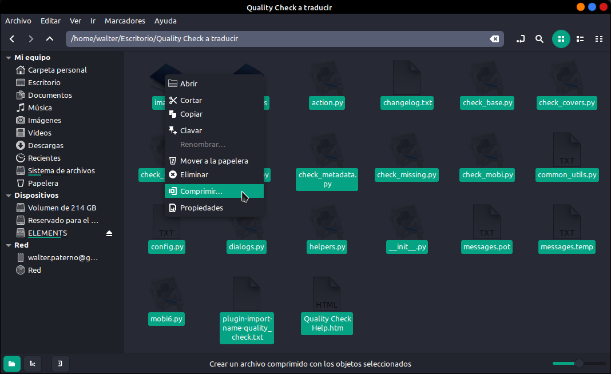

y lo comprimimos en un archivo zip

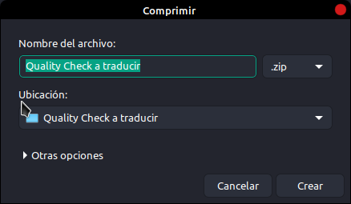

y como verán nos pone el nombre de la carpeta que tiene el nombre del plugin que lo diferencia del original.

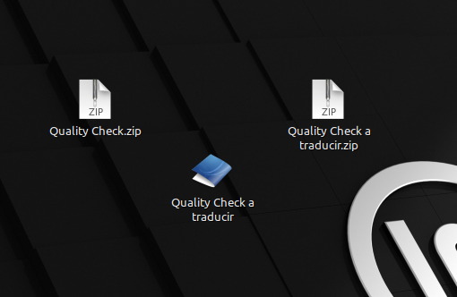

Iniciamos Calibre y lo instalamos, si todo salio bien tendremos el plugin traducido al idioma que lo hayamos traducido.

ir al mensaje:https://t.me/calibreconfiguraciones/24870

[https://telegra.ph/Traducir-un-plugin-11-26](https://telegra.ph/Traducir-un-plugin-11-26)

 

## [Volver al inicio](https://telegra.ph/Indice-Calibre-en-Espa%C3%B1ol-10-03)

 

---

[:material-arrow-left: Volver al índice](../../alfabetico.md) · [:fontawesome-brands-telegram: Preguntar en el grupo](https://t.me/calibreconfiguraciones){ target=_blank }
