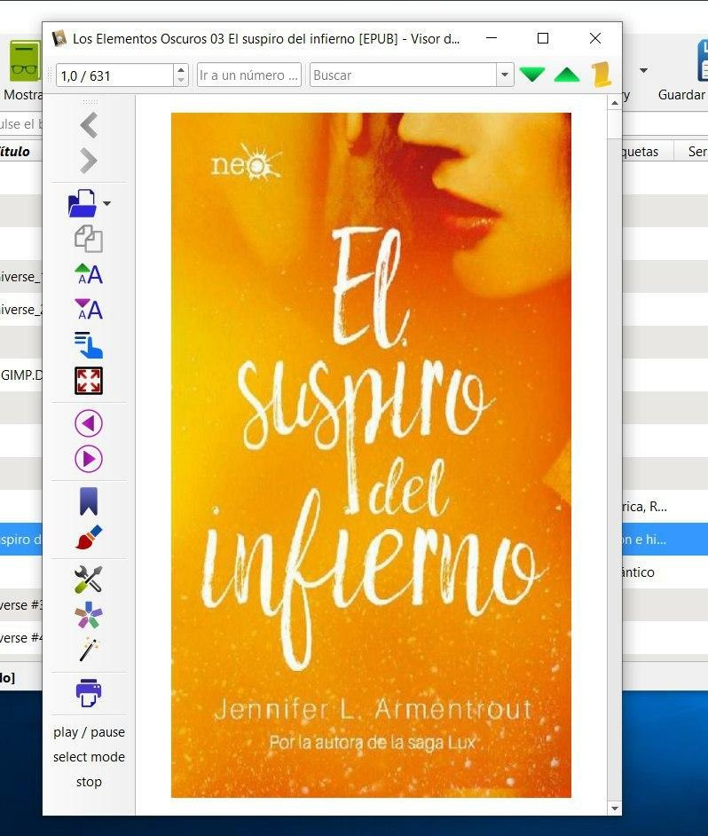
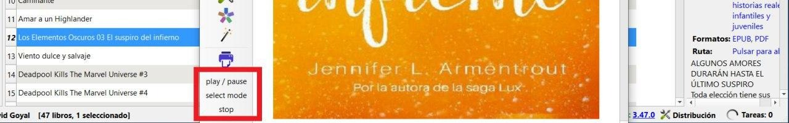

# TTS en Calibre

:material-account: [Walter](https://t.me/Dunhill69){ target=_blank } · :material-link-variant: [Ver el original en Telegraph](https://telegra.ph/TTS-en-Calibre-09-21){ target=_blank }
{ .tut-datos }

---

Plugin desactualizado (**funciona en la versión 3.46 de Calibre**)

¿Saben que podemos hacer que calibre nos lea un libro ?

Con este plugin (solo para Windows) una vez instalado hacemos doble click sobre el nombre del libro y se nos abre el visor de libros.

Ir al plugin: [https://www.mobileread.com/forums/attachment.php?attachmentid=147606&d=1459840409](https://www.mobileread.com/forums/attachment.php?attachmentid=147606&d=1459840409)

En la parte de abajo debajo de la impresora estarían los controles para que empiece la lectura.

ir al mensaje: [https://t.me/calibreconfiguraciones/830](https://t.me/calibreconfiguraciones/830)

[https://telegra.ph/TTS-en-Calibre-09-21](https://telegra.ph/TTS-en-Calibre-09-21)

 

## [Volver al inicio](https://telegra.ph/Indice-Calibre-en-Espa%C3%B1ol-10-03)

 

---

[:material-arrow-left: Volver al índice](../../alfabetico.md) · [:fontawesome-brands-telegram: Preguntar en el grupo](https://t.me/calibreconfiguraciones){ target=_blank }
